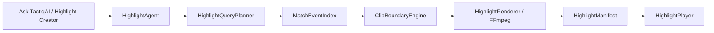

# TactiqAI M17 — AI Highlight Creator and natural-language video search

Verified locally on 2026-11-08. **Implemented and available in the frontend; language coverage remains experimental.** A request can retrieve existing evidence and produce a real playable MP4. The fresh language sample scores 18/20, below the suggested 95% target. No new football inference, CV training, possession changes, Ask grounding changes or Azure uploads are included. M8 camera, M9 player and M14/M15/M16 ball snapshots remain separate; M14 stays the default ball review.

## Use it

At <http://127.0.0.1:5173>, choose a recording and use **AI Highlight Creator**, or type a video request into the existing **Ask TactiqAI** form. The page scrolls to the creator. Try `Show me all the goals` or `What was the longest pass?` on `118575_clip`, and `Show me all the shots` on `117093_clip`.

The player supports playback, pause, seeking, individual moments, opening original footage, more buildup, shorter clips and follow-up questions. Each moment exposes its timestamp, selection reason and source evidence. The original footage opens at the clip-context start; existing Ask/event navigation retains its two-second policy. Missing events produce a clear response, not a placeholder movie. CV-only recordings have no verified football-event index, including `team_goal` despite its filename.

Downloads are disabled by default. `MATCHMIND_HIGHLIGHT_DOWNLOADS=1` enables the link and attachment response only when the operator has confirmed the necessary media rights. Playback is private service access, not a grant of redistribution rights. The allowed/denied download branches were tested with generated fixture media; the live rights-disabled browser hides the download control. No copyrighted music is added.

## Architecture and audit



`src/highlights/` contains the closed schemas, language agent, deterministic planner/index, boundaries, renderer and asynchronous service. `src/serving/app.py` attaches `HighlightAPI` routes through that service's router. The React `HighlightPlayer` is integrated into both structured match review and CV review. Ordinary Ask answers still use the existing provider and grounding path; explicit video requests route to the creator.

The existing intelligence exporter publishes BAS `GOAL`, `SHOT_VALIDATED` and action labels separately from `PASS_COMPLETED`, trajectory `SHOT_CANDIDATE`, inferred possession and motion events. M17 reads these exports; it never reruns or modifies detectors. BAS references are treated as annotation-supported, not as a new independent adjudication. BAS pass matching supports release timing/sender, not independently measured distance or reception. Shot trajectory speeds and uncertain CV ball positions are not promoted to verified shot metrics.

The Gemini adapter reuses the existing closed JSON catalogue selector: it selects among constrained query plans, not event IDs or footage timestamps. Microsoft uses the existing structured function-call abstraction, with the closed highlight plan schema. The deterministic interpreter preserves extracted filters, ordinals, review status and metrics; hosted output cannot broaden them or silently change the parsed event type. Provider errors or disagreements produce a labelled local fallback. Auto mode prefers Gemini when its existing key is configured. One Gemini query pattern was live-verified; Microsoft plan compatibility and rejection of invented filters are unit-tested, but no live Microsoft M17 call is claimed.

## Recording capability matrix

Counts below come from the validated live Azure snapshots. Zero means no qualifying recorded events, not proof that an event never occurred. Passes are coverage-qualified tracking estimates, with at least .90 observed-step fraction and completed outcome. This threshold is a declared admission rule, not calibrated event accuracy. All save queries, verified jersey-name queries and home/away identity filters remain unsupported. Left/right and explicitly tracked/actor IDs can be filtered.

|Recording|Annotated goals|Annotated shots|Estimated passes|Annotated crosses|Annotated tackles|Review-only shot candidates|
|---|---:|---:|---:|---:|---:|---:|
|117092_clip|0|2|28|5|1|4|
|117093_clip|0|3|28|1|0|0|
|118575_clip|1|0|29|2|2|0|
|118576_clip|0|3|19|4|0|1|
|118577_clip|0|2|18|1|2|5|
|118578_clip|0|2|24|3|3|3|
|128057_clip|0|1|16|2|2|1|
|128058_clip|0|0|26|2|3|1|
|132831_clip|1|0|16|1|0|1|
|132877_clip|0|0|46|0|1|1|
|test_match|0|0|0|0|0|0|
|team_goal|0|0|0|0|0|0|
|southampton|0|0|0|0|0|0|

Inferred possession changes are review-only. Ask `Review unconfirmed shots` for the separate candidate mode; those clips are explicitly labelled unconfirmed. Default shot queries include annotation-supported shots only. Existing generic “Home side” display labels are not independent home-team identity evidence.

## Query, event and manifest contracts

`HighlightQueryPlan` forbids extra fields and nonfinite values. It carries event types, all/maximum/ordinal/recap selection, supported metric, team, player and namespace, clip-relative time range, optional 5–120 second budget, context amount and explicit review flag. It cannot carry event IDs, arbitrary URLs, file paths or invented measurements. Examples:

```json
{"event_types":["goal"],"selection":"all"}
{"event_types":["pass"],"selection":"maximum","metric":"distance_m"}
{"event_types":["goal"],"selection":"ordinal","ordinal":2,"buildup":"more"}
```

The event index is version `m17.2`. Each closed `HighlightEvent` retains source event/group IDs, recording, type, start/end and detection timestamps, annotation ID, original validation state, annotated/inferred/candidate status, automatic-use flag, team, tracker/actor and receiver IDs, supported metrics, source recording/timebase and related group event IDs. No possession sequence is invented. Events are time-sorted; type/team/player maps support bounded retrieval, and metric ranking is deterministic over matching events. This is an in-memory index over short registered clips, not a large persistent search database.

The closed `HighlightManifest` connects every selected event to every output segment, with source SHA256, Azure ETag/source access provenance, index hash/version, query plan, render settings, output ranges, omitted event IDs and output hash/size/duration. Its validation rejects wrong-recording links, missing event references and intervals outside the recording. Only supported canonical rows can enter it.

Follow-ups refer to a session-owned previous job in the same recording. `the second one` selects from that previous result, not an unrelated event elsewhere. A single-result identity question answers from that event's tracked ID only; ambiguous results require choosing a moment. Wrong-match and wrong-session references return 404. Jobs and context are in memory; restarting the API invalidates old job URLs, while completed disk renders can be reused by submitting the same request again.

## Timestamp alignment and boundaries

For SoccerTrack, the existing loader uses `clip_frame = BAS.frame - 1 - source_offset_frames`. The source clip timestamp is `clip_frame / fps`; period-relative time adds `source_offset_frames / fps`. Full-match time additionally requires a known period-start offset. First-period start is zero; a later half is never automatically assumed to start at 45 minutes. Unknown match offsets remain unavailable. Alignment source filenames/hashes are preserved from the validated artifact summary.

Each canonical timestamp must agree with `event.frame / fps`; invalid clock rows are excluded. Pass windows start at the existing release frame and include the exported reception/outcome or confirmation time. The renderer checks the registered video's decoded rate, declared frame count and duration against the recording. It explicitly converts video-stream origin to FFmpeg's input seek origin using the probed video and container start times. Nonzero origin, rotation and rational FPS fixtures pass.

This verifies export/frame conversion, not zero-error physical-event timing. The original 118575 synchronization states approximately one-frame precision from 21 bbox-foot checkpoints. M17 inherits that uncertainty. The independent BAS comparison reports exact agreement with its frame conversion; it must not be presented as new visual timing ground truth.

Default context windows: goals 15 seconds before / 6 after, shots 6 / 4, passes 3 / 3, other supported events 4 / 3. More buildup uses 20 seconds before goals and five extra seconds for other events; short clips use 2 / 2. These are fixed fallback windows, not reconstructed attacking sequences. The engine accepts window defaults as code-level policy; no possession linkage or learned outcome boundary is claimed. Budgets divide available context, preserve essential event intervals, merge overlaps within a source period and cap the compilation. Events that cannot fit are omitted and reported. All output uses one continuous registered recording/period, so it does not concatenate across unverified clip/half offsets.

Recaps transparently prioritize goals, annotated shots, crosses, tackles, then recorded passes, chronologically within priority. They do not measure objective excitement, chance quality or attacking effectiveness. A one-minute request is an upper budget; footage is not padded to pretend a full minute exists.

## Rendering, permissions, caching and limits

`HighlightRenderer` uses FFmpeg argument arrays, never a shell command assembled from user input. Source video comes only from the trusted recording/media registries. Private Azure clips use conditional ETag reads into a hash-checked source cache; no arbitrary external URLs are fetched. Source names, rate/count checks and the inherited sync mapping establish the recording association; the analytics bundle does not contain an independent original-video SHA binding. The actual retrieved source SHA is pinned in each highlight manifest and cache key.

Accurate decode/transcode cuts avoid keyframe-only seek errors. Output normalizes to H.264 / AAC, 1280×720 with aspect-preserving padding, square pixels, 30 FPS, 48 kHz stereo and fast-start MP4. Rotation is handled by FFmpeg. Original audio is retained and resampled; absent audio produces silence. Compatible normalized segments concatenate with stream copy. A real source thumbnail is generated. AAC packet/mux granularity can add a few tens of milliseconds to container duration; output duration is checked within .15 seconds of planned segments. There is no placeholder footage or added music.

Jobs expose QUEUED, PROCESSING, COMPLETED, FAILED and CANCELLED. One worker, four active jobs globally, two per session, 500 retained in-memory records, at most 30 source events / 120 planned output seconds, one-GiB Azure source-file limit, two-GiB source cache and one-GiB completed-output budget bound the work. FFmpeg uses two encoding threads, per-process timeouts and a 300-second render budget. Output size is limited and validated. Cancellation kills running FFmpeg work and clears unpublished partial output.

The completed cache key includes source hash, index version/hash, validated plan, rendered intervals, renderer `m17.2` settings and download policy. Source and output hashes are checked; changed output cannot be served as valid. A new request triggers cleanup of expired output directories and terminal session jobs after 24 hours, with idle source-cache expiry. This is request-driven expiry, not a background deletion scheduler. Local registered source videos are never cleanup targets.

API routes, all under the existing authorization dependency:

- `GET /matches/{recording}/highlights/capabilities`
- `POST /matches/{recording}/highlights` with question, UUID session, optional previous-job UUID and provider
- `GET` / `DELETE /matches/{recording}/highlights/{job}` with session UUID
- `GET /matches/{recording}/highlights/{job}/{video.mp4|thumbnail.jpg|manifest.json}` with session UUID; download requires the server rights setting

Invalid/corrupt sources, failed FFmpeg, insufficient context and unavailable evidence produce explicit failure/unavailable results. No unrelated local artifact fallback occurs. The current API's optional bearer-token policy remains unchanged; UUID possession isolates local sessions but is not a replacement for authenticated multi-user ownership in a future hosted service.

## Measured evaluation

|Evaluation|Measured result|Meaning / limit|
|---|---|---|
|Development language regression|50/50 annotated-component matches; 4/4 follow-ups|Two initial misses corrected; not an independent full-plan benchmark|
|Fresh language requests|18/20 (90%)|Below 95% target; single-author, small sample|
|Supported/unsupported evidence cases|20/20|Includes unknown metrics, identities, CV-only footage and explicit review|
|BAS reference retrieval|50 TP / 0 FP / 0 FN|2 goals, 13 shots, 21 crosses, 14 tackles across ten clips; source-reference fidelity, not new human adjudication|
|Longest recorded pass ranking|10/10 clips|Compared with six-decimal exported transfer distance; .500001e-6 m tolerance reflects CSV rounding only|
|Event-frame alignment|0 conversion error on all 50 references|Original sync uncertainty is inherited; not physical-event timing accuracy|
|Controlled MP4 corpus|12/12 normal fixtures + 3/3 origin/rotation/rational-FPS fixtures|Small defined corpus; does not establish 99% population reliability|
|Real outputs|6 distinct playable Azure-source MP4s|Eight successful video responses include cache reuse|
|Source interval bounds|13/13 manifest intervals|Across the six distinct videos|
|Event provenance|19/19 manifest event links|Same event can appear in more than one generated video|

The fresh-language misses are `Can I see each attempt on goal?` (interpreted as goal + shot instead of shot) and `Give me a minute of highlights` (duration not extracted). Use `Show me all the shots` and `Make a one-minute highlight video` for those intents. No tuning to those fresh cases is included. The 50-request development suite labels selected components, not every possible output field; neither score certifies unrestricted conversational understanding. Intent, event, metric and filter denominators are recorded separately in the portable JSON. Hosted-model accuracy is not inferred from deterministic-parser scores.

The first media evaluator included black padding in its portrait color sample and passed FFmpeg `.15` instead of `0.15` for a tone sample. Those evaluator defects were corrected without changing source annotations or rendering thresholds; the initial diagnostic is retained under `render_initial_evaluator.json`. Controlled audio/video starts differ by at most 0.021029 seconds and stream durations by at most 0.021333 seconds in the 12 normal fixtures. Color transitions and independent source-tone comparisons verify the order and time mapping, not just successful process exit. Three additional fixtures verify nonzero timestamp origin, rotation metadata and 30000/1001 FPS.

## Real demonstrations and local generated videos

All examples below were executed against the live private Azure-backed service, not synthetic stand-ins. Playable files remain in ignored local outputs; they are not published or uploaded. Refresh the frontend after a backend restart, then re-submit a query because job/session URLs are ephemeral.

|Request / recording|Verified result|Generated duration|Size|Local example|
|---|---|---:|---:|---|
|Show me all the goals. / 118575_clip|I found 1 goal. Here’s the video.|21.055 s|1,245,837 bytes|[MP4](../outputs/highlights_m17/5c4443b4b1bf86d177bb344ae9332e3318f8ea7022334a428e115ec5ba949e72/highlight.mp4)|
|Show me the buildup to the first goal. / 118575_clip|I found 1 goal. Here’s the video.|26.055 s|1,618,487 bytes|[MP4](../outputs/highlights_m17/aba96b2bc36dc25cc3c410257ab660c2d5ca59451a8b67eddae9de25965787b9/highlight.mp4)|
|What was the longest pass? / 118575_clip|The longest recorded pass was 44.0 meters (a tracking estimate). Here’s the play. Passes are tracking estimates; any annotation support is listed below.|11.288 s|826,788 bytes|[MP4](../outputs/highlights_m17/c2432c0198f2781b74e904d052531603918688249c7da5aeff1988a3c9b66d0c/highlight.mp4)|
|Show me all the shots. / 117093_clip|I found 3 shots. Here’s the video.|30.021 s|1,729,591 bytes|[MP4](../outputs/highlights_m17/da35f54805c0406ac751da3546cc0bf29cb38a5f260709f1531bbc27589efde3/highlight.mp4)|
|Make a one-minute highlight video. / 118575_clip|I found 12 recorded moments. Here’s the video. Passes are tracking estimates; any annotation support is listed below. It uses up to 60 seconds of available moments; it isn’t padded to fill the requested length.|50.721 s|3,102,777 bytes|[MP4](../outputs/highlights_m17/31676018e9d6714e1513bebd75ba2fba6be35f47dcc13a9e850e82df3af57d3e/highlight.mp4)|
|Show me the second one. / 118575_clip|I found 1 moment in that result, but there isn’t a moment number 2.|—|—|No video created|
|Who made that pass? / 118575_clip|This event is linked to tracked player 15. That is a tracking ID, not a verified jersey number or name.|—|—|No video created|
|Show me all the goals by the home team. / 118575_clip|I can’t verify which recorded side is the home or away team.|—|—|No video created|
|Show me all the goals. / test_match|I couldn’t confirm any goals in this recording.|—|—|No video created|
|Show me the fastest shot. / 118575_clip|I can’t reliably rank shots by speed or chance quality in this recording.|—|—|No video created|
|Show me player 10's highlights. / 118575_clip|Jersey numbers aren’t verified here. You can ask about a tracked player number instead.|—|—|No video created|
|Review unconfirmed shots / 128058_clip|I found 1 shot. Here’s the video. This is review footage, including unconfirmed events.|10.888 s|742,678 bytes|[MP4](../outputs/highlights_m17/40211a3080f2c4dcb1200056cbbf30e4a78cd5d350ffa62964566b3f69355dcf/highlight.mp4)|

The 60-second request produced about 50.72 seconds from 12 moments; overlapping context merged into six intervals. The second-goal follow-up correctly reports that the previous result contains only one moment. The identity follow-up identifies tracked player 15, not a verified jersey/name. Home-team goals, fastest-shot ranking, unknown jersey identity and CV-only goals return limitations. Unconfirmed review is separate from the default annotated-shot path.

Initial source-download-inclusive timings were 27.46 seconds for the first goal, 35.12 seconds for the first shot compilation and 50.36 seconds for first candidate-review footage. Initial rendering took 2.54 seconds for longer goal context, 1.52 seconds for the longest pass and 5.59 seconds for the recap with sources already cached. A measured goal cache hit took .52 seconds; the explicit Gemini interpretation plus cache hit took 1.38 seconds. These are local observations under differing cache/load conditions, not a controlled throughput or real-time claim. Final-run timings and hashes are in the portable JSON. Source-video caches dominate storage; no original CV source file is removed.

## Tests, regressions and integration decision

- **845 backend tests run: 844 passed, one expected skip; 34 new M17 tests.** Includes closed plans, synonyms, clock conversions, ranking/filters, wrong-session context, provider contracts, candidate review, boundaries, real concat/audio, failure/corruption, cache recovery, cancellation, source-path rejection, playback ranges and allowed/denied synthetic-media download responses.
- **109 frontend tests across 19 files pass; typed production build passes.** Highlight UI contracts cover unavailable footage, source links and recording-scoped sessions.
- **23 current Chrome application tests pass**, including all ten Azure clips, Ask, all M14/M15/M16 ball selectors, M8/M9 CV, smoothing, original playback policy and the new highlight experience. A final dedicated highlight recheck passes after the final source-rights metadata change.
- Both archived standalone world/ReID browser viewers pass. The unchanged historical M5 test still fails its fixture requirement (`m5` expected, current authoritative service `m8`). It is not a current M8 regression or an all-historical-tests-passed result.
- Final live `/health`, `/ready`, `/recordings` return 200; readiness includes **13** sources. Existing Local Ask returns status `ok` with **six evidence rows**. Video requests use successful HTTP 206 ranges. Wrong-recording and wrong-session references return 404.
- No M8–M16 model, inference pipeline or existing canonical analytics artifact was rewritten or retrained. Existing CV snapshot validation succeeds; the current CV/browser regressions pass. Research/model/media artifacts are not uploaded to Azure.

**Decision:** the local highlight feature is implemented and usable for the supported structured recordings. General language coverage remains experimental; the fresh 95% interpretation target is not achieved. Reliable jersey/home identities, independently validated shot speeds/chance quality, verified CV football events, real possession-linked buildup and broad ≥99% media reliability remain unestablished. Future work can expand independently labelled language coverage, add verified event providers, persist authenticated job ownership and scale the index. None is claimed implemented in M17. Work stops at M17.

## Reproduction and startup

FFmpeg and ffprobe must be on PATH. A new persistent Python 3.12 environment was created because the old `/tmp/tactiq-cv-m1` environment had lost its configuration/packages. Its tested package snapshot is `configs/highlights/m17_runtime.lock`; it includes optional CV test dependencies, not new trained weights. The service itself uses the existing serving/Azure dependencies plus the FFmpeg binaries. Existing milestone dependency snapshots were not replaced.

From the repository root:

```sh
AZURE_TOKEN_CREDENTIALS=AzureCliCredential MATCHMIND_PROVIDER=local \
MATCHMIND_CACHE=outputs/cache/azure_m17 \
TACTIQAI_BACKEND_PYTHON=/Users/greatabhieyighan/Library/Caches/TactiqAI/backend-m17/bin/python \
scripts/start_backend.sh
```

Then `npm --prefix frontend run dev`. Azure CLI authentication and the existing `.env` configuration are reused; no MATCHMIND variable was renamed. Optional new variables: `MATCHMIND_HIGHLIGHT_CACHE` changes the private output root; `MATCHMIND_HIGHLIGHT_DOWNLOADS=1` explicitly enables permitted downloads. Keep local CV videos.

Measured verification commands (substitute the persistent Python path for `python`):

```sh
python -m unittest discover -s tests
python -m scripts.evaluate_highlights_m17 language
python -m scripts.evaluate_highlight_evidence_m17
python -m scripts.evaluate_highlight_limits_m17
python -m scripts.evaluate_highlight_render_m17
python -m scripts.evaluate_highlights_m17 live
python -m scripts.finalize_highlights_m17
npm --prefix frontend test -- --run
npm --prefix frontend run build
cd frontend
TACTIQAI_AZURE_BROWSER=1 TACTIQAI_AZURE_REQUIRE_ANALYSIS=1 \
TACTIQAI_BROWSER_REGISTRY=../configs/serving/browser-two-recordings.json \
npx playwright test --config playwright.m17.config.ts
```

The fixed fresh-language cases and their measured result are preserved separately in `configs/highlights/m17_language_holdout.json` and portable evidence; do not relabel them as development successes. Private evaluation files, real videos, initial diagnostics, runtime snapshot and verification logs remain under `outputs/m17_evaluation` and `outputs/highlights_m17`. [Portable results with denominators, cases, manifests and source hashes](evidence/ai_highlight_creator_m17_results.json).


Measured storage at completion: three private source-cache files total **883,436,865 bytes**; twelve output MP4s (including retained initial and final render versions) total **18,573,216 bytes**. The six final example videos are a subset. The separately validated Azure analytics cache occupies about 200 MiB; the restored service/CV-test runtime occupies about 1.2 GiB. No original CV video or earlier milestone output was deleted. Peak resident memory was not measured for M17.

Unknown or invalid legacy event clocks disable highlights for that recording with a diagnostic; they do not make the existing API fail startup. This compatibility behavior is regression-tested.
