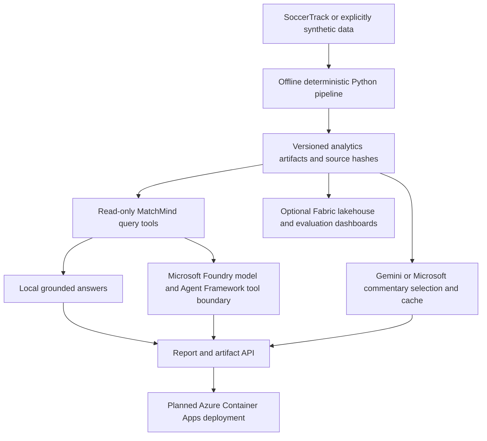

# Azure architecture and integration boundary

Status 2026-10-14: Microsoft REST has saved live verification; post-hardening TLS recheck awaits approval. Local API is verified and Docker was verified in the prior milestone. No Container Apps deployment, real Agent Framework run, Fabric cloud ingestion or MCP execution is claimed. See [TactiqAI hardening](microsoft_hardening.md). Gemini remains supported. Neither provider calculates authoritative football statistics.

## Canonical Blob workflow status — 2026-10-17

All ten configured clip recordings are now live-verified against tactiqaistorage/tactiq-artifacts, with private video streaming from soccertrack-v2, using DefaultAzureCredential → AzureCliCredential. After explicit user approval, eight additional real analytics bundles were uploaded create-only (184 files including manifests, 167,490,828 bytes); existing blobs were not overwritten and videos were not reuploaded. Every new bundle passed fresh Azure manifest/hash/schema and real application read-back verification. The restarted API reports ten available, artifact-ready, media-ready recordings; `/health`, `/ready`, `/recordings`, all ten tactical views, video byte ranges and grounded Local Ask requests passed live HTTP checks. No Container Apps deployment or external model call was performed.

Configured recordings still validate independently: missing/corrupt analytics cannot enter MatchMindTools or query routes, and no local artifact fallback occurs. `/ready` returns 503 with zero usable recordings. Future video-only recordings may play without gaining access to unavailable analytics. Implementation regression coverage remains 50 focused media/artifact/review/recording tests passed; earlier full discovery had one local-video readability error. [Publication evidence, exact configuration and verification limitations](azure_artifacts.md).

## Implemented now

`src/providers/base.py` defines the commentary and query-provider protocols. Existing Gemini commentary uses the unchanged grounded sentence catalogue. `MicrosoftCommentaryProvider` consumes that same request and validates its sentence IDs using the existing validator. `MicrosoftFoundryProvider` uses the Azure OpenAI-v1 Chat Completions REST surface for function routing and strict structured statement selection. It accepts server-side API-key auth or an injected Entra token callback. Its deployment is configuration, not a hard-coded model recommendation. Endpoint and deployment validation, timeout, response-size bounds, no redirects, safe errors and mocked requests are tested. The user has since live-verified the configured REST deployment, corroborated by saved local demo output. Automatic certifi verification and sanitized error diagnostics are unit-tested; a post-change live check has not run. Azure OpenAI-v1 supports the documented endpoint hosts; structured outputs require a compatible deployed model. [Endpoint documentation](https://learn.microsoft.com/en-us/azure/ai-foundry/model-inference/concepts/endpoints?tabs=python), [structured outputs](https://learn.microsoft.com/en-us/azure/foundry/openai/how-to/structured-outputs).

`src/providers/agent_framework.py` exports plain Python functions with named typed signatures and the existing closed argument/output schemas. Every function calls the existing dispatcher. This is a tested SDK-neutral integration boundary, an optional real runtime adapter plus typed callable boundary; the SDK is not installed and no real agent ran. Agent Framework supports function tools, including plain callables. FrameworkProvider now contains Agent/FoundryChatClient invocation code and discards SDK prose before closed selection. Install/pin the optional SDK and verify it live before claiming framework execution. Arbitrary SDK-generated prose must never bypass grounding. [Foundry model provider](https://learn.microsoft.com/en-us/agent-framework/integrations/by-component/model-providers/microsoft-foundry).

`src/providers/agent.py` runs validated tools, retains fact IDs, event IDs, sources, timestamps, validation state and limitations, and permits only supported statement indices as final wording. Unsupported local question categories do not trigger network requests. Tool/schema/selection/network failures retain the original deterministic answer. Tool plans are bounded to three calls. No SQL, Python execution, filesystem paths or arbitrary URLs are available to agents.

`src/serving/app.py` loads an administrator-controlled registry once. The service imports the artifact query layer, not video processing or offline analytics. Recording aliases include the half to avoid ambiguity. It provides health, summary, events, player, ask, event explain and allowlisted report endpoints. Report HTML remains its existing offline UI; service-served reports connect Ask to the same-origin API, with provider selection, structured follow-ups, evidence and safe local fallback. Existing reports and commentary caches remain usable during outages.

## Intended roles

| Component | Legitimate MatchMind role | Current state |
|---|---|---|
| Deterministic Python | Coordinates, motion, possession, transfers, trajectory candidates, tactics, evaluation, canonical events and provenance | Existing implementation preserved |
| Foundry | Model deployment and tool/statement selection over bounded facts | Saved REST live verification; new TLS/error paths unit-tested, post-change live recheck pending |
| Agent Framework | Agent lifecycle and function-tool execution; final text passes closed selection validator | Optional runtime/callable adapter; fake-SDK tests only, no real SDK execution |
| Azure MCP Server | Developer operations such as inspecting Azure storage/resources and diagnostics with scoped Azure permissions | Architecture only; never exposed to football end users |
| Fabric / OneLake | Optional durable multi-match artifact tables, provenance/version history, development/held-out evaluation dashboards | Six analytical CSV exports verified locally; no Fabric upload, not required per question |
| Container Apps | Proposed hosting for the small read-only API, scaling independently of offline processing | Docker built and ran with real HTTP checks; Bicep/script prepared, deployment remains |
| AKS | Consider only if later operational requirements need Kubernetes control or a complex GPU processing fleet | Not justified for the current artifact API |
| Gemini | Existing optional grounded commentary sentence selection and cache | Preserved; mocked tests remain, no new live calls |

Azure MCP is an operations integration, not the MatchMind football tool server: Microsoft documents its local server as developer-oriented. Exposing resource-management tools to public Ask users would create unnecessary authority. A future MatchMind MCP server could separately expose only the closed read-only query registry. [Azure MCP overview](https://learn.microsoft.com/en-us/azure/developer/azure-mcp-server/overview).

Fabric would ingest artifacts with match/half/scope/config/source-hash keys and explicit observed/inferred/heuristic labels. OneLake provides governed shared analytical storage. Export immutable snapshots for the online API; do not recompute metrics with a data agent. Keep synthetic data visibly marked and excluded from real-match accuracy claims. [OneLake overview](https://learn.microsoft.com/en-us/fabric/onelake/onelake-overview).

Container Apps is the proposed first hosting target for this stateless container. This choice is an architectural judgment for a small HTTP service; AKS control is unnecessary at this stage. Heavy processing remains offline or a separate batch job. Keep one warm replica for a demo if cold-start latency becomes an issue. [Container Apps overview](https://learn.microsoft.com/en-us/azure/container-apps/overview).

## Deployment preparation and remaining work

Run the local instructions in [current demo guide](microsoft_demo.md). `Dockerfile.service` uses a non-root user and only online code/service requirements; optional WITH_AZURE=true includes Blob SDKs. Mount artifacts read-only; use the registry to select trusted snapshots. The report's local video URL needs a separately hosted media asset and URL rewrite before cloud use. The API serves allowlisted HTML/PNG files and, when explicitly configured, a clip MP4 from MATCHMIND_MEDIA_ROOT; arbitrary filesystem paths remain unavailable.

Before a public deployment, provision image storage and Container Apps, configure managed identity/Key Vault-backed secrets and ingress authentication, publish licensed media appropriately, add rate/concurrency limits and observability, validate a supported Foundry deployment live, then wire the optional Agent Framework lifecycle. The current optional bearer token is suitable for a controlled demo; Entra gateway authentication is the intended hosted boundary. No browser credentials are required. No deployment or resource mutation was performed in this milestone.

The default is local. Missing Azure configuration starts the service locally; runtime provider failures return the same deterministic answer with a safe fallback status. For commentary demos, keep existing generated HTML/cache or explicitly use `--commentary-provider template`; generation is not required when serving a previously generated report. Cache identity includes provider configuration and grounded request hashes. Do not regenerate into a cherished live-commentary directory merely to serve it.

Current exact commands, verification table and setup: [Microsoft demo](microsoft_demo.md), [deployment guide](../deploy/azure/README.md). Local ArtifactStore/bundle packaging, Blob snapshot adapter, structured request logs/readiness and Fabric schema exports are now implemented. Cloud integration status remains explicit in those guides.

## Private video source

The API can stream existing private `soccertrack-v2/mot/clips/<match>.mp4` files using `MATCHMIND_MEDIA_BLOB_CONTAINER` and the existing account URL/Entra credential. HEAD and single HTTP ranges support browser metadata/playback/seeking; downloads are ETag-pinned. No SAS or credentials reach the frontend. All ten videos and canonical analytics bundles are now available. The user approved the eight additional bundles; create-only publication and fresh Azure manifest/hash/schema/application read-back checks passed for all eight. The restarted backend reports ten ready recordings; all ten tactical views, video byte ranges and grounded Local Ask requests passed live HTTP checks. See [current media and publication status](azure_artifacts.md).
