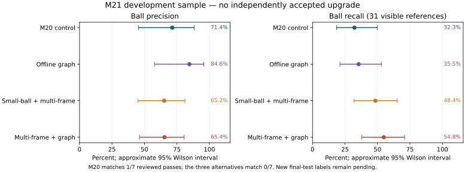

# TactiqAI M21 — Advanced perception research

Verified 2026-11-19. **The experiment framework and opt-in integration are implemented and exercised. A major, independently validated accuracy upgrade has not been established.** All 20 configurations ran on all three development clips. None improves ball detection while preserving both M20 ball precision and completed-pass matches under the recorded selection policy. M21 therefore selects `m20_control`. The ordinary application default remains M14; M19 and M20 remain available.

The immediate priority from [the completed human evaluation](cv_human_evaluation_2026_11_18.md) was small-ball detection, cross-clip behavior and false-positive rejection. Those experiments ran before research-only 3D fitting. No new large checkpoint, paid compute, hosted LLM request or full-match CV run was needed. Existing neural weights were reused; the newly fitted model is a small regularized temporal classifier.

[Portable aggregate evidence](evidence/cv_m21_results.json) · [development comparison chart](evidence/cv_m21_detection_comparison.svg). Private labels, raw footage, model weights and generated experiment artifacts are excluded from Git.

## References and adaptation

The actual CourtVision source was read at commit `581f67e82c9e271751baffb62046cee4e1e94902`, including its [three-frame student](https://github.com/aiden-guan/courtvision/blob/581f67e82c9e271751baffb62046cee4e1e94902/courtvision/perception/student.py), [offline ball linker](https://github.com/aiden-guan/courtvision/blob/581f67e82c9e271751baffb62046cee4e1e94902/courtvision/nba/analyze.py), [tracker](https://github.com/aiden-guan/courtvision/blob/581f67e82c9e271751baffb62046cee4e1e94902/courtvision/perception/tracker.py), [camera estimation](https://github.com/aiden-guan/courtvision/blob/581f67e82c9e271751baffb62046cee4e1e94902/courtvision/perception/broadcast_court.py) and [3D fitting](https://github.com/aiden-guan/courtvision/blob/581f67e82c9e271751baffb62046cee4e1e94902/courtvision/perception/ball3d.py). Transferable ideas are temporal visual support, skip-edge sequence optimization, uncertainty-aware gaps, camera compensation, staged association and retrospective event verification. Basketball court dimensions, hoop events, fixed camera-center assumptions and teacher-label benchmark claims were not adopted as football facts. CourtVision code is MIT, but its model notices include separate dataset restrictions; no CourtVision checkpoint was downloaded or copied.

The [basketball broadcast analytics article](https://www.linkedin.com/pulse/turning-basketball-broadcast-footage-tactical-game-analytics-arshad-kidcf/) documents YOLO/ByteTrack, jersey classification and dynamic landmark mapping. No accessible implementation was available there. It informed experiments, rather than supplying a reproduced implementation or verified football accuracy.

## Human-reference audit and baseline

All 60 saved tasks passed source/task/reviewer/clock/box/window validation: 20 per recording, one reviewer. The usable sample is **34 known ball frames, including 31 visible balls; six exhaustively reviewed pass windows with seven completed passes; and 12 same-person continuity pairs**. Two uncertain ball frames and six incomplete/uncertain pass windows are excluded and counted. There are no different-person identity negatives. Only three continuity pairs match unique existing model boxes; nine cannot be scored conditionally.

These annotations already influenced M19/M20 diagnosis and this round's development decisions. They are **development data**, even when boxes were independently drawn by a human. The inherited evaluator's `partial_independent_reference_evaluation` string describes reference origin, not an untouched test split. No neighboring-frame random split or final-test acceptance is claimed. Pointwise Wilson 95% intervals below describe small binomial samples; correlated frames/windows and one reviewer make them insufficient evidence of generalization or paired statistical superiority.

Original annotation SHA-256: `c4ac71548269fd1fe4e601684dffa09a706e8a215ed978ff9e0c8feb2966991e` (60 labels, unchanged). Source/task fingerprint: `d09ac4321745a6373fa8f9291f67bd206322bf5655bbc5b2a80ed2300afc0ade`. `outputs/m21/audit_v1` reproduced all four original baselines. `audit_v3` explicitly verifies a byte-identical M20 replay against the original published hashes; there is no silent alternate-input fallback. Existing iCloud files were restored before comparisons.

| Frozen baseline | Ball TP / FP / FN | Precision / recall | Completed passes matched |
|---|---:|---:|---:|
| M14 | 6 / 3 / 25 | 66.7% / 19.4% | 0/7 |
| M16 | 9 / 2 / 22 | 81.8% / 29.0% | 0/7 |
| M19 | 9 / 2 / 22 | 81.8% / 29.0% | 1/7 |
| M20 | 10 / 4 / 21 | 71.4% / 32.3% | 1/7 |

## Competing methods actually run

`src/vision/advanced21/` separates detection, temporal checks, association, players, camera, physics, passes and closed diagnostic schemas. Immutable campaign directories record source/checkpoint/config/reference hashes, all candidate provenance, hardware, inference timing and process memory. Fresh inference processed all **1,701 frames**, not just reviewed timestamps.

**A: control and small-ball inference.** The existing M20 soccer YOLO11s checkpoint and trajectory-guided measurements are frozen. Four single-frame development pilots compare existing soccer/generic weights at 192/320-pixel tiles. The generic 320-pixel pilot found 12 correct, 12 false and 19 missed balls using single-frame highest-score selection; its candidate pool contains 14 human-box matches. This is a pilot diagnostic, not the full pipeline's accuracy. It was selected on development evidence, then evaluated with identical gates in full runs. Dense source-coordinate tiles use 20% overlap, bounded crops and NMS retaining the actual winning detection score.

**B: temporal verification.** Deterministic crop appearance/flow/motion checks are compared with a strongly regularized 12-feature logistic verifier. Scaling, fitting and labels exclude the entire target recording for each of three development folds. Training uses 13/13/18 independent candidate-bearing frames and 17/14/23 candidates for the test_match/team_goal/southampton exclusions respectively; 22 frames/27 candidates for the all-development deployment fit. This is too little data to claim calibrated probabilities. Derived far-away candidate negatives are development supervision, not newly human-labelled truth. The acceptance threshold is fixed at 0.5; the actual visual threshold remains 0.35.

A further experiment reuses the frozen M16 visual-pair CNN. Its prior training provenance is 235 organizer positive pairs and 23 Codex source-only reviewed weak negative regions from SoccerNet SN_game6. These are not independent human evaluation references; positive visibility was not fully verified. No M21 human labels were used to train that CNN. This experiment did not resolve the precision/recall tradeoff. A second current-pixel detector check, on 192-pixel crops, is an additional veto requiring confidence >=0.35 and box IoU >=0.1. It never raises the original score or promotes a prediction.

**C: multi-frame detection.** Camera-aligned current plus two past RGB frames are fused with weights 0.6/0.25/0.15. Detections on fused pixels only propose search regions. A separate neural detection on the actual current image must verify each observation. A fusion-only hypothesis cannot become directly observed. The dense and multi-frame variants tie on the reviewed sample, so this experiment does not establish an incremental benefit from fusion itself. A large temporal neural model was not trained on these sparse labels.

**Offline trajectory optimization.** First-order frame Viterbi with an explicit missing state and a skip-edge DAG linker were both evaluated against the M20 IMM and matched-IMM detector ablations. Costs combine actual confidence, camera-compensated displacement and bounded gap penalties; camera cuts reset tracks. Reconstructed positions retain support-frame IDs and `directly_observed:false` and cannot enter visible-flight pass gates. No old pass anchor was injected to restore a lost event. Matched IMM comparisons retain original M8 context and are described as offline; separate `causal_ball_only` variants strip that bidirectional absolute-camera context and use only current/past relative motion. M9 participant and event analysis remains offline in all variants. The UI does not advertise a fully causal live match-intelligence system.

## Measured ablations

All rows use the same 34 known frames, 31 visible balls, IoU >=0.25 and seven reference passes. A wrong selected ball can contribute both an FP and an FN. Empty predicted pass sets have undefined precision, rather than 100% precision. All configurations produced zero false completed-pass estimates within only **18.012 exhaustively reviewed seconds**; this is not evidence of zero false passes over a match.

| Configuration | Ball TP / FP / FN | Precision | Recall | F1 | Pass matches |
|---|---:|---:|---:|---:|---:|
| `m20_control` | 10 / 4 / 21 | 71.4% | 32.3% | 0.444 | 1/7 |
| `dense_current` | 15 / 8 / 16 | 65.2% | 48.4% | 0.556 | 0/7 |
| `temporal_deterministic` | 10 / 4 / 21 | 71.4% | 32.3% | 0.444 | 1/7 |
| `temporal_learned` | 9 / 4 / 22 | 69.2% | 29.0% | 0.409 | 1/7 |
| `multiframe_detection` | 15 / 8 / 16 | 65.2% | 48.4% | 0.556 | 0/7 |
| `offline_viterbi` | 8 / 2 / 23 | 80.0% | 25.8% | 0.390 | 0/7 |
| `offline_dag` | 11 / 2 / 20 | 84.6% | 35.5% | 0.500 | 0/7 |
| `temporal_offline` | 17 / 9 / 14 | 65.4% | 54.8% | 0.596 | 0/7 |
| `player_motion` | 10 / 4 / 21 | 71.4% | 32.3% | 0.444 | 1/7 |
| `combined` | 14 / 8 / 17 | 63.6% | 45.2% | 0.528 | 0/7 |
| `external_temporal` | 14 / 8 / 17 | 63.6% | 45.2% | 0.528 | 0/7 |
| `external_offline` | 15 / 9 / 16 | 62.5% | 48.4% | 0.545 | 0/7 |
| `cross_verified` | 6 / 3 / 25 | 66.7% | 19.4% | 0.300 | 0/7 |
| `cross_offline` | 6 / 3 / 25 | 66.7% | 19.4% | 0.300 | 0/7 |
| `combined_cross` | 5 / 3 / 26 | 62.5% | 16.1% | 0.256 | 0/7 |
| `imm_control` | 10 / 4 / 21 | 71.4% | 32.3% | 0.444 | 1/7 |
| `imm_dense` | 15 / 8 / 16 | 65.2% | 48.4% | 0.556 | 0/7 |
| `imm_multiframe` | 15 / 8 / 16 | 65.2% | 48.4% | 0.556 | 0/7 |
| `imm_cross` | 6 / 3 / 25 | 66.7% | 19.4% | 0.300 | 0/7 |
| `imm_combined` | 5 / 3 / 26 | 62.5% | 16.1% | 0.256 | 0/7 |

| Configuration | Precision Wilson 95% | Recall Wilson 95% |
|---|---:|---:|
| `m20_control` | 45.4–88.3% | 18.6–49.9% |
| `offline_dag` | 57.8–95.7% | 21.1–53.1% |
| `imm_multiframe` | 44.9–81.2% | 32.0–65.2% |
| `temporal_offline` | 46.2–80.6% | 37.8–70.8% |

M20 pass recall is 14.3% (Wilson 95% 2.6–51.3%); precision is 1/1 (20.7–100%). Variants matching zero of seven passes have recall interval 0–35.4%. No reliable improvement claim follows from these overlapping, small development samples.



| Configuration | Clip | Ball TP / FP / FN | Precision / recall | Median matched center error (px) | Pass matches |
|---|---|---:|---:|---:|---:|
| `m20_control` | test_match | 8 / 2 / 3 | 80.0% / 72.7% | 2.43 | 1 |
| `m20_control` | team_goal | 0 / 1 / 11 | 0.0% / 0.0% | undefined | 0 |
| `m20_control` | southampton | 2 / 1 / 7 | 66.7% / 22.2% | 1.02 | 0 |
| `offline_dag` | test_match | 8 / 2 / 3 | 80.0% / 72.7% | 2.43 | 0 |
| `offline_dag` | team_goal | 0 / 0 / 11 | undefined / 0.0% | undefined | 0 |
| `offline_dag` | southampton | 3 / 0 / 6 | 100.0% / 33.3% | 1.49 | 0 |
| `imm_multiframe` | test_match | 9 / 1 / 2 | 90.0% / 81.8% | 2.62 | 0 |
| `imm_multiframe` | team_goal | 3 / 4 / 8 | 42.9% / 27.3% | 1.03 | 0 |
| `imm_multiframe` | southampton | 3 / 3 / 6 | 50.0% / 33.3% | 2.31 | 0 |
| `temporal_offline` | test_match | 9 / 1 / 2 | 90.0% / 81.8% | 2.62 | 0 |
| `temporal_offline` | team_goal | 4 / 5 / 7 | 44.4% / 36.4% | 1.37 | 0 |
| `temporal_offline` | southampton | 4 / 3 / 5 | 57.1% / 44.4% | 2.41 | 0 |

Localization is measured only on correctly matched selected boxes, so comparisons with different match subsets cannot establish a 20% accuracy gain. Incorrect associations, reacquisition accuracy, fragmentation against truth and long-flight accuracy remain unmeasurable with isolated frames; engineering track-change counts are retained separately in the JSON rather than called ground-truth ID switches.

The highest reviewed recall is `temporal_offline`: 17/31 balls, versus M20's 10/31. On team_goal it finds 4/11 with five false detections, versus M20's 0/11 with one false detection. Failure diagnostics show the M20 team_goal pool has no IoU-qualified raw neural match on all 11 reviewed visible frames. New inference therefore addresses a real candidate-generation failure, but still confuses foreground/background regions. Some failed boxes have centers inside a human box while missing IoU; that is a box-extent diagnostic, not grounds to relax matching or edit existing labels.

Selection maximizes development F1 **subject to no increase in ball/pass FPs, no loss of ball precision and no loss of matched passes relative to M20**. `offline_dag` improves ball precision to 84.6% and recall to 35.5%, but loses the sole pass match. Higher-recall alternatives also lose that pass and increase ball FPs. None qualifies; `m20_control` stays selected. No per-clip cherry-picking or threshold relaxation was applied.

## Player continuity, camera and 3D results

A ByteTrack-comparable high/low-confidence IoU tracker, camera/jersey association and camera plus multi-observation OSNet association were run on the same frozen M9 observed player boxes. The existing OSNet cache pins video, source M8 baseline, features, embeddings and checkpoint hashes; no fresh player detection or embedding training was performed. Multi-view continuation uses up to five previous embeddings, >=0.9 cosine support, at least two previous views for low-overlap continuation and <=0.35-second gaps. Anonymous M21 tracks reset on cuts; manual identities are never merged or propagated.

The baseline matches three of 12 human pairs and gets those three correct. IoU-only gets two of those three correct; camera/jersey and camera/deep recover three of three, matching M9. Nine pairs remain unmatched and all references are same-person. These results do not establish better overall continuity, false-merge control, team accuracy, referee separation or goalkeeper classification. Alternative tracks remain diagnostic; existing M9 participant identities and confirmations stay authoritative for pass attribution.

Field-masked bidirectional LK/RANSAC supplies accepted relative transforms on **491/541, 452/500 and 608/660** frames. A separate causal smoothing ablation (time constant 0.08 seconds) worsens median internal feature residuals:

| Clip | Raw median px | Smoothed median px | Raw / smoothed p90 px |
|---|---:|---:|---:|
| test_match | 0.222 | 0.963 | 1.318 / 3.905 |
| team_goal | 0.354 | 0.392 | 1.156 / 1.455 |
| southampton | 0.448 | 0.498 | 1.941 / 2.059 |

These are in-sample automatic field-feature residuals, **not independent pitch-landmark accuracy**. Smoothing was not adopted; original M8 105×68-metre pitch mapping and epoch/relocalization semantics remain unchanged. No independent landmark reduction is claimed.

Research-only robust ballistic fitting requires verified full 3×4 camera projections, >=6 observations spanning >=0.25 seconds, sufficient numerical rank, bounded condition number, positive camera depth, gravity 9.81 m/s², plausible height/speed and a reprojection gate. Synthetic calibrated tests pass. None of the real clips supplies verified full 3D camera geometry: all return an explicit unavailable reason. A ground-plane homography is insufficient. Diagnostic 2D image-space fits are model consistency measures, not independent trajectory accuracy. No ball height, airborne state, physical shot speed or reconstructed point becomes an authoritative football statistic.

## Second-stage football verification

The existing `detect_m19` and `PassConfig` gates remain unchanged. An added retrospective verifier checks observed receiver continuation and third-party contact; it only rejects or retains already-qualified estimates. Candidate transfers cannot be promoted. An isolated run on unchanged M20 ball/player evidence retains the one matched pass and adds none (1 TP, 0 FP, 6 FN). Changing ball association explains the losses in other configurations. Seven positives and sparse negative windows do not justify a learned event classifier, so none was trained. Goals, shots, tackles, interceptions, attempted passes, accuracy and verified possession stay unavailable where not supported; no SoccerTrack/GSR/possession semantics changed.

## Runtime and reproducibility

Measured on macOS arm64, 10 CPU cores, 16 GiB RAM, existing MPS runtime (Torch 2.15.0/OpenCV 5.0.0). Shared fresh perception costs below include all dense/fusion/current-pixel verification views, temporal features and relative camera work. The second-detector cost is additional. Pilot, baseline extraction, cached verifier, association, event and analysis costs are separate in the evidence. Cached analysis timings must not be represented as end-to-end inference speeds.

| Clip | Frames | Shared perception seconds | FPS | Peak process RSS MiB | Additional cross-detector seconds |
|---|---:|---:|---:|---:|---:|
| test_match | 541 | 189.40 | 2.86 | 910.3 | 48.73 |
| team_goal | 500 | 80.08 | 6.24 | 968.9 | 30.80 |
| southampton | 660 | 246.09 | 2.68 | 1024.2 | 33.49 |

Generic YOLO checkpoint SHA: `85a76fe86dd8afe384648546b56a7a78580c7cb7b404fc595f97969322d502d5`; soccer YOLO SHA: `638dc0baeed14f0cb4cb50f55454840a7614928405f5886381f70793439db4df`; frozen visual-pair SHA: `203be9128306f08a60ec3ab0df28fa86c50d49c4855ec1db51e87da3fb66c270`. All were already present. Runtime values are one local run, not a hardware-independent benchmark. Throughput is below real time.

`analysis_final_v1` contains 20 variants × three recordings, all 60 strict sidecars validated before registration. A separate cached-input analysis rerun matches **240 ball/canonical/event/evidence SHA comparisons**. Diagnostic reasons/timing are not claimed byte-identical; floating-point GPU inference itself was not independently rerun for this proof. Original source videos, upstream artifacts and all 60 annotations remain intact.

## New source-only evaluation coverage

48 model-blind tasks are sealed in `configs/evaluation/cv_m21_holdout.json`: two five-second excerpts, **one new source-match group**, 36 ball tasks including consecutive-frame groups, eight continuity pairs and four exhaustive pass windows. Source selection used predeclared offsets 600/1800 seconds, not model failures. No model ran on these excerpts. Browser verification checked transport and controls without visually inspecting held-out frames or saving labels. Zero new labels existed at acquisition.

The source is the user's existing Azure `soccertrack-v2/external_matches/vibuxer_z4ny0atm95s8/full_match.mp4`. A pinned-ETag, bounded read transferred 19,922,944 bytes to extract ten seconds locally; the full 759,278,077-byte video was neither saved nor processed. SDK per-range content checks and the previously verified metadata hash pin provenance; the whole blob was not rehashed during this read. The two source excerpts are disjoint from the three development videos, but original-match overlap with external detector training data has not been fully audited. This is one small prospective source group, not a diverse established final benchmark.

Review at http://127.0.0.1:5173/?review=m21&recording=m21_holdout_1. New labels use `outputs/m21/human_review/labels.json`; the original M19 label store is separate. Tight source-pixel ball boxes, a zoom control, explicit uncertainty, same/different identity instructions and exhaustive pass windows are supported. Editing never autosaves. No source model overlay is displayed.

Before claiming final acceptance, lock a candidate/config/training provenance before new-label inspection, verify source-match exclusions, complete human reviews, and evaluate once using the same fixed rules. Additional coverage still needed: several unseen matches/camera styles, small/blurred/occluded balls and hard negatives, longer consecutive trajectories, balanced different-person pairs, labelled pitch landmarks and independently verified event endpoints. Keep original labels immutable; future corrections need a new version and reason. If final-test labels guide tuning, reclassify that set as development and acquire another untouched group. The present 48 tasks contain no pitch-landmark truth and cannot certify 3D accuracy.

## Serving and frontend

Select a short clip at http://127.0.0.1:5173, then **Ball review → M21 Advanced Perception · opt-in**. Choose an experiment and enable the side-by-side comparison. Both canvases copy the same decoded source video; evidence overlays display only on matching frames. The panel shows reviewed ball/pass results, candidate decisions, direct versus inferred state, and camera/player/3D limitations. Seeking, playback, player focus and the grounded assistant remain connected to the selected experiment. Changing experiments clears previous answers/video and isolates event indexes by recording, pipeline and experiment.

Strict loaders enforce source, world, ball, event, config and diagnostic hashes plus frame clocks, schema, source bounds and original visual confidence. Fusion-only hypotheses and future reconstruction cannot masquerade as observed/causal evidence. Missing/corrupt optional variants fail with diagnostics while legacy modes and valid Azure recordings remain usable. `/ready` reflects usable recordings rather than requiring every optional experiment. No local-artifact substitution or Azure validation relaxation was introduced.

The M21 outputs and review excerpts are local sidecars, not canonical Azure bundles. Existing Azure analytics/media remain private and authenticated. Keep the three local CV source videos and generated M21 sidecars for this local workspace; no Azure upload or video deletion occurred in this milestone. No `MATCHMIND_*` variable was renamed.

## Reproduce and start

Commands below use the existing runtime and already available inputs. They are the executed workflow expressed with fresh output names; `fresh_directory` refuses existing experiment directories. Do not overwrite frozen outputs. The sealed review preparation script intentionally refuses to replace an existing task manifest.

```sh
export TACTIQAI_BACKEND_PYTHON=/Users/greatabhieyighan/Library/Caches/TactiqAI/backend-m17/bin/python
$TACTIQAI_BACKEND_PYTHON -m scripts.audit_cv_m21 --output outputs/m21/audit_new --replay-baseline outputs/m20/reproduce_v1
$TACTIQAI_BACKEND_PYTHON -m scripts.pilot_cv_m21 --output outputs/m21/detector_pilot_new
$TACTIQAI_BACKEND_PYTHON -m scripts.run_cv_m21 --output outputs/m21/perception_new --m20-reference outputs/m20/reproduce_v1 --audit outputs/m21/audit_new
$TACTIQAI_BACKEND_PYTHON -m scripts.verify_cv_m21_pairs --source outputs/m21/perception_new --output outputs/m21/perception_pairs_new
$TACTIQAI_BACKEND_PYTHON -m scripts.verify_cv_m21_cross_detector --source outputs/m21/perception_pairs_new --output outputs/m21/perception_cross_new
$TACTIQAI_BACKEND_PYTHON -m scripts.analyze_cv_m21 --source outputs/m21/perception_cross_new --output outputs/m21/analysis_new --audit outputs/m21/audit_new
$TACTIQAI_BACKEND_PYTHON -m scripts.evaluate_cv_m21_players --output outputs/m21/player_comparison_new --audit outputs/m21/audit_new
$TACTIQAI_BACKEND_PYTHON -m scripts.evaluate_cv_m21_camera --output outputs/m21/camera_comparison_new
$TACTIQAI_BACKEND_PYTHON -m scripts.ablate_cv_m21_passes --output outputs/m21/pass_verification_new --m20-reference outputs/m20/reproduce_v1 --audit outputs/m21/audit_new
$TACTIQAI_BACKEND_PYTHON -m scripts.diagnose_cv_m21 --source outputs/m21/perception_cross_new --analysis outputs/m21/analysis_new --audit outputs/m21/audit_new --output outputs/m21/failure_audit_new
```

The installed, verified registry points to `outputs/m21/analysis_final_v1`; regenerating another campaign does not automatically deploy it. Explicit validated installation is `python -m scripts.install_cv_m21 --root <new-analysis-root>`; it changes only the opt-in registry. For the current local backend:

```sh
AZURE_TOKEN_CREDENTIALS=AzureCliCredential MATCHMIND_ARTIFACT_STORE=azure \
MATCHMIND_PROVIDER=local MATCHMIND_CACHE=outputs/cache/azure_m17 \
MATCHMIND_HIGHLIGHT_CACHE=outputs/highlights_m18 \
TACTIQAI_BACKEND_PYTHON=/Users/greatabhieyighan/Library/Caches/TactiqAI/backend-m17/bin/python \
scripts/start_backend.sh
```

In another terminal: `npm --prefix frontend run dev -- --host 127.0.0.1`. Existing Azure configuration and `az login` credentials apply. Restored Desktop/iCloud experiment inputs must remain locally readable; cold placeholder downloads previously delayed startup. This milestone does not claim to fix iCloud download latency.

Validation commands:

```sh
$TACTIQAI_BACKEND_PYTHON -m unittest discover -s tests
npm --prefix frontend test -- --run
npm --prefix frontend run build
npm --prefix frontend run test:browser -- --config playwright.m21.config.ts
```

## Final verification and remaining work

- **Backend:** 1,062 tests run, 1,061 passed, one expected skip. Covers corruption/confidence/provenance rejection, causal/offline separation, optional availability, version-isolated assistant indexes and separate review storage.
- **Frontend:** 159 tests passed; TypeScript and production build passed (main entry 495.98 kB; lazy M21 panel 8.34 kB).
- **Chrome:** all nine integration cases passed: M21 comparison/experiment isolation across all three clips, sealed review with no writes, legacy M19/M20, CV passes, team_goal playback, full halves, player focus, heatmap/pass map and Azure goal-compilation playback/seeking. Hosted planners were not contacted; these checks explicitly use the grounded local provider.
- **Live API:** 44 requests succeeded. `/health` 200 with 12 canonical analytics recordings; `/ready` 200 with 15 usable recordings; `/recordings` 200. All six CV versions load on all three short clips. M21 metadata/frame/reference/events and explicit-control local assistant return 200. Original source ranges return 206. Existing Azure `118575_clip` view and grounded Local Ask return 200 with answer status `ok`; video range is 206.
- **Integrity:** original 60-review SHA unchanged after browser/API checks; 240 primary reproduction hashes match, all 60 variant sidecars validated, no new human labels fabricated, no videos/models/raw annotations committed and no Azure objects written.

The local frontend and Azure-backed backend were left running after these checks. [Verified development workspace](evidence/cv_m21_workspace.jpg).

Remaining accuracy work is substantial: train/evaluate stronger football-specific small-ball models with properly sourced visibility/negative labels; improve false rejection without losing real release/flight observations; gather broader independent source groups; measure continuous associations and camera geometry; and revisit event models after collecting enough independent events. Full-match CV, reliable shot/goal/tackle detection, independently verified metric/3D accuracy and broad identity generalization are not delivered by this development round. M22 has not started.
