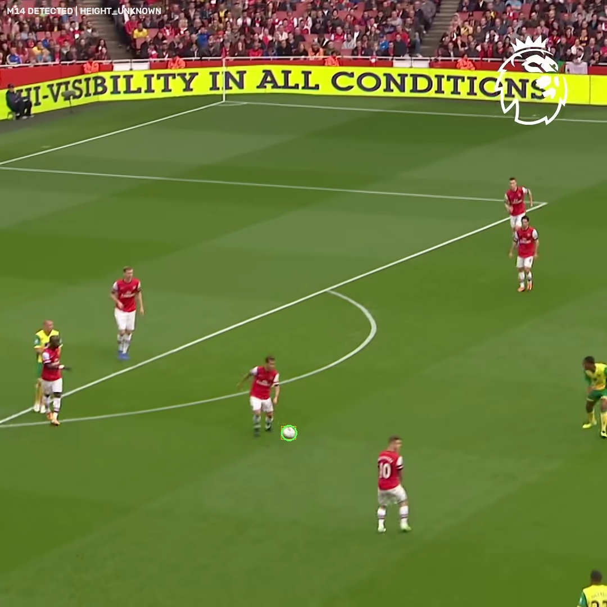
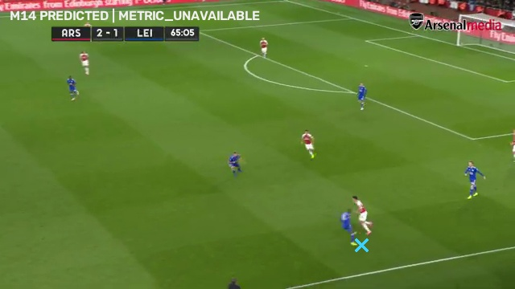
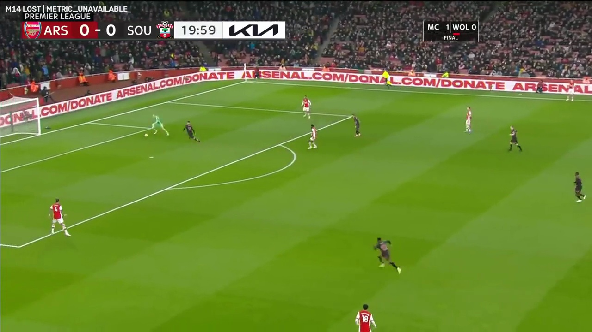
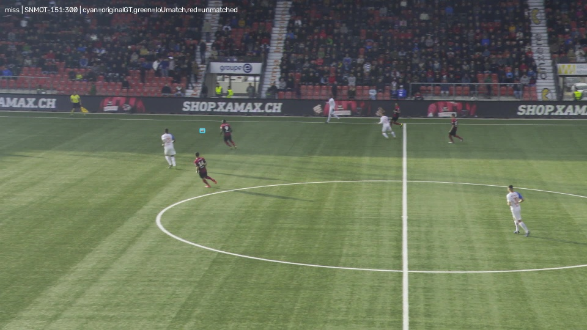
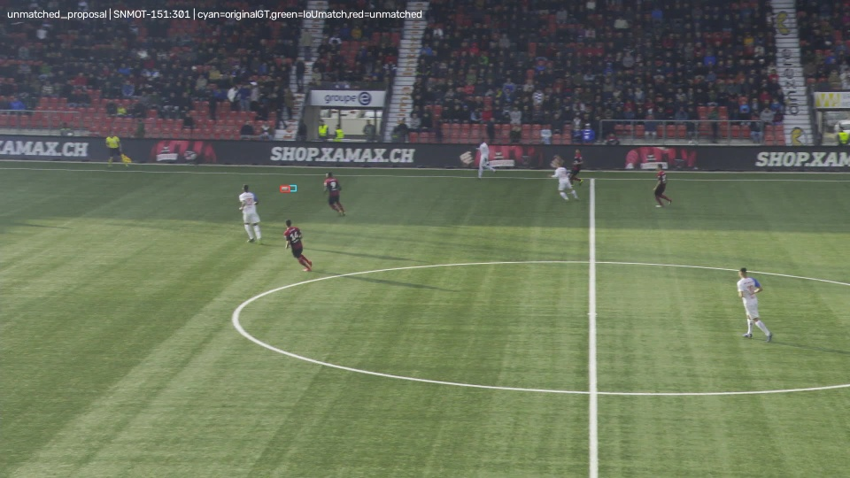
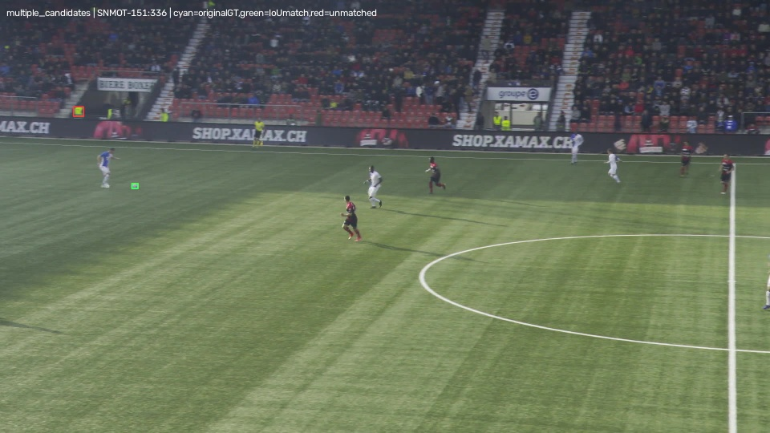

# TactiqAI — CV Milestone 14: video ball evidence

2026-11-02. **IMPLEMENTED / LOCALLY VERIFIED / REFERENCE-EVALUATED / EXPERIMENTAL.** An offline pretrained detector, causal tracker, separate canonical VIDEO_CV ball stream and synchronized frontend are installed for test_match, team_goal and southampton. M8 cameras and M9 players remain authoritative. This is not a production ball analytics model.

**Acceptance limitation:** trustworthy metric ball reconstruction is not demonstrated on these videos: **0 of 1,701 frames have supported metric ball coordinates**. The M8 mapping and conservative ground-contact gate are implemented and tested, but acceptance criterion 5 remains unproven on real data. Unknown height is not silently projected onto the pitch. No possession, passes, shots, commentary or Ask inference is added.

## Detector and training

Torchvision Faster R-CNN MobileNetV3-Large FPN320, official COCO weights, sports-ball class 37. Model resize 384; full-frame plus overlapping tile inference, 20% overlap, cross-view NMS 0.3, bounded 30 retained candidates and maximum box extent 15% of image dimensions. Raw proposal floor 0.02; selected operating confidence 0.5. The selected configuration is generic pretrained inference with 256-pixel tiles; it was selected on validation before held-out TEST.

Official initializer: 77,844,807 bytes, SHA256 `907ea3f91ff92242bc1baea8049276a3e76bca48ce7560bd268cc029f37977b5`. [Architecture/weights](https://docs.pytorch.org/vision/main/models/generated/torchvision.models.detection.fasterrcnn_mobilenet_v3_large_320_fpn.html), [code BSD-3-Clause](https://github.com/pytorch/vision/blob/main/LICENSE). Code licensing does not establish unrestricted rights to pretrained source data. YOLO was investigated but not installed or used.

A genuine ball-specific two-class head transfers COCO background/ball classifier and box weights, trains RPN and ROI heads with frozen backbone/FPN/BN. AdamW lr0.0001, weight decay0.0005, seed20261105, four epochs ×60 steps ×batch2 per trial. Augmentations include positive/background crops, flips, illumination, blur, down/up sampling, JPEG and partial synthetic ball occlusion. Trial1 uses smaller RPN anchors and 320-pixel training/480 inference tiles. A bounded validation-only trial2 preserves original anchors, uses ROI batch16 and 192-pixel training/256 inference tiles. Checkpoints preserve optimizer/RNG/config/dataset/initializer hashes.

All configurations use the same 20 validation frames (every eighth of 160) and confidence grid .05/.1/.2/.35/.5; maximum F1 at IoU .25 selects the model, then precision and cheaper full-frame inference break ties. Trial1 best fine-tune F1 .0769; trial2 best fine-tune .2128 (epoch3). Selected generic256 validation precision .8889, recall .4, F1 .5517 (8TP/1FP/12FN). Fine-tuning did not beat generic inference. The campaign was sealed before TEST and was not retuned afterward. Configurations: [trial1](../configs/ml/ball-m14.json), [trial2](../configs/ml/ball-m14-small.json), [tracker](../configs/ml/ball-m14-tracker.json).

## Annotation audit and split

Original [SoccerNet Tracking](https://github.com/SoccerNet/sn-tracking) organizer image-space ball boxes and roles are used, rather than pitch-coordinate NPZ labels. [Source terms](https://www.soccer-net.org/faq) permit research training; commercial use is not established. This bounded local experiment does not publish source data or upload Azure artifacts. Existing SoccerTrack pitch x/y data cannot supervise image bounding boxes and are excluded from detector training.

|Split|Match|Clips|Frames|Ball boxes|
|---|---|---|---:|---:|
|Train|game6|097–100|124|116|
|Validation|game4|060–061|160|160|
|TEST|game9|151–152|200|200|

Train frames13–737 step24, validation200–279 and TEST300–399 in each relevant clip. Matches are disjoint. The three final demonstration videos never enter training. Downloaded range payload113,582,408 bytes; no full archive download. Original annotation and frame hashes, archive member/revision/CRC, splits and frame lists are retained in `outputs/ml/ball_m14/dataset.json`. Organizer GT may be interpolated or include multiple/reserve balls. Visibility, active in-play ball identity, occlusion and airborne status are unannotated. Eight training frames without a ball annotation are **not** certified invisible-ball negatives.

## Held-out detection

Same200 frames, locked thresholds. Primary IoU≥.25; strict IoU≥.5 and size/sharpness strata are also retained in `test_results.json`.

|Detector|TP|FP|FN|Precision|Recall|F1|FP/frame|
|---|---:|---:|---:|---:|---:|---:|---:|
|Generic full-frame|0|1|200|0|0|0|.005|
|Generic 480 tiles|51|1|149|.9808|.255|.4048|.005|
|Selected generic 256 tiles|111|74|89|.6000|.555|.5766|.370|
|Best fine-tuned 256 tiles|151|392|49|.2781|.755|.4065|1.960|

Selected median matched center error1.227px, p90 2.478px. The 480 setting has better TEST precision but is **not promoted after seeing TEST**. All TEST GT boxes are12–24px; below12/above24 strata are empty. Only three boxes meet the low-sharpness proxy, all missed; this cannot establish robust blur performance. Occlusion/airborne recall cannot be measured without those annotations.

## Temporal ablations and limits

A constant-velocity Kalman state carries image position/velocity/covariance. Current observations retain the actual accepted neural center, not a smoothed/predicted point. Repeated competing birth hypotheses stay AMBIGUOUS rather than selecting the highest-confidence box. An active track combines confidence and innovation; TTL .35s, uncertainty growth and confidence decay bound missing-data continuation. Predicted overlap with a player is an explicit occlusion **hypothesis**, not proven occlusion. Cuts/epoch changes reset the track. Trails break across missing/ambiguous frames. Image speed gates and conditional metric speed gates reject impossible jumps without imposing a hard acceleration limit that would suppress kicks.

M8 compensation uses `inv(Hcurrent) @ Hprevious` within an epoch, otherwise only an accepted adjacent-frame M8 field-motion estimate. Ground-plane camera compensation is approximate for unknown-height balls and regressed prediction accuracy in this evaluation.

**Center consistency below uses ≤12px organizer GT, not detector box IoU precision above.** Detector-only accepts a point only for exactly one above-threshold proposal, marking multiple proposals ambiguous. Tracking rows use the same cached proposals and frames; no retuning.

|Ablation|Observed frames|Predicted frames|Accepted GT-consistent / accepted|GT-inconsistent predictions|
|---|---:|---:|---:|---:|
|Detector only, unique candidate|97|0|80/97 =82.47%|N/A|
|Tracking only|123|38|101/123 =82.11%|23/38 =60.53%|
|+ M8 camera compensation|122|38|101/122 =82.79%|29/38 =76.32%|
|+ physical constraints (installed)|108|50|92/108 =85.19%|34/50 =68.00%|

The physical gate reduces unmatched accepted points, with lower observed coverage. Predictions remain poor and must not be interpreted as observations. Same-GT associations are95/95,95/95,89/89 **conditioned on both endpoints already matching GT**; these are not full tracking accuracy. Tracker-gap recoveries9/9/7 are not true occlusion-recovery accuracy. Tracking overhead .0318/.0420/.0427s for200frames, excluding detector and camera measurement. Metric error unavailable.

## World model, reconstruction and serving

`BallFrame` includes detection/tracking states, image box/point, separate predicted point/age/uncertainty, historical last-confirmed point, confidence, camera epoch, candidate count/list, ambiguity/reason, observed trail, velocity and provenance. Closed states: DETECTED, TRACKED, PREDICTED, OCCLUDED, LOST, AMBIGUOUS. Coordinate states: GROUND_SUPPORTED, AIRBORNE_SUSPECTED, HEIGHT_UNKNOWN, METRIC_UNAVAILABLE. Schema validators reject nonfinite values, invalid boxes, unsupported observed provenance, stale clocks and authoritative pitch positions without current direct evidence.

Existing M8 `project_player` support/bounds/uncertainty checks underpin conditional mapping. A repeated three-frame near-foot contact/size check and camera uncertainty≤2.5m can admit a low-confidence≤.35 ground-contact heuristic. This is **not height estimation or true3D reconstruction**. Plane intersections for unknown height remain diagnostic only; airborne/unknown height never receive authoritative pitch positions. No real frame passed the conservative ground gate. A future validated ground-ball/height model is PLANNED, not implemented.

Separate sidecars: `outputs/world_model/ball_m14/<recording>/{ball_frames.jsonl,video_ball_observations.jsonl,manifest.json}`. Canonical stream provenance is VIDEO_CV; predictions remain explicit and separate from current image observations. It does not replace SoccerTrack ball observations. `configs/serving/cv_ball.json` attaches optional validated sidecars. Loading validates video and originalM9 hashes, sidecar/canonical hashes, every frame, clock and provenance. Missing/corrupt optional ball artifacts produce diagnostics while retaining usable M9 review; changed files are rejected. No serving-time neural inference.

Frontend: solid lime observed ball, dashed cyan image prediction, optional amber candidates, current-frame inspector, last-confirmed historical evidence and navigation to TRACKED/PREDICTED/AMBIGUOUS/LOST examples. Pitch markers/trails require supported metric evidence; missing-height plane intersections are never drawn as current pitch balls. Player and camera frame clocks stay synchronized. Existing M9 names, identity uncertainty and source semantics remain unchanged.

## Real videos and qualitative review

|Source|Frames|Directly observed|Predicted only|Supported metric|Detector seconds|Tracker seconds|End-to-end seconds|
|---|---:|---:|---:|---:|---:|---:|---:|
|test_match|541|214 (39.56%)|199 (36.78%)|0|333.09|.123|338.48|
|team_goal|500|39 (7.80%)|98 (19.60%)|0|84.27|.091|88.39|
|southampton|660|163 (24.70%)|181 (27.42%)|0|495.24|.229|502.38|

These are coverage counts, **not independently labelled accuracy**. No metric error or ball-height accuracy is claimed. CPU/MPS fallback is supported; measured runs used Apple MPS. Approximate end-to-end rates1.60/5.66/1.31fps are not real time. Warm training benchmark snapshots: MPS allocated254,136,576 bytes, driver1,180,778,496 bytes; these are not peak memory. Detector cache prevents repeated inference when reviewing artifacts.

Local overlayMP4s and JPEG examples accompany each manifest. Qualitatively inspected test_match frames14,48,270,540 show markers on visible balls, with unknown metric location preserved. team_goal frame125 shows an explicit image prediction; Southampton frame165 shows LOST despite a visible ball near the goalkeeper, demonstrating a miss. Held-out `failure_examples/unmatched_proposal_0.jpg` shows a proposal adjacent to the cyan annotation: an IoU mismatch can be localization error rather than a wholly fictitious object. Miss, multiple-candidate and unmatched examples plus crops are preserved. Real videos contain no verified hard-cut example; reset behavior is tested synthetically. No independent manual accuracy is inferred from model overlays.

## Reproduction and artifacts

Run from repository root with the existing CV virtualenv (`/tmp/tactiq-cv-m1/bin/python`). Torch2.14.1/torchvision0.29.1/Python3.12.14 were used. Existing source metadata comes from the frozen M12/M13 bounded SoccerNet audit; `ml/ball14/data.py` records exact remote ranges and input provenance.

For a fresh experiment directory, freeze baselines (`python -m ml.ball14.common`), download SHA-pinned initializer (`python -m ml.ball14.download`), build bounded data (`python -m ml.ball14.data`), train (`python -m ml.ball14.train`), and create trial2 under a separate `TACTIQAI_BALL14_ROOT` with shared dataset/initializer, `trial_settings.json` from `configs/ml/ball-m14-small.json`. Inspect `campaign.py` for the fixed two-trial validation-only seal. Sealed evaluation: `python -m ml.ball14.benchmark`; real processing: `python -m ml.ball14.process`; examples: `python -m ml.ball14.review`; validate/install: `python -m ml.ball14.install_review`. Completed held-out evaluation refuses rerun/retuning. Do not overwrite historical artifacts. Local campaign locks preserve actual checkpoint hashes, configs, dataset, evaluation sample IDs and cache hashes. Heavy frames, checkpoints and video artifacts remain ignored.

Start the installed backend:

```sh
AZURE_TOKEN_CREDENTIALS=AzureCliCredential MATCHMIND_PROVIDER=local \
MATCHMIND_CACHE=/tmp/matchmind-azure-startup-cache \
TACTIQAI_BACKEND_PYTHON=/tmp/tactiq-cv-m1/bin/python scripts/start_backend.sh
```

Open http://127.0.0.1:5173 and choose any of the three CV recordings. No environment-variable rename or Azure upload is needed.

## Integration decision

Only the experimental ball review layer is attached; M8 geometry and M9 players retain authority. Fine-tuned ball weights are not selected. Existing SoccerTrack analytics, Azure bundles, Ask grounding and M10–M13 research artifacts are unchanged. Preserved-baseline hashes and every preexisting world field across1,701frames were verified. Required future work: more independent match/visibility/height labels, stronger small-object localization, prediction calibration, true occlusion evaluation and validated ground contact before metric ball analytics. Stop at M14.

### Visual evidence

These are model overlays, not independently labelled accuracy examples.








Storage measured with `du -sk`: research root1,699,792KiB (~1.62GiB), real-video ball sidecars/overlays59,256KiB (~57.9MiB); no original video copies or cloud uploads. The portable [results JSON](evidence/cv_m14_results.json) preserves measured selection/test/real-video/preservation/resource summaries; full heavyweight caches remain ignored. `python -m ml.ball14.center_baseline` reproduces the additional unique-candidate diagnostic from the sealed cache without new TEST inference.

## Final regression verification

743 backend tests run:742 passed, one expected skip, including55 new M14 tests. All96 frontend tests pass; TypeScript/production build passes. All11 Chrome application suites pass in the settled full run, covering all10 Azure clips, all3CV sources, ball observed/predicted/lost seeking, camera/players and smooth frame-synchronized playback. An initial browser run encountered502 during backend restart and was interrupted; it is not counted as a passing run. The independent M14 ball browser test also passed.

Live health/ready/catalog200, ready13; three CV metadata cameraM8/playerM9/ballM14; Azure118575 view200, video range206/1024bytes, grounded Local Ask200 with nested answer statusok and6evidence rows. No ball evidence is fed to Ask. Baseline hash verification passes, and every prior world field matches across all1,701frames. Tests: `python -m unittest discover -s tests -t .`; `npm --prefix frontend test -- --run`; `npm --prefix frontend run build`; from frontend, `TACTIQAI_AZURE_BROWSER=1 TACTIQAI_AZURE_REQUIRE_ANALYSIS=1 ./node_modules/.bin/playwright test --config playwright.m14.config.ts`.
