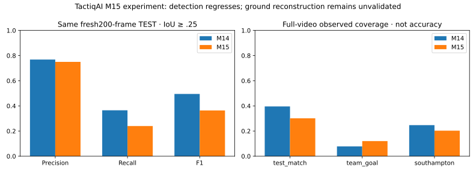
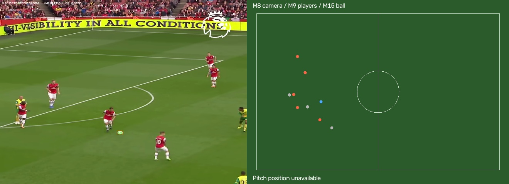
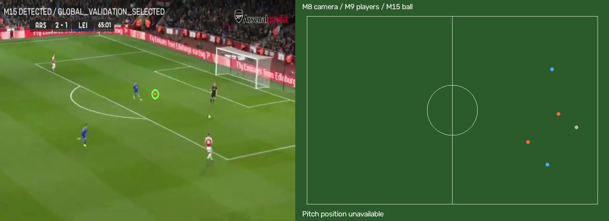
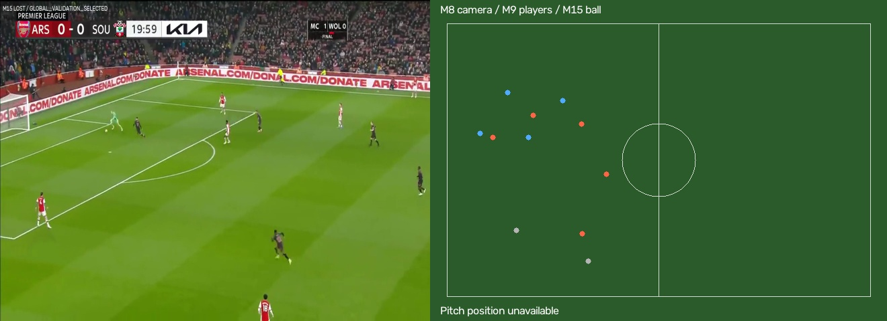
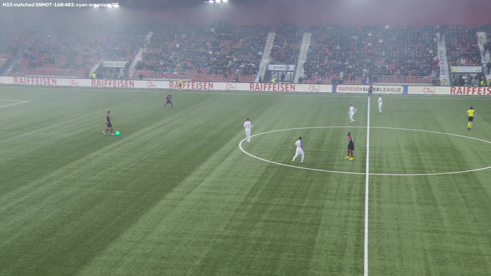
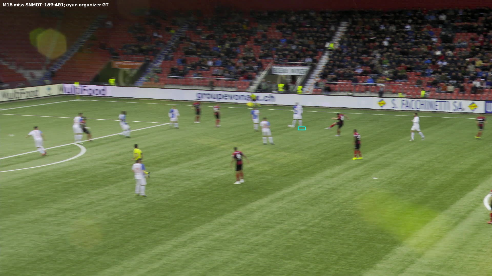
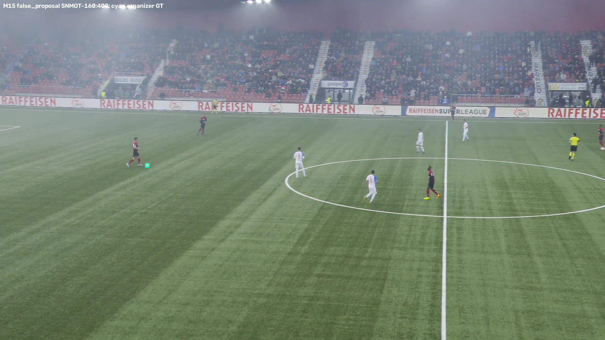

# TactiqAI — CV Milestone 15: motion-guided ball experiments

M15 is a separately versioned **EXPERIMENTAL** ball review. M14 remains the default ball layer; M8 camera and M9 player authority remain unchanged. Production SoccerTrack analytics and Ask do not consume experimental ball observations.

## Dataset and benchmark audit

The M14 code, checkpoints, selection/evaluation JSON, original ball sidecars, existing camera/player snapshots and M10–M13 artifacts were hash-frozen before changes. Recomputing its original200-frame detector metrics from cached raw candidates exactly reproduces precision60.0%,recall55.5%,F1 .5766233766 without changing original artifacts. These historical figures must not be compared directly to scores on M15's different frames.

The public [SoccerNet Tracking](https://github.com/SoccerNet/sn-tracking) source is main-camera broadcast imagery, not panoramic SoccerTrack. Original organizer ball image boxes/within-clip IDs provide independent labels relative to the detector; pitch-coordinate NPZ labels were not converted into image labels. [SoccerNet terms](https://www.soccer-net.org/faq) support research use; this local experiment does not establish commercial rights. User-supplied local video extracts stay local; broader redistribution rights are not established.

M15 samples are entirely new, nonadjacent clips relative to the previously exposed M14 evaluation. Train: game6 SNMOT-109/110,frames101–220,240frames. Validation:game4 SNMOT-070/071,frames201–280,160frames. Final TEST:game9 SNMOT-159/160,frames401–500,200frames. Matches are disjoint **within M15**. They are the same three games available in the public training archive previously audited for M14; this is not an entirely unseen-worldwide-game benchmark relative to all historical experiments. No original M14 TEST samples are used for M15 selection, training or retuning. Source metadata, clip starts, original GT/frame hashes, archive revision/CRC and exact ranges are preserved in `outputs/ml/ball_m15/dataset.json` and `protocol_seal.json`. Bounded network frame/annotation payload132,297,426bytes plus metadata252,044bytes; full archive was not downloaded.

Organizer GT does not certify visibility, occlusion, ground/airborne state or the active in-play ball. Source-only crop review shows stationary/set-piece balls, blur, body overlap and balls against advertising; these are difficult and narrow training/validation conditions. Some boxes may be interpolated or retain an obscured ball. Motion samples require one consistent ball ID, contiguous clocks and bounded movements, but this does not establish independent visibility. Absence of an annotation is not certified invisibility.

### Additional source-only audit of your three videos

A fixed41-frame sample (frame20 then every40frames) covers test_match,team_goal,southampton. Codex visually inspected original source images without detector, tracker or M8 overlays, with source-color connected-component assistance for tight boxes. Final sealed labels contain27scorable visible-ball boxes and14uncertain/excluded frames. Boot overlap, tiny unresolved balls and unreliable centers were excluded before any M15 TEST prediction was viewed. These labels are independent of the models but **not externally adjudicated human ground truth**. They are sparse, approximate image boxes/centers and cannot support dense tracking or true occlusion-recovery recall. Centers have nominal1.5–2px annotation uncertainty. Height mostly remains UNKNOWN; visually suspected airborne examples do not supply 3D height or surveyed metric truth. Player proximity/cuts are limited source-review notes, not dense authoritative annotations. None of the three videos or their labels enter training or selection.

Sealed portable annotations: `configs/ml/ball-m15-demo-annotations.json`; full source audit/crops and video hashes are local under `outputs/ml/ball_m15/source_review`. Independently verified ground/airborne training and validation labels, and metric ball reference coordinates, are unavailable.

## Detector experiment

Investigated modern efficient [Ultralytics YOLO11](https://docs.ultralytics.com/models/yolo11/) against frozen Torchvision Faster R-CNN. YOLO11n has approximately2.6M parameters; official checkpoint5,613,764bytes, SHA256 `0ebbc80d4a7680d14987a577cd21342b65ecfd94632bd9a8da63ae6417644ee1`, from the [official v8.3.0 release](https://github.com/ultralytics/assets/releases/tag/v8.3.0). Package `ultralytics==8.3.228`. Code/model [AGPL-3.0/enterprise terms](https://www.ultralytics.com/license) are recorded; no commercial deployment or blanket license compatibility is claimed. Public soccer-specialized third-party weights were investigated but not used because their training/test overlap with the evaluation videos could not be certified.

A real soccer-specific YOLO11n fine-tune uses960training crops and480validation crops, 320px source crops, imgsz640, batch8,12epochs, AdamW lr.001→.0001, decay.0005, seed20261115, Apple MPS, 0workers, no AMP. Positive crops retain original GT; player-foot and random background crops retain any intersecting ball boxes. These mine shoes/pitch/crowd distractors but are not guaranteed certified hard negatives because organizer annotations can be incomplete. Brightness, blur, scale/down-up sampling, JPEG compression, partial occlusion, flips, color, translation and mosaic augmentation are applied. No targets are generated from model predictions. Frozen best crop-VAL checkpoint SHA256 `e5adf3e90e0274c1f2bff396ec4df05e9f7d89289718e01d06887d91041f1551`. Training wall654.889s. MPS allocated snapshot53,035,776bytes after training; training progress reported roughly3.24GB allocator use, neither is a measured peak RSS. Torch warns some MPS operations are not deterministic; seeded runs are not claimed bitwise deterministic.

Model/tile/threshold selection uses identical40validation frames (every fourth), confidence grid .1/.2/.35/.5/.65, source tiles320/640 plus full frame resized640, overlapping20% tiling, cross-view NMS.3, max30candidates. The fine-tune fails to beat generic YOLO: best validation F1 .14545 versus .23077. Frozen M14, evaluated as a safeguard before final TEST, ties generic YOLO at6TP/6FP/34FN,precision.5/recall.15/F1.23077. The tied YOLO candidate is retained under the pre-TEST safeguard (also lower measured inference cost and smaller median localization error); no fresh TEST outcome selects it. Full selection candidates/locks and preserved failed pilot verifier live under the local M15 root. Fine-tuned weights are not activated.

Selected detector:generic YOLO11n,320px tiles,confidence.65. Raw candidates retain visual scores and competing boxes. An isotonic visual-probability calibration is fitted on VAL; its in-sample Brier score is only a fit diagnostic, with prospective TEST Brier reported separately. The logistic candidate verifier also has its decision threshold calibrated on independent VAL.

## Motion prediction and association

Causal histories contain up to8accepted **actual neural observations**, times and confidences. Inputs include relative image positions, velocity/direction, acceleration, elapsed time and confidence; supported M8 warps align the image history before runtime prediction. Camera compensation is an image/ground-plane approximation for unknown-height balls, not independent3D truth. Raw organizer trajectories are used for training and image-motion baselines; training does not contain independent metric-camera truth.

Baselines: recent three-point least-squares constant velocity and five-point acceleration. A genuinely trained lightweight GRU takes8features ×8history steps, hidden24, producing2D displacement and isotropic log-sigma at horizons1,3,5,10frames. Gaussian NLL, AdamW,80epochs, gradient clipping; checkpoint chosen by validation mean endpoint error. Model/optimizer configuration, weights, training history and hashes are retained. On validation, constant velocity mean errors8.18/17.33/29.86/77.65px beat acceleration9.31/24.64/50.43/155.82 and GRU10.83/28.10/48.19/98.03. **GRU is not selected.** Validation90% error radii calibrate the simpler predictor; prospective TEST region coverage is required and reported. A separate past-only M8 camera-warp extrapolation diagnostic compares camera-compensated forecasting without access to future images/GT and does not change selection.

Interpretable scoring combines visual confidence/shape with distance normalized by uncertainty and image direction. A lightweight standardized logistic verifier is trained on training-clip candidates labelled by organizer IoU≥.25, then threshold/margin selected on validation. Features include raw visual score, normalized prediction residual, direction agreement, normalized area/aspect, optional person-foot proximity, history presence, age and competing visual score. Visual detector features provide appearance evidence; no separate ReID embedding is trained for balls. Player proximity is not possession or proof of ball identity. Training histories use previous organizer GT; actual evaluation is causal with accepted tracker history, so train/evaluation exposure bias remains a limitation.

The best logistic verifier has21TP/1FP/139FN,precision.95455,recall.13125,F1.23077 on all160VALframes. The simpler unverified candidate/filter baseline has23TP/11FP/137FN,precision.67647,recall.14375,F1.23711. **The learned verifier is disabled** because its selection objective.22952 is worse than the baseline.23461. Candidate scores/calibrated visual probabilities remain diagnostic; they do not gate installed global observations. Active selection retains the frozen filter's visual/innovation association with the selected detector threshold and bounded prediction policy. The selection objective is observed IoU F1 minus .1×GT-inconsistent-predictions/frame. Confidence separation and a minimum visual score are required. Predictions are never inserted into detection history or canonical observed coordinates. Missing detections expire after.12s, confidence decays and uncertainty grows. Cuts/epoch changes clear image continuity; physical image-speed gates remain. Existing M14 filter provides the causal update; displayed current points remain actual candidate centers, not Kalman means. Unsupported metric trails are cleared as well as current metric coordinates.

Two-stage search is implemented and evaluated: global discovery, uncertainty-growing high-resolution local crop, immediate global fallback when local visual verification fails, and periodic global search every8frames. It cannot remain indefinitely locked to a local crop. **Local search is disabled in the selected pipeline** because its validation objective.22430 regresses versus global baseline.23461. It remains an ablation. Global search is used for installed M15 review; no speed gain from disabled local search is claimed.

## Pitch reconstruction: diagnosis and explicit unmet objective

M14's observed frames with supported plane intersections were92test_match/34team_goal/143southampton. Apparent plane diameter was physically compatible in91/16/142frames. Yet **zero** accepted detections passed the existing near-foot tolerance, hence no three-frame contact sequence. Nearness to body-box bottom centers is brittle and ball observations sparse; a plausible plane diameter cannot independently resolve height. M14's geometry/contact gates are unchanged.

M15 adds auditable ground-cue diagnostics (accepted M8 geometry, plane support, perspective-dependent apparent diameter, foot proximity). It does **not** claim that these cues certify ground contact. Without independent ground/airborne calibration and metric references, M15 blocks promotion of the old heuristic to authoritative coordinates. No3D height is invented. GROUND_SUPPORTED, AIRBORNE_SUSPECTED, HEIGHT_UNKNOWN and METRIC_UNAVAILABLE remain separate states. Image observations continue when metric reconstruction is unknown. Reliable independently validated ground-ball estimation and nonzero trustworthy pitch coverage remain **NOT ACHIEVED**, rather than increasing coverage by relaxing a gate.

The mini-pitch supports a solid white directly observed ground-supported ball and a contiguous supported trail. No predicted metric marker is produced: an independently validated ground-plane predictor is unavailable. Image uncertainty regions/predictions remain visibly separate; the inspector explicitly says “Pitch position unavailable.” These rendering capabilities are schema/unit/browser tested, not evidence of real-video metric accuracy.

## Versioning, serving and interaction

M14 snapshots and registry are retained. M15 writes separate ball frames, canonical `ball-m15-v1` VIDEO_CV rows, manifests, overlays and frame-by-frame M14 comparisons. M8/M9 source hashes, sidecar/canonical hashes, every frame/clock/provenance and schema/model version are validated. Current observed points must reference retained actual visual candidates. Corrupt/missing optional M15 does not remove usable M9 review or masquerade as M14/M15 success.

`configs/serving/cv_ball_m15.json` is an optional experiment registry. Default `/matches/<id>/cv` and `/cv/frame` retain M14. Explicit `?ball_pipeline=m15` requests M15, returning503 if unavailable instead of silently falling back. The frontend **Ball review** selector compares M14 baseline and M15 experimental; all player/camera controls retain their original behavior. The source video, mini-pitch, frame clock, ball inspector, actual observations, separate predictions, uncertainty radius, candidate scores/calibrated visual probability and search stage remain synchronized through seeking/playback.

## Quantitative outcome on the same fresh TEST

**The M15 accuracy/pitch targets were NOT achieved.** The selected model misses more balls than frozen M14 on the fresh200-frame organizer TEST and on the source-only demo audit. Tracking center consistency improves by accepting fewer observations and shortening predictions. This does not establish better complete ball intelligence or reliable mini-pitch reconstruction. No settings were retuned after TEST.

|Fresh200frames, IoU≥.25|TP|FP|FN|Precision|Recall|F1|FP/frame|Median / p90 matched center error|
|---|---:|---:|---:|---:|---:|---:|---:|---|
|M14|73|22|127|76.84%|36.50%|49.49%|0.110|1.655 / 3.569px|
|M15|48|16|152|75.00%|24.00%|36.36%|0.080|1.530 / 3.263px|

This is a different benchmark from M14's historical57.66% F1. The correct same-frame comparison is **49.49%→36.36% F1**, not57.66%→36.36%. M15's precision75%,recall24%,F1 .3636 miss the80%/75%/75% engineering targets. FP/frame .08 meets the.15 point target but accompanies a major recall reduction. Legacy detector evaluator defaults missing sharpness to a low bucket; M15 has no measured sharpness labels, so those inherited blur strata are **not valid measurements** and are omitted from portable results. Size strata remain valid; no broad blur/visibility/airborne recall claim is made.

### Seven tracking ablations

Accepted center consistency below means≤12source pixels from organizer GT, a different protocol from detector box IoU. Counts and denominators are explicit. Correct-association language here is limited to coordinate/GT consistency, not globally certified physical ball identity. No benchmark has independent visibility/occlusion labels.

|Ablation|Observed|Predicted|Accepted center-consistent|GT-inconsistent predictions|Longest prediction|
|---|---:|---:|---:|---:|---:|
|m14_frozen|80/200|52/200|66/80 (82.50%)|28/52|0.320s|
|new_detector_only|58/200|0/200|45/58 (77.59%)|0/0|0.000s|
|new_kalman|45/200|43/200|45/45 (100.00%)|2/43|0.320s|
|learned_motion|39/200|15/200|37/39 (94.87%)|1/15|0.120s|
|candidate_verification|28/200|7/200|28/28 (100.00%)|0/7|0.120s|
|motion_guided_local_search|40/200|14/200|38/40 (95.00%)|0/14|0.120s|
|complete_selected|39/200|15/200|37/39 (94.87%)|0/15|0.120s|

The complete selected pipeline uses global generic YOLO, the frozen filter's visual/innovation association, simple velocity display forecasts and.12s expiry. **Learned GRU, learned verifier and local search are disabled after validation regressions.** Their ablations remain visible; the best-looking TEST ablation is not promoted afterward. New Kalman has45observations/45center-consistent and2/43inconsistent predictions, while the selected version has39/37 and0/15; the selected configuration is not changed to chase that retrospective result.

Selected observed center consistency37/39=94.87%, descriptive Wilson95% interval83.11–98.58%; M14 is66/80=82.5%. Selected0/15inconsistent predictions has a Wilson upper bound20.39%: it is **not** proof that true error is zero or reliably below20%. M14 has28/52=53.85% inconsistent predictions on these fresh samples. Coverage falls40%→19.5% observed and26%→7.5% predicted. Selected matched-fragment count9, tracker-gap reacquisition9correct/11attempts=81.82%. True occlusion-reacquisition recall, error during verified occlusion and invalid ground-contact acceptance rates are unavailable. Adjacent frames and only two TEST clips invalidate broad independent-sample certainty claims; Wilson intervals are descriptive, not match-level generalization guarantees.

### Motion horizons and calibration

166eligible organizer TEST histories, including47image-direction-change cases. Mean endpoint errors:

|Predictor|1frame|3frames|5frames|10frames|
|---|---:|---:|---:|---:|
|velocity|3.586px|9.642px|17.836px|40.111px|
|acceleration|4.167px|14.373px|32.073px|101.902px|
|gru|5.867px|13.844px|22.904px|39.599px|
|past-only camera velocity|3.624px|9.677px|17.962px|40.914px|

Constant velocity p90 errors6.36/17.12/30.57/86.62px. Validation-derived nominal90% radii contain96.39/97.59/93.98/97.59% of TEST positions; fixed radii14.32/37.78/49.75/184.73px. Runtime scales the one-frame radius by elapsed time and source diagonal; this is an approximate domain transfer, not a calibrated3D confidence guarantee. Camera extrapolation uses accepted past chains in94/166histories and otherwise falls back; it slightly regresses TEST mean error and is not used to reselect models.

GRU regions contain100% but are unusably broad: mean radii88.65/654.57/2311.03/8923.23px. Coverage alone is not good calibration. On47sudden direction changes, CV mean errors5.02/11.17/18.48/35.08px versus GRU4.98/10.71/17.21/31.57; this retrospective subgroup improvement does not override the VAL decision. No learned discrete motion-state/football-action classifier was trained; image velocity and direction-change diagnostics are used. Prospective candidate-probability TEST Brier improves .05636raw→.04518calibrated. This does not establish calibrated track confidence after wrong historical associations.

## Per-recording results and actual-video evidence

|Video|M14 observed|M15 observed|M14 predicted|M15 predicted|Supported metric|M15 detector time|M15 end-to-end / FPS|
|---|---:|---:|---:|---:|---:|---:|---|
|test_match|214/541|163/541 (30.13%)|199|51|0|84.413s|89.638s / 6.04fps|
|team_goal|39/500|60/500 (12.00%)|98|18|0|33.898s|38.496s / 12.99fps|
|southampton|163/660|134/660 (20.30%)|181|44|0|97.651s|103.617s / 6.37fps|

All real runs used fresh inference (`cached_inference=false`). End-to-end includes inference, causal tracking and source/mini-pitch overlay rendering; the separate search/tracking wall timer and detector sums are in the manifests. Faster than M14's338.48/88.39/502.38s, but **not real time at source FPS**. Exact tracking-only overhead is isolated on the cached TEST ablations, not independently timed inside full-video streaming. No peak RSS measurement is claimed. Storage snapshot:research root241,536KiB (~236MiB), ball sidecars/overlays44,152KiB (~43MiB), before final report/log copies. Weights/frames/video artifacts remain ignored; no source videos are deleted, copied into Git or uploaded to Azure.

Coverage above is not accuracy. Source-only27-frame actual-sidecar evaluation:

|Video (scorable frames)|M14 observed / correct IoU|M15 observed / correct IoU|M14 wrong predictions / predictions|M15 wrong predictions / predictions|
|---|---:|---:|---:|---:|
|test_match (9)|5 / 5|4 / 4|1 / 2|0 / 1|
|team_goal (8)|0 / 0|0 / 0|3 / 4|0 / 0|
|southampton (10)|3 / 3|2 / 2|0 / 2|0 / 1|
|all (27)|8 / 8|6 / 6|4 / 8|0 / 2|

These sparse sidecar samples show fewer accepted observations, not demonstrated real-video accuracy gains. In particular, more team_goal detections overall do not establish improvement: neither tracker accepts a current ball at any of its8scorable audited frames. Raw detector audit across27frames: M14 10TP/0FP/17FN,F1 .5405;M15 8TP/2FP/19FN,F1 .4324. Per-source raw F1:test_match .875→.7143,team_goal0→.1818,southampton .4615→.3333. Sparse manual boxes and uncertain-frame exclusions limit generalization. Four visually suspected airborne labels yielded no metric acceptance; that cannot validate ground accuracy because no verified ground positives or surveyed metric coordinates exist.

### Visual examples and failures









Qualitatively inspected source/overlay examples include visible observed balls, clear misses and a shoe false positive. Source test_match135 and Southampton330 remain LOST despite a visible ball. team_goal125 has an unconfirmed proposal away from the actual ball, illustrating why DETECTED without accepted coordinates is not confirmed tracking. Actual overlays retain explicit unknown pitch location. Full source/mini-pitch MP4s, accepted/rejected candidate scores and every-frame M14/M15 comparisons are local artifacts. Successful/failed tracker-gap reacquisitions are numerically reported; true occlusion recovery remains unlabelled. No real hard camera cut was verified in the three videos; reset behavior is synthetic-tested. Qualitative examples are not additional ground truth.

## Verification and integration decision

**IMPLEMENTED:** versioned detector comparison/fine-tuning, learned GRU and logistic experiments, confidence calibration, motion/camera baselines, bounded causal tracking, global/local search with recovery, geometry diagnostics, canonical sidecars, opt-in synchronized M15 frontend and frame-by-frame comparisons.

**LOCALLY VERIFIED:** M14 content hashes; all preexisting M8/M9 fields identical over1,701frames; camera accepted counts269/456/600 preserved; original M10–M13 inputs and SoccerTrack analytics/grounding unchanged.37newM15 backend tests cover prediction, candidate scoring, low-visual rejection, ambiguity, cuts, expiry, uncertainty, reacquisition, local/global recovery, canonical provenance and independent version/corruption handling.780backend tests run:779passed, one expected skip.102frontend tests and production build pass. All11Chrome application suites passed in1.7min, covering10Azure clips,3CVsources and M15 observed/predicted/lost seeking; separate M14 ball browser regression also passes (1test/4.9s).

Live health/ready/catalog200,ready13. Both explicitly selected ball versions validate cameraM8/playerM9 and exact frame50 clocks. Azure118575view200/video range206/1024bytes;grounded Local Ask200/nested answerstatusok/6evidence rows;CV Ask503. No cloud deployment, artifact upload or new analytics semantics. First readiness request during backend restart was retried after the server became ready; no browser startup-race failures occurred in the final run.

**REFERENCE-EVALUATED / EXPERIMENTAL:** limited source-only27-frame audit and200organizer-frame benchmark show a precision/coverage tradeoff, not overall improvement. GRU, learned verifier and local crops regress the validation criterion and are disabled. Generic YOLO misses more balls on final TEST than M14. A real soccer fine-tune was trained but failed validation. **No learned model is promoted merely because it exists.**

**NOT ACHIEVED / PLANNED:**≥75%detectorF1,≥80%precision/≥75%recall, broad independent-match/visibility-labelled evaluation, reliable zero-height classification, independently validated nonzero metric ball positions, meaningful predicted pitch markers and production ball analytics. No possession, passing, shots or commentary changes. M15 is not a production replacement: **M14 remains default; M15 is explicitly selectable for inspection.** Stop after M15.

## Exact commands and artifacts

Current installed runtime: `/tmp/tactiq-cv-m1/bin/python`; Python3.12.14, Torch2.14.1, torchvision0.29.1, Ultralytics8.3.228. API serving does not import Ultralytics or run neural inference. Optional dependency file: `requirements-ball-research.txt` after existing CV/backend requirements.

Start backend from repository root:

```sh
AZURE_TOKEN_CREDENTIALS=AzureCliCredential MATCHMIND_PROVIDER=local \
MATCHMIND_CACHE=/tmp/matchmind-azure-startup-cache \
TACTIQAI_BACKEND_PYTHON=/tmp/tactiq-cv-m1/bin/python scripts/start_backend.sh
```

Frontend: `cd frontend && npm run dev`. Open http://127.0.0.1:5173, choose a CV recording, then **Ball review → M15 experimental**. M14 remains the initial selection. No existing environment variable needs changing. Keep original local CV videos for playback.

Research stages executed from root (existing sealed stages intentionally refuse destructive overwrite/reselection):

```sh
/tmp/tactiq-cv-m1/bin/python -m ml.ball15.common
/tmp/tactiq-cv-m1/bin/python -m ml.ball15.setup
/tmp/tactiq-cv-m1/bin/python -m ml.ball15.data
/tmp/tactiq-cv-m1/bin/python -m ml.ball15.annotations
/tmp/tactiq-cv-m1/bin/python -m ml.ball15.reproduce
/tmp/tactiq-cv-m1/bin/python -m ml.ball15.train_detector
/tmp/tactiq-cv-m1/bin/python -m ml.ball15.motion
/tmp/tactiq-cv-m1/bin/python -m ml.ball15.select_detector
/tmp/tactiq-cv-m1/bin/python -m ml.ball15.calibrate
# Preserve initial failed YOLO pilot, compare frozen M14 on VAL, rebuild verifier:
/tmp/tactiq-cv-m1/bin/python -m ml.ball15.reselect
/tmp/tactiq-cv-m1/bin/python -m ml.ball15.calibrate
/tmp/tactiq-cv-m1/bin/python -m ml.ball15.search
/tmp/tactiq-cv-m1/bin/python -m ml.ball15.benchmark
/tmp/tactiq-cv-m1/bin/python -m ml.ball15.camera_prediction
/tmp/tactiq-cv-m1/bin/python -m ml.ball15.ground
/tmp/tactiq-cv-m1/bin/python -m ml.ball15.process
/tmp/tactiq-cv-m1/bin/python -m ml.ball15.install_review
/tmp/tactiq-cv-m1/bin/python -m ml.ball15.evaluate_demo
/tmp/tactiq-cv-m1/bin/python -m ml.ball15.review
/tmp/tactiq-cv-m1/bin/python -m ml.ball15.live_check
/tmp/tactiq-cv-m1/bin/python -m ml.ball15.report
```

Use a fresh versioned research root via `TACTIQAI_BALL15_ROOT` for a new training experiment; retain the existing sealed root and never rerun TEST for threshold tuning. Fresh setup requires the existing bounded SoccerNet M13 archive index/metadata audit and local videos. `ml.ball15.review.source_frames()` can restore the exact annotated JPEGs from the original videos and checks their hashes. Sidecar output paths are separately protected against overwriting existing manifests; use a fresh checkout/versioned output for full release reproduction.

Regression commands:

```sh
/tmp/tactiq-cv-m1/bin/python -m unittest discover -s tests -t .
npm --prefix frontend test -- --run
npm --prefix frontend run build
cd frontend
TACTIQAI_AZURE_BROWSER=1 TACTIQAI_AZURE_REQUIRE_ANALYSIS=1 ./node_modules/.bin/playwright test --config playwright.m15.config.ts
TACTIQAI_AZURE_BROWSER=1 ./node_modules/.bin/playwright test --config playwright.m14.config.ts ball-world
```

[Portable measured results](evidence/cv_m15_results.json), `configs/ml/ball-m15-{protocol,selection,demo-annotations}.json`, local checkpoint/model/annotation/campaign hashes, TEST caches/state streams, per-source sidecar manifests, comparisonJSONL, overlays and verification logs preserve the experiment. No videos or heavyweight model/data caches are added to versioned source.
