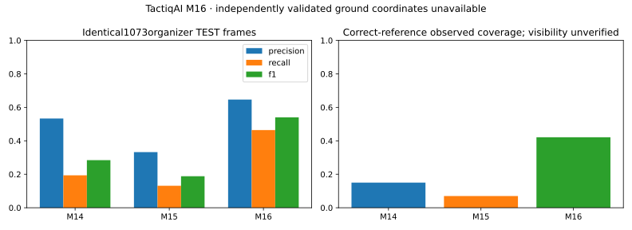

# TactiqAI — CV Milestone 16: small-ball detection and temporal visual experiments

2026-11-03. M16 is a separately versioned experimental ball pipeline. M14 remains the default. M8 camera and M9 player authority, SoccerTrack analytics, Azure and Ask grounding retain their existing semantics. M10–M15 checkpoint/code/reference content is hash-frozen. No possession, passing, shooting or commentary work is included.

## Diagnosis before training

Recomputed M15 validation candidate losses on160organizer boxes before the new experiment:

|Failure category|Boxes|
|---|---:|
|No raw proposal near the ball|78|
|Proposal center near GT but box IoU below.25|8|
|Box matched at raw confidence.02 but filtered by.65 threshold|49|
|Matched at operating threshold|25|

Raw candidate recall74/160=46.25% is already a ceiling before temporal filtering. Lowering threshold.65→.02 raises TP25→74 but FP33→2613: confidence reduction alone cannot solve recall.63/160GTballs are under12px. M15 local search matches73rather than74rawGTboxes, loses one global match and recovers zero unmatched globals. Its local search replaces proposals and uses crops smaller than the training context; that scale/context mismatch is a design limitation, not a separately isolated causal experiment. M16's replacement preserves global candidates by construction and adds nonduplicates from a larger256–480pxcontext. It must still demonstrate improved accepted correct coverage before activation.

M15 training had240frames, two short clips and one match. Repeated stationary balls and unknown-visibility/random-background crops limit both diversity and negative-label reliability. The coordinate-only GRU lacks appearance input, uses overlapping histories and regresses all four VAL horizons; its enormous prospective uncertainty regions do not establish good calibration. The verifier raises precision but loses enough recall to regress the selection objective. Neither was promoted. Full quantitative taxonomy and threshold grid: `outputs/ml/ball_m16/failure_taxonomy.json`.

M14's repeated near-foot gate accepted zero contacts. M8 geometry and apparent ball size cannot independently establish zero ball height. The user confirmed there are no additional independently verified ground-ball timestamps or metric references. M16 must preserve unknown height rather than manufacture mini-pitch coordinates.

## Source and annotation audit

Inspected the public SoccerNet Tracking archive directory and original annotation metadata with bounded range requests before large frame payloads. The additional public archive supplies matches7,8,11. Original professional organizer annotations contain image boxes/tracklets, but do not provide independently usable explicit ball visibility/occlusion/ground-height states. Absent annotations are not negative labels. Multiple annotated balls can include reserve/out-of-play balls; detector/object GT is not verified in-play identity.

M16 split:

|Split|Frames|Organizer ball boxes|Matches|Independently visibility-verified full frames|Verified no-visible-ball frames|
|---|---:|---:|---|---:|---:|
|Train|3040|3078|6,8|0|0|
|Validation|288|288|4|0|0|
|Final TEST|1073|1073|7,11|0|0|

Training samples80positive-labelled frames per clip across38clips. Validation uses consecutive36-frame windows across8clips. Final TEST uses consecutive100-frame windows across11clips, retaining available annotated frames; excluded unavailable GT is not relabelled as absence. Tiny valid boxes are retained for validation/TEST. Matches7and11 were unused in M14/M15 ball training or validation. Original M14/M15 TEST frames never enter training. Source image hashes are unique; whole-match/duplicate/historical-TEST guards and original archive CRC/hash checks pass. Exact frame/time/camera/box/source provenance, plans and dataset hash are sealed before M16 selection.

**These are 3,040organizer-positive training frames and1,073organizer-box TEST references, not3,040independently verified visible positives or a visibility-labelled positive/negative TEST.** The requested verified-negative and independent visibility criteria remain unmet. More frames cannot erase that annotation limitation. No unknown-visibility frame is manufactured as negative.

Source-only visual review accepted24recognizable shoe/leg candidate crops from training match6 and excluded ambiguous circular blobs. They are reviewed candidate regions, not certified ball-absent full frames. They are highly correlated and reviewed by Codex, not externally adjudicated. Their coordinates, source hashes, review decisions and selection provenance are retained. No separate-match reviewed negative sequences are available for calibrating a temporal classifier.

The public SoccerNet research scope from previous milestones is retained; no unrestricted commercial rights or cloud deployment is asserted. The archive directories/metadata and selected compressed frames are downloaded, not complete multi-gigabyte archives. HTTP429responses were handled with lower concurrency and bounded backoff. Cached frames from pre-seal sampling revisions are retained and excluded from the sealed manifest rather than counted as training/evaluation samples.

## Training and model design

A soccer-specific YOLO11s experiment uses the official COCO initializer and a one-class ball head. It increases capacity relative to M15's YOLO11n while remaining within the measured Apple Silicon budget. Four-epoch maximum, early stopping patience2,640training resolution,batch8,AdamW lr.0005→.00005,decay.0005,seed20261116,0workers,no AMP. Exact initializer/checkpoint/config/dataset hashes are retained.

One positive crop per frame uses256/320/480source-pixel contexts, including tiny balls at enlarged scale. Every intersecting annotated ball remains labelled. Augmentation includes source-crop scale variation, motion blur, JPEG compression, lighting/color variation, partial occlusion, flips, translation and low-rate mosaic. Source-box validity and split contracts are checked. No random/person crop with unknown ball visibility is labelled negative. Consequently the detector does **not** claim balanced verified-positive/negative frame batches; the small reviewed negative pool is used in the balanced temporal visual experiment. This is a documented data limitation, not a silent negative-label shortcut.

The existing YOLO BCEclassification, IoU/DFLbox objective is retained; no unvalidated custom focal loss is claimed. Small-object oversampling occurs through positive-focused source crops and scale variation. Selection compares640/960/1280inference with full-frame plus overlapping640pxsource tiles on identical validation frames, then thresholds.1/.2/.35/.5/.65. Validation F1 selects the detector, with recall and lower measured cost as tie-breakers. Larger resolution/model size is not automatically selected.

## Temporal visual verification and tracking

A real shared-frame CNN encodes previous and current48×48RGBcrops with12/24-channel convolutions; current/previous/absolute-difference features feed a24unitMLP. It outputs a candidate probability. Training uses235actual consecutive organizer-positive crop pairs from the frozen M15 training match (not the expanded multi-match detector corpus) and23temporally usable pairs from24source-reviewed shoe/leg candidate regions, balanced1:1sampling,AdamW,20bounded epochs. Organizer positives still have unverified visibility; training loss is not accuracy. Without independent match-disjoint reviewed negative sequences, this classifier is an **unselected diagnostic**, not a validated active verifier. Its fixed.5probability ablation is reported separately; no final TEST score can activate it.

The multi-hypothesis tracker retains up to four image trajectories, uses uncertainty-aware visual/motion association, dynamic velocity updates, repeated visual support, ambiguity margins, camera-motion compensation, bounded occlusion hypotheses and expiring predictions. Current points must come from retained actual candidates. Cuts/epochs reset continuity. A strong distant visual score does not automatically displace a supported trajectory; a nearby weak proposal is not automatically confirmed. Multiple hypotheses can accommodate kicks/deflections, but this is not a learned football-action model or a guarantee against false reacquisition. A Kalman baseline is retained if validation correct-reference coverage/consistency does not improve.

Additive local recovery searches a prediction region at higher resolution while preserving every global candidate; source-context minimum256px avoids M15's most aggressive scale mismatch. It cannot permanently lock the detector into a crop because global search continues. Raw proposal recall and additional cost are measured on validation. No local component is selected without accepted correct-coverage evidence.

## Mini-pitch and provenance

M16 adds no authoritative metric coordinates without independently verified ground contact and defensible pitch references. Existing M8 projection/uncertainty is reused only as geometry support. Ball observations remain in the source overlay when pitch position is unavailable. Airborne suspicion/unknown height/metric unavailability remain explicit. Supported white metric markers and trajectories are rendered only through the existing provenance-checked path; there are no invented3Dheights or unsupported predicted pitch markers.

Optional `configs/serving/cv_ball_m16.json` attaches separate frame/canonical streams after hash/schema/source/clock validation. M14/M15 remain queryable. Explicit `ball_pipeline=m16` never silently falls back when unavailable. The frontend selector offers M14,M15,M16 while M14 stays default. Every old M8/M9 world field must remain identical outside the additive ball layer.

## Published multi-view geometry reference audit

The [official SoccerNet-v3D source](https://github.com/mguti97/SoccerNet-v3D) provides small CSV/calibration assets. Downloaded onlySNv3D.csv(3,801,107bytes),ISSIA-3D.csv(451,850bytes) and calibrationJSON(7,508bytes), with hashes; no protected footage or third-party model weights. The repository code licence isGPL-2.0; dataset/media terms are separate. This is a conditional numerical reference experiment, not a ground-label transfer to your videos.

Within each synchronized multi-view action, the held-out image point is excluded from DLTtriangulation. At least two other views form a reference, with calibrationJaC≥.75 and other-view reprojection≤3px. Of171three-or-more-view groups,95reference views pass quality/field bounds;18have triangulated|Z|≤.15m. These are **near-ground according to triangulation**, not verified physical contact or surveyed ground truth. All4,051published camera records have zero distortion; pinholeKRTis appropriate for these annotations.

M8's unchanged point mapper, supplied with the external camera geometry, accepts11/18near-ground views(61.11%);7are outside its calibration-region support. Accepted mappings have median error1.102m/p901.714m against the reference from other views. Original full-field quads can cross the projective horizon; the final reference support polygon clips the world pitch to positive depth and image frustum before projection. The initial un-clipped diagnostic is retained separately; M8's mapping gates were not relaxed.

This does **not** validate M8 camera estimation on new images, a visual ground classifier, verified ground coverage or accurate pitch balls in your three videos. Published calibration is shared by reference construction, images within actions are correlated, and raw images were not downloaded. The actual user-video pipeline continues to withhold unsupported metric positions. The ≥70%independently verified ground-ball objective remains unestablished.

## Recorded model and selected detector result

OfficialYOLO11s initializer:19,313,732bytes,SHA256`85a76fe86dd8afe384648546b56a7a78580c7cb7b404fc595f97969322d502d5`. Model code/weights use [Ultralytics AGPL/enterprise terms](https://www.ultralytics.com/license); this local experiment makes no commercial-deployment claim. Optional runtime matches M15'sUltralytics8.3.228/Torch2.14.1/torchvision0.29.1. The bounded training run took1309.283s. Best validation checkpointSHA256`638dc0baeed14f0cb4cb50f55454840a7614928405f5886381f70793439db4df`; datasetSHA256`6524d99f34176a5ce9ca23c2f00102e8cc1569c280c8771c8f02869ffa0035ad`. MPS allocator progress was approximately4.4–4.46GB; the OS process maxRSS was980,860,928bytes. These are different memory measures, not a combined physical-memory peak. MPS kernels are not claimed bitwise deterministic despite the seed.

Full-frame validation selected640inference/confidence.35, with42TP/26FP/30FN on the identical72-frame selection sample:F1.6000.960/1280were actually evaluated and did not win. Multi-hypothesis validation had142center-correct/166accepted against165/190forKalman; it did not improve correct-reference coverage or consistency and is disabled. Additive local search raised raw matching proposals205→206of288VALboxes with245local calls/5.620extra seconds. That proposal-only gain does not establish safe accepted-tracking improvement; local search is disabled. The trained visual verifier lacks independent reviewed negative validation and is likewise an unselected diagnostic.

The selected M16 detector on1,073sealed TEST references produces498TP/272FP/575FN:precision64.68%,recall46.41%,F154.04%,FP/frame0.253. **The ≥85%F1target was not reached.** Raw candidates match812/1,073before filtering;314matches are below the operating threshold,74fail boxIoU despite a nearby proposal center,187have no near/matching proposal,and498remain accepted at the detector operating point. The present candidate pool cannot reach80%boxrecall even with perfect association. These are organizer-box statistics; true visible-ball accuracy remains separately limited by missing visibility labels.

## Reproduction and artifact boundaries

Use the existing optional CV environment (`/tmp/tactiq-cv-m1/bin/python` in this verification). The source manifest, frozen hashes and sealed selection are preserved under `outputs/ml/ball_m16`; portable protocol/selection/source-only annotation records are in `configs/ml/ball-m16-*.json`. Large downloaded images, weights, cache journals and rendered videos stay in ignored output directories. The sealed sample JPEGs occupy 948,307,955 bytes; all 5,199 cached JPEGs occupy 1,138,080,804 bytes, including unused pre-seal sampling revisions. The dataset's `network_bytes` field describes only the final resumed invocation, not cumulative transfer.

The actual sequence is `python -m ml.ball16.common`, `source_audit`, `diagnose`, `data`, `negative_review`, `train`, `temporal`, `evaluate select`, then `evaluate test`, followed by `process`, `install` and `demo_evaluation`. Review-dependent source annotations must be retained rather than fabricated by a blind rerun. Evaluation, selection and publication reject overwriting sealed results. Use a new `TACTIQAI_BALL16_ROOT` for a separately named experiment; it is not permission to tune against the sealed final TEST. The independent numerical geometry audit uses `metric_reference` and `metric_geometry`.

Verification commands:

```sh
/tmp/tactiq-cv-m1/bin/python -m unittest discover -s tests
npm --prefix frontend test -- --run
npm --prefix frontend run build
cd frontend
TACTIQAI_AZURE_BROWSER=1 TACTIQAI_AZURE_REQUIRE_ANALYSIS=1 \
TACTIQAI_BROWSER_REGISTRY=configs/serving/browser-two-recordings.json \
npx playwright test --config playwright.m16.config.ts
```

Start the backend from the repository root with the existing Azure-enabled environment:

```sh
AZURE_TOKEN_CREDENTIALS=AzureCliCredential MATCHMIND_PROVIDER=local \
MATCHMIND_CACHE=/tmp/matchmind-azure-startup-cache \
TACTIQAI_BACKEND_PYTHON=/tmp/tactiq-cv-m1/bin/python scripts/start_backend.sh
```

Start the frontend with `npm --prefix frontend run dev`. Local CV source videos remain required. No Azure bundles are changed by this milestone; ball processing does not create football analytics or grounded CV Ask support.

## Identical fresh TEST comparison

All versions use the same 1,073 organizer-box frames from two unseen matches, IoU ≥ .25 and their previously sealed operating settings. Historical M14/M15 benchmarks above are separate protocols. No final TEST tuning occurred.

|Metric|Frozen M14|Frozen M15|Selected M16|
|---|---:|---:|---:|
|TP|208|141|498|
|FP|182|283|272|
|FN|865|932|575|
|Precision|53.33%|33.25%|64.68%|
|Recall|19.38%|13.14%|46.41%|
|F1|28.43%|18.84%|54.04%|
|Accepted center-consistent observations|161/220 (73.18%)|75/164 (45.73%)|452/530 (85.28%)|
|GT-inconsistent predictions|202/325 (62.15%)|43/60 (71.67%)|55/150 (36.67%)|
|Correct-reference observed center coverage|161/1073 (15.00%)|75/1073 (6.99%)|452/1073 (42.12%)|
|Matched track fragments|57|25|77|
|Correct gap reacquisitions / attempts|57/96|25/81|77/144|

M16 improves correct-reference observations (161→452) and box detection, rather than merely abstaining more. Its 85.28% accepted center consistency and 55/150 incorrect predictions still fail the 95% / ≤5% goals. Correct visible-ball coverage cannot be certified from organizer boxes; correct-reference center coverage is only 42.12%. Independent pitch coverage remains unestablished. Longest M16 predicted continuation is .12 seconds. Gap-reacquisition measures are tracker-gap diagnostics, not visibility-conditioned occlusion recall.

### Per-match detector results

|Match / frames|Version|TP / FP / FN|Precision|Recall|F1|
|---|---|---|---:|---:|---:|
|SN_game11 / 500|M14|108 / 87 / 392|55.38%|21.60%|31.08%|
|SN_game7 / 573|M14|100 / 95 / 473|51.28%|17.45%|26.04%|
|SN_game11 / 500|M15|56 / 139 / 444|28.72%|11.20%|16.12%|
|SN_game7 / 573|M15|85 / 144 / 488|37.12%|14.83%|21.20%|
|SN_game11 / 500|M16|219 / 137 / 281|61.52%|43.80%|51.17%|
|SN_game7 / 573|M16|279 / 135 / 294|67.39%|48.69%|56.53%|

### Ablations

Detector-only, detector+Kalman, detector+multi-hypothesis, detector+visual temporal verifier, and complete M16 share the same detector pool: detector metrics must not be misrepresented as temporal-filtered F1. Tracker comparisons below show the actual acceptance tradeoff. Complete M16 is the validation-selected Kalman configuration.

|Tracker|Center-correct / accepted|IoU-correct observations|Incorrect / comparable predictions|
|---|---:|---:|---:|
|new_detector_motion|452/530|429|55/150|
|new_multi|403/462|384|38/116|
|new_temporal_visual|299/332|278|36/97|

The visual-verification diagnostic reaches higher accepted consistency by reducing correct observations; it is not promoted. Per-match tracker details and whole-match bootstrap intervals are in the portable evidence report. Only two independent TEST matches exist: bootstrap ranges are exploratory, and per-frame Wilson intervals cannot establish generalization. M16 small-object recall is 76/203 (37.44%); localization median/p90 on matched detector boxes is 2.306/7.087 px. Low-Laplacian-sharpness recall is 1/24; sharpness is a measured proxy, not verified motion-blur truth.

## Real source videos and runtime

All 1,701 source frames were processed without candidate-cache reuse. Each recording has synchronized source/mini-pitch MP4, frame JSONL, canonical `ball-m16-v1` observations, hashes/offsets and every-frame M14/M15/M16 comparison JSONL. These videos do not inherit SoccerNet accuracy claims.

|Source|Frames|Observed M14 → M15 → M16|M16 predicted only|M16 wall seconds / FPS|Metric supported|
|---|---:|---:|---:|---:|---:|
|test_match|541|214 → 163 → 393|63|55.69 / 9.71|0|
|team_goal|500|39 → 60 → 6|9|13.45 / 37.18|0|
|southampton|660|163 → 134 → 77|56|90.85 / 7.26|0|

The team-goal regression is severe: 1.20% observation coverage, compared with M14 7.80% and M15 12.00%. Southampton also loses coverage; the broad improvement on organizer TEST does not establish generalization to these clips. M16 remains optional. Peak process maxRSS reached 2,383,708,160 bytes on macOS (~2.22 GiB). Only team_goal exceeds its 25 FPS source rate in this bounded offline measurement; test_match and southampton do not reach source-rate real time. Do not describe the pipeline generally as real time.

### Source-only reference audit

Forty clear source-only boxes (27 historical + 13 new) were sealed before selection/final TEST. Fifteen additional new frames were excluded as ambiguous. This is a single Codex visual/color-assisted audit, not independently adjudicated human GT; no ground-contact or metric truth is asserted.

|Source / scorable frames|Correct observed IoU boxes M14 / M15 / M16|Incorrect M16 predictions / comparable|
|---|---:|---:|
|test_match / 15|10 / 5 / 15|0/0|
|team_goal / 11|0 / 0 / 0|1/1|
|southampton / 14|4 / 2 / 2|1/2|
|all / 40|14 / 7 / 17|2/3|

All 1,701 original world frames remain identical outside the additive ball layer. M8 accepted-camera counts remain 269/541, 456/500 and 600/660. M8/M9/M10–15 source/checkpoint/reference hashes verify unchanged. Independent height and metric references remain absent; zero unsupported pitch points are published.

## Visual evidence and presentation correction



[Source/mini-pitch test_match example](evidence/m16_test_match.jpg), [team_goal](evidence/m16_team_goal.jpg), [southampton](evidence/m16_southampton.jpg). These are frames from your local source videos, not generated images. SoccerNet failure examples are explicitly labelled with sequence/frame provenance: [miss](evidence/m16_miss.jpg), [matched](evidence/m16_matched.jpg), [unmatched proposal](evidence/m16_unmatched.jpg). Do not interpret an organizer annotation as a visibility certificate or an unmatched proposal as independently reviewed absence.

Visual inspection caught an inherited M15 title in the reused pitch renderer. `python -m ml.ball16.render_review` regenerates presentation files with the M16 title from the already sealed observations. All manifest/frame/canonical hashes remain unchanged. Its extra rendering pass is recorded separately in `render_correction.json`; it does not replace original inference-inclusive timing measurements.

The CV frame endpoint now uses Pydantic's direct JSON serialization of the same validated model, avoiding a redundant FastAPI recursive conversion. A regression test compares the complete parsed response to the validated frame for all three versions. A local 30-request sequential sample took 3.679→0.340 seconds directly and 5.665→0.223 seconds through Vite. The earlier sample overlapped browser checks, so this is an operational diagnostic, not a controlled speedup benchmark. Payloads remain approximately442KB; no evidence fields or validation were removed.


## Final verification and integration decision

- Backend: **811 run, 810 passed, one expected skip**; 31 new M16 tests. Dataset/negative contracts, hashes/leakage, finite/source bounds, additive recovery, image-CNN output, hypothesis ambiguity/cuts/expiry/reacquisition, unknown height/metric provenance, canonical versioning, all-three-version serving, corruption rejection and complete frame JSON equivalence are covered.
- Frontend: **105 passed across 18 files**, production build passed.
- Current application Chrome run: **22 passed**. All ten Azure clips, M8/M9 review, smoothing, all three ball versions, three local sources, Ask, identity persistence, second recording, evidence lead-in/deep link, pending-catalog fixture, fallback and responsive layout are checked.
- Historical standalone world viewer and ReID research explorer: **one test each passed**. ReID screenshots use a separate test path, preserving original experiment artifacts.
- The historical `camera-placement.spec.ts` was also run: **one failure**, requiring camera version `m5` while the current service correctly returns `m8`. Its M5-only fixture is obsolete for the current application; no camera rollback or relaxed assertion is made. The current M8 camera tests pass. This is not an all-historical-browser-tests-passed claim.
- Earlier browser attempts failed before servers were started, and smoothing showed load-sensitive failures before the final checks. Legacy demo assertions were repaired for the already-existing two-second playback lead-in and scoped Ask/evidence regions. The pending-clip test now isolates its catalog response because 128058 is valid in live Azure. No football/Ask product semantics changed.
- Final measured smoothing update rates were 23.53 / 25.10 / 29.97 per second for test_match / team_goal / southampton, zero missing-overlay samples and maximum one-frame lag in that bounded Chrome measurement. This does not certify every machine or source.
- Live health / ready / recordings: **200**, readiness **13** usable recordings. Three CV sources × M14/M15/M16 metadata and frame50 requests pass. Azure 118575 view **200**, video byte range **206 / 1,024 bytes**, grounded Local Ask **200**, answer status **ok**, **six evidence rows**.

Frozen M8/M9/M10–15 inputs, old experiment data and reference hashes verify unchanged. Logs and machine-readable verification are retained under `outputs/ml/ball_m16/verification*`; portable evidence is [cv_m16_results.json](evidence/cv_m16_results.json).

**Decision: M16 experimental, M14 default.** The new detector improves unseen organizer-box recall and correct-reference coverage substantially, but fails the predefined detector/tracking/prediction gates and regresses on two local sources. Verified visible-ball negatives, match-diverse temporal verification labels, calibrated prediction uncertainty and defensible independent ground/metric references remain missing. No unsupported pitch coordinates or new football semantics are introduced. No Azure upload or environment change is needed; keep local CV source videos. Work stops at M16.
