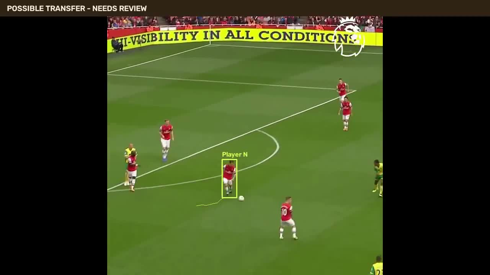
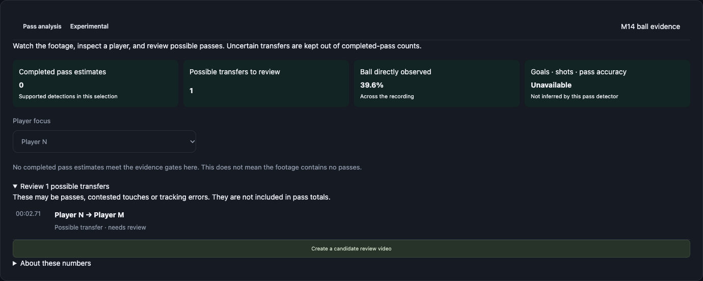

# Experimental video-only pass detection on the three short clips

Verified 2026-11-13. The long Tottenham/Arsenal video run was deferred at the user's request. This update adds a pass-event and statistics layer to `test_match`, `team_goal`, and `southampton`, with a source-linked frontend review similar to the structured SoccerTrack workflow.

**Current result: eight possible transfers to review, zero completed-pass estimates that pass all evidence gates. This does not mean the clips contain no passes.** The existing video-only tracking is not yet sufficient for reliable pass totals. Goals, shots, tackles, attempted passes and pass accuracy remain unavailable rather than being filled with zeros.

## What actually ran

The run validated all source-video hashes, every indexed M8/M9 world frame and the corresponding M14 ball/canonical stream. It reused these unchanged, already computed vision outputs and executed the new pass stage over **all 1,701 frames**. There was no new neural inference, model training, frame subsampling or Azure upload in this pass run. Reusing a validated upstream cache is distinguished from rerunning the neural models.

|Clip|Frames|Source FPS|Ball directly observed|Completed-pass estimates|Possible transfers|
|---|---:|---:|---:|---:|---:|
|test_match|541|23.9760|214 / 541 (39.56%)|0|5|
|team_goal|500|25|39 / 500 (7.80%)|0|1|
|southampton|660|29.9700|163 / 660 (24.70%)|0|2|

The unchanged gates were also run on existing M16 ball outputs as a comparison. M16 directly observes393/541, 6/500 and 77/660 frames, and yields 8/0/2 review candidates, with zero completed-pass estimates. That comparison does not promote M16, select a new threshold or demonstrate improved independent pass accuracy. The active pass sidecars remain tied to the default **M14** evidence; alternate ball overlays do not silently become their source.

Original source-video, M9 world-frame and M14 ball-frame hashes were independently rechecked after processing and remained unchanged. [Portable actual results](evidence/cv_passes_v1_results.json).

## Detection and uncertainty

`src/vision/events/passes.py` uses only directly observed current ball detections and current visible players with explicit, nonambiguous M9 appearance-segment references. Image-space lower-body proximity is a **contact hypothesis**, not proof of physical touch or ground contact. Nearest candidates require a separation margin, and endpoints need repeated visual support.

A completed-pass estimate requires stable sender/receiver hypotheses, observed release and ball flight, sufficient observed-ball coverage with bounded gaps, the same ball track/camera epoch, known compatible team hypotheses, receiver visibility at release and sufficient player separation measured within the same frame. The same-frame comparison avoids interpreting a camera pan as player separation. A single actor, an unresolved identity, predictions, historical positions, cuts and opponent recoveries cannot silently become completed passes.

Failures become **transfer candidates** with explicit reasons. Missing ball observations, identity fragmentation, uncertain teams, closely spaced players and absent visible flight explain the rejected transfers. No gate was relaxed to force a positive count. There is no independent real-video event reference set here; controlled synthetic acceptance/rejection tests are regression checks, not measured match accuracy.

Only current, bounded-uncertainty M8/M9 player positions can supply a heatmap or pass-map endpoints. Endpoints describe player-foot locations, not a measured ball trajectory or verified zero ball height. Missing coordinates stay missing. Unknown-height balls remain without authoritative pitch coordinates.

Unsuccessful passing intent is not established by observing an opponent recovery, so attempted passes and completion percentage remain null. The detector does not infer goals from the `team_goal` filename or from celebrations.

## Data collected

The default output directories are:

```text
outputs/world_model/cv_passes_v1/test_match/
outputs/world_model/cv_passes_v1/team_goal/
outputs/world_model/cv_passes_v1/southampton/
```

Each contains `manifest.json`, `events.json`, `events.csv`, `player_summary.json`, `player_summary.csv` and `evidence_frames.jsonl`. Candidate and estimated status, source frames/timestamps, explicit sender/receiver appearance references, team hypotheses, ball-support frames and rejection reasons remain inspectable. Unsupported CSV statistics are blank, not zero. These observations can support future review and model work; they are not human-adjudicated training labels.

Manifests pin the source video, world stream, selected ball stream/model, config and event/evidence hashes. The optional loader rejects corrupt files, wrong sources/clocks/counts and unsupported goal/accuracy values; changed files become unavailable. A missing or invalid event sidecar leaves video/CV review and application readiness intact. It never grants `artifact_ready`, canonical football analytics or ordinary grounded Ask readiness.

## Frontend and assistant

Refresh http://127.0.0.1:5173 and choose one of the three **CV Experimental** clips.

- **Pass analysis** shows qualified detection counts, ball coverage and uncertain transfers separately. Expand **Review possible transfers** and select a moment to watch its lead-in.
- Choose a player in **CV player focus**, or select their source box/pitch marker. The player report shows pass/reception estimates and available position maps. Unsupported shots/goals/accuracy are shown as unavailable. Focus persists when a player leaves the current frame.
- **Create a candidate review video** submits the explicit review request. Videos display **POSSIBLE TRANSFER — NEEDS REVIEW**, with a player marker before the event when focused. Candidates remain excluded from completed-pass counts.
- Ask “How many passes were detected?”, “Show me their stats”, or “Make a review video of possible passes”. One answer/video replaces the previous one. Per-event lists/raw evidence remain behind Developer mode.

The unified assistant reads validated CV events directly; it does not fabricate a SoccerTrack `MatchMindTools` bundle. Explicit segment references prevent all CV players from matching the same null numeric actor ID. The LLM can interpret requests, but cannot silently drop an explicit review requirement or promote candidates into confirmed events. Hosted-provider contracts were mocked; no new live model call was made in this update.

CV highlight manifests use the verified clip clock with an **unknown match period**, rather than inventing a first-half origin. Source/render hashes remain checked. Ordinary `/matches/{id}/ask` stays 503 in the Azure-backed service for these CV-only recordings; the separate unified `/assistant` supports the limited experimental pass capabilities.





[Actual endpoint evidence for all eight candidates](evidence/cv_pass_candidates.jpg). These images come from the three existing source videos, not SoccerTrack annotations or generated imagery.

## Reproduce

Use a fresh output directory; completed experiments are preserved:

```sh
/Users/greatabhieyighan/Library/Caches/TactiqAI/backend-m17/bin/python \
  -X pycache_prefix=/tmp/tactiq-pass-pycache -m scripts.process_cv_passes \
  --output /tmp/tactiq-cv-pass-reproduction
```

`--ball-version m16` runs the explicit comparison in a separate directory. `configs/serving/cv_events.json` selects the validated M14 pass sidecars. Optional `MATCHMIND_CV_EVENTS_REGISTRY` selects another trusted local event registry; existing `MATCHMIND_*` names retain their meanings.

The existing backend command and Azure `.env` remain valid:

```sh
AZURE_TOKEN_CREDENTIALS=AzureCliCredential MATCHMIND_ARTIFACT_STORE=azure \
MATCHMIND_PROVIDER=local MATCHMIND_CACHE=outputs/cache/azure_m17 \
MATCHMIND_HIGHLIGHT_CACHE=outputs/highlights_m18 \
TACTIQAI_BACKEND_PYTHON=/Users/greatabhieyighan/Library/Caches/TactiqAI/backend-m17/bin/python \
scripts/start_backend.sh
# Separate terminal:
npm --prefix frontend run dev
```

Application compute remains local. Existing SoccerTrack media streams from Azure; the three CV originals remain their local playback sources and must be retained. The uploaded long video has not been analysed or registered by this short-clip update.

## Verified checks

**949 backend tests run: 948 passed, one expected skip; 122 frontend tests and typed production build passed.** Final service checks: health 200,ready 200/15, all three CV event endpoints 200;ordinary CV Ask 503;existing Azure view/grounded Local Ask 200 and 16-byte video range206. Results are recorded in [portable evidence](evidence/cv_passes_v1_results.json). Five Chrome cases passed, including all three CV sources, candidate-source seeking, player statistics and scope, review-video playback, pre-event markers, explicit candidate warnings, single answers and mobile overflow, plus existing full-match/score/maps/goal/sprint flows. The initial run caught a configuration serialization mismatch, a nullable frontend field and a registry path fixture mismatch; these were corrected before the successful final runs. No corrupt evidence was accepted to make a check pass.
