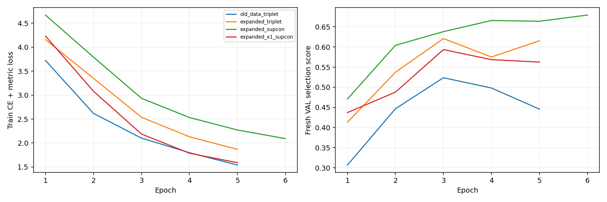
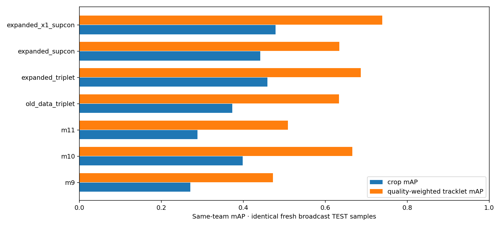

# TactiqAI CV Milestone 13 — Soccer-ReID v2 training and evaluation

Verified 2026-11-02. **IMPLEMENTED / LOCALLY VERIFIED / EXPERIMENTAL.**

**M13 DOES NOT BEAT M10 UNDER THE LOCKED ACCEPTANCE GATE.** The validation-selected v2 model improves fresh broadcast crop mAP, but its tracklet mAP and shadow reconnect decisions do not improve consistently. No production activation is justified. M8 camera/M9 player world remain active; M10 remains the retained research baseline.

This is the result of the selected model, not a claim that every M13 alternative is worse: the x1.0 candidate scores better on final TEST, but was not selected by validation. It is reported without post-hoc promotion. Independent worldwide physical-player split certification remains unavailable; see the [M12 audit](cv_soccer_reid_m12_dataset.md). The strict certification criterion is NOT claimed complete.

## Fresh held-out protocol

New public broadcast game9 final TEST was unused by M10/M11 and unseen by M13 inference until model, pooling and calibration locks. Dataset:6,592TRAINcrops/75annotated identities;535freshVAL/11;966freshTEST/21. Retrieval:8VALand20TESTpaired query identities,3crop queries/galleries each;2–9squery versus20–30sgallery;4–8observations per tracklet. Negatives stay in the same match/team; original GT identity positives stay within the anchor clip. Every model receives identical query/gallery crop assets and sample selections, while preserving its own trained preprocessing.

The beat rule was fixed before TEST: selected model same-team crop mAP and selected-pool tracklet mAP each≥M10+3percentage points, with crop Rank-1 nonregression. No epoch/model/threshold was selected from TEST. Historical M10/M11 TEST remains a separately labelled unchanged protocol, never a new validation set.

|Model|Crop Rank-1|Rank-5|mAP|Crop ROC-AUC|Weighted tracklet Rank-1|mAP|
|---|---|---|---|---|---|---|
|M9 generic OSNet|26.67%|60.00%|27.06%|0.5681|30.00%|47.21%|
|M10 Soccer-OSNet|38.33%|76.67%|39.88%|0.6292|55.00%|66.57%|
|M11 best ViT|23.33%|66.67%|28.78%|0.6080|30.00%|50.91%|
|M13 old-data control|33.33%|80.00%|37.31%|0.6786|45.00%|63.38%|
|M13 expanded triplet|48.33%|85.00%|45.92%|0.7191|50.00%|68.67%|
|M13 selected expanded contrastive|38.33%|80.00%|44.11%|0.7432|45.00%|63.42%|
|M13 alternative OSNet x1.0|50.00%|83.33%|47.90%|0.7318|60.00%|73.92%|

Selected v2 is **expanded_supcon** (OSNetx0.25,epoch6), selected aggregation **quality_weighted**. Against M10 on identical fresh samples: crop Rank-1unchanged38.33%;crop mAP39.88→44.11%;weighted tracklet mAP66.57→63.42%. The combined gate fails.

The x1.0 alternative obtains50.00%crop Rank-1/47.90%mAP and73.92%weighted tracklet mAP on TEST. This is a promising held-out candidate result, but its validation selection score was lower. Promoting it after seeing TEST would break this experiment's selection discipline. No retraining or new threshold search followed these results.

## Controlled experiments and attribution

All four variants start from the relevant author's **person-ReID-pretrained MSMT17-combineall** OSNet checkpoint; none is trained from scratch. The x0.25 control is a retraining of M10's architecture/data, not a byte-for-byte replication of M10: the seed, step budget, new scale augmentation and validation set differ. Actual M10 checkpoint is separately evaluated in every table.

|Variant|Data / objective|Selected epoch|VAL selection score|
|---|---|---|---|
|old_data_triplet|old, x0_25, contrastive=False|3|0.5237|
|expanded_triplet|expanded, x0_25, contrastive=False|3|0.6210|
|expanded_supcon|expanded, x0_25, contrastive=True|6|0.6793|
|expanded_x1_supcon|expanded, x1_0, contrastive=True|3|0.5935|

- **Data:** old_data_triplet versus expanded_triplet keeps generic x0.25 initialization, loss, optimizer, seed and maximum step budget equal. Both select epoch3. Fresh crop mAP37.31→45.92% and tracklet63.38→68.67% support a benefit from the added broadcast supervision in this controlled comparison. New class-head size reflects added identities; this is not a globally causal population estimate.
- **Objective:** expanded_triplet versus expanded_supcon changes the added supervised contrastive term, under the same maximum budget/selection policy. The validation-selected contrastive run uses6epochs versus3and scores worse on fresh TEST (45.92→44.11%crop mAP;68.67→63.42%tracklet). It helps the separate historical panorama diagnostic. Do not claim a universal contrastive improvement, or attribute selected-checkpoint differences solely to loss without noting different selected epochs.
- **Backbone:** expanded_supcon versus expanded_x1_supcon compares widths and corresponding person-ReID initializers with the same data/objective/max-budget. x1.0 trains more slowly and was stopped after5epochs by fixed patience; selected epoch3. Its better TEST score does not reverse the validation choice. Width and checkpoint initialization are joint changes, not a pure parameter-count causal proof.
- **Aggregation:** compare mean, quality weighting and bounded learned attention for the selected visual model. Validation chooses quality weighting (tie with learned broken deterministically by method order). Learned attention does not improve final TEST.

|Selected v2 aggregation|VAL same-team tracklet mAP|Fresh TEST Rank-1|Rank-5|mAP|
|---|---|---|---|---|
|mean|90.62%|45.00%|90.00%|63.19%|
|quality_weighted|91.67%|45.00%|90.00%|63.42%|
|learned|91.67%|40.00%|90.00%|60.92%|

## Models, loss and realistic augmentation

OSNet outputs512D normalized body descriptors. x0.25 starts from untouched M9 generic initializer; x1.0 uses the [author's model zoo](https://kaiyangzhou.github.io/deep-person-reid/MODEL_ZOO) MSMT17-combineall checkpoint,17,273,805bytes, strictly loaded into the original vendored architecture. Backbone pretrained class head4101 is replaced by a training-only identity head. Freeze early conv layers/BN statistics; train conv4,conv5,fc and identity classifier. No names, faces or jersey-number model features.

Training-only target IDs come from the M12 supervision policy, not generated trackers. BatchP=8identities,K=4temporally stratified observations uses M10's same-team-prioritized sampler and batch-hard cosine triplet margin0.3. Main loss=identity CE+triplet; contrastive variants add0.2supervised contrastive,temperature0.1,with same-team negatives and known positives. No all-colours-only objective.

Head-masked full-body crops resize128×256 with ImageNet normalization, matching M10's full-layout strategy. Moderate lighting/saturation changes, mild blur, down/up resolution degradation, flip, small partial occlusion and neutral scale padding0.85–1.0simulate aspects of broadcast variation. No face reconstruction, OCR or destructive arbitrary rotation. M9 uses its original below-head crop; M11 uses its preserved aspect-padded224×224preprocessing and selected best single-frame fine-tuned DINO ViT. These are full trained-pipeline comparisons, not claims that preprocessing has been causally isolated.

Max6epochs/run,100steps/epoch,AdamWlr0.0003,weight_decay0.0005,gradient norm≤5,patience2. Python/NumPy/Torch/data seed20261104. Data and loss variants have identical maximum budgets; early stopping/VAL selection differ. Actual runs:old5epochs,expanded triplet5,expanded contrastive6,x1contrastive5. Checkpoints retain model, optimizer state,Torch RNG, configuration/dataset hashes and selected epoch. Original M10/M11 checkpoints are not overwritten.

Lightweight pooler:512→64→1MLP attention with bounded correction plus log quality prior; padded positions have zero weight; normalized weighted descriptor. Trained for8epochs×40steps atlr0.0001on frozen selected visual features with triplet+0.1contrastive, using multiple GT temporal windows per identity. Selection uses fresh VAL only. It is not a temporal Transformer, calibrated visibility model or learned geometry scorer.

## Calibration, precision and false matches

Every image model's cosine threshold is selected separately on fresh **same-team VAL only**, maximizing recall subject to empirical FMR≤1%. `calibration_lock.json` and a content-hashed `evaluation_lock.json` seal those thresholds/protocol/selection before TEST. Only8validation query identities makes this fragile. No crop threshold is silently reused as a calibrated segment/fusion probability.

|Model|VAL-selected cosine threshold|TEST precision|Recall|False-match rate|False-nonmatch rate|
|---|---|---|---|---|---|
|M9 generic OSNet|0.9371|0.00%|0.00%|0.00%|100.00%|
|M10 Soccer-OSNet|0.9359|100.00%|0.56%|0.00%|99.44%|
|M11 best ViT|0.7885|27.27%|1.67%|0.49%|98.33%|
|M13 old-data control|0.9451|0.00%|0.00%|0.00%|100.00%|
|M13 expanded triplet|1.0000|0.00%|0.00%|0.00%|100.00%|
|M13 selected expanded contrastive|0.9107|57.14%|4.44%|0.37%|95.56%|
|M13 alternative OSNet x1.0|0.9277|100.00%|1.11%|0.00%|98.89%|

Selected v2's57.14%precision/4.44%recall at the locked point is not deployable identity reliability. Its0.37%FMR still misses95.56%of positive crop pairs. The expanded-triplet validation problem admitted no useful match under the1%FMRtarget: its threshold is the “reject all” sentinel slightly above1, not a usable calibrated cosine cutoff. Zero precision with no accepted pairs uses zero_division=0and does not mean perfect precision. Small FMR alone is not success when almost every true match is missed.

Machine-readable results also retain fixed0.82cosine FMR/FNMR, positive/negative score distributions, crop-size and overlap/blur proxies and pair-gap bins10–15/15–30seconds. These are pair metrics, not actual physical player-ID switch rates. Original annotation visibility is unavailable. Small/occlusion strata are limited; no unsupported pose or heavy-occlusion accuracy claim.

## Cross-dataset diagnostic: historical SoccerTrack

After the new TEST comparison was sealed and completed, evaluate locked M13 variants on the **original historical M10 protocol** (129crop queries/43identities,10–30-frame tracklets,early10–70svsgallery≥170s). These scores are not directly comparable with the fresh Swiss30sprotocol above. Original M10/M11 datasets/evaluations remain byte-preserved.

|Model|Historical same-team crop mAP|Historical weighted tracklet mAP|
|---|---|---|
|M10 retained baseline|43.88%|93.69%|
|M11 best ViT retained baseline|37.77%|79.11%|
|M13 old-data control|41.63%|86.09%|
|M13 expanded triplet|41.18%|81.05%|
|M13 selected expanded contrastive|45.21%|90.01%|
|M13 alternative OSNet x1.0|42.38%|88.51%|

Added-data-only control gains on broadcast TEST but loses historical panorama tracklet mAP86.09→81.05%. Contrastive selected v2 obtains45.21%historical crop mAP/90.01%tracklet mAP, still below M10's historical tracklet93.69%. There is evidence of domain tradeoffs, not consistent broad generalization. Only one fresh validation/test game and incomplete global player registry prevent a broad unseen-broadcast physical-identity claim.

## Real-video shadow: same observations, frozen camera/team/physics

Run the validation-selected visual model on `test_match`, `team_goal`, `southampton`. Original M9 generic replay exactly reproduces saved accepted-edge lists. Reuse identical eligible crop keys, raw boxes, source videos/frames, M8 camera epochs/positions, feature quality/histograms and frozen M9 segment team labels/strengths. M10 descriptors are reused from their hash-validated cache.

Two v2 branches distinguish representation from aggregation: M13median uses original M9 segment median; M13selected-pool uses up to8time-stratified quality-selected observations and the locked quality-weighted method. All use unchanged deterministic physical reachability, epoch/team/unknown-position/image-continuity gates,appearance0.82,score0.78,global alternative-assignment margin0.06and Hungarian one-to-one assignment. No independent position is fabricated; identity/team/position uncertainty stays separate. No M13 serving snapshot is created.

|Source|M9 accepted / ambiguous / rejected|M10|M13 median|M13 selected pool|
|---|---|---|---|---|
|test_match|1 / 1 / 85|1 / 3 / 83|2 / 0 / 85|1 / 2 / 84|
|team_goal|1 / 4 / 30|2 / 2 / 31|1 / 2 / 32|2 / 2 / 31|
|southampton|6 / 1 / 28|8 / 0 / 27|5 / 2 / 28|4 / 3 / 28|

Totals:M9=8accepted;M10=11;M13median=8;M13selected-pool=7. More/fewer reconnects alone is not identity accuracy. Candidate evidence, global margins, persistent-entity counts and fragments/entity are retained for every branch. Simultaneous duplicate violations and internally impossible accepted metric links are zero throughout. Independent incorrect reconnect/ID-switch ground truth remains unavailable.

All26existing reference cases were compared, retaining the explicit M10 reference amendment without rewriting old evidence. Nine connections changed relative to M9 or M10; every one was visually inspected with midpoint/end/start crops and source context. [Changed-connection review](evidence/cv_m13_changed_connections.json) records qualitative plausibility/indeterminate outcomes rather than fabricated GT labels.

- A new retained test_match green-kit boundary link remains indeterminate due to severe truncation.
- The old test_match106→144endpoint link has matching terminal green appearance but earlier source-fragment frame476shows red/white appearance. This flags **within-fragment continuity uncertainty**; the old endpoint reference cannot validate the whole segment. No historical label was silently overwritten.
- Upper-field red/white and distinct orange-goalkeeper team_goal connections are qualitatively plausible; the blue boundary connection remains indeterminate.
- Southampton changed links involve yellow officials, dark-kit teammates and tiny far-touchline red/white players. Same kit/physical feasibility does not prove identity. No official-to-outfield error is asserted from these images.

Existing labelled reference negatives have zero newly linked `APPEARS_DIFFERENT` cases, but do not cover all changed edges or establish safety. Independent identity annotation remains required for integration.

## Failure analysis and scope of acceptance

The selected model has37wrong same-team crop Rank-1queries out of60. Failure sheets show similar uniforms, limited body detail and pose/lighting differences; these are qualitative observations, not independently labelled causal categories. `failure_analysis.json` retains exact query/candidate samples. No label is declared wrong from a model score alone.

Ablations support a useful added-data result in this bounded control, but not a successful selected replacement. M13x1.0TEST improvement and contrastive historical gains are retained rather than hidden; neither authorizes post-TEST model switching. Larger independent validation and player-registry-certified splits are still needed. No full acceptance or independent global-player/broadcast accuracy guarantee is claimed.





## Checkpoints, runtime and storage

|Artifact|SHA256|
|---|---|
|Selected x0.25 epoch6|`9af33720c4f0236d83376db4983d89e12431dbbb16a1d4c4321ba07fb4d17766`|
|Selected learned pool checkpoint (not selected method)|`a1f397efbbe62849afef10befff267b5c11885bcfec3afc2203678884226c784`|
|Dataset manifest|`f44b3d7c33d726530d8e17c7a183f4f3b03d4d56731e350defb9a42d8fe33546`|
|Training configuration|`8b76a6d47a01dc2211c10780f9356607c4eba6aa233eef49d4d2650d4e9375ce`|
|Alternative x1.0 initializer|`48df972f72887b95cf3b43b3a07c3a7d2398381aea0f9cae64a7ef11d512b727`|

Selected checkpoint:`outputs/ml/soccer_reid_m13/expanded_supcon/epoch_06.pth`. All21visual epochs and8pool checkpoints/history/optimizer state/hashes remain local. Model/version registry separately records immutable selection and evaluated/integration status. MPS numerical nondeterminism means seed control is not bitwise retraining proof.

Actual Apple M4/16GB/MPS,Python3.12.14,Torch2.14.1; remaining actual package versions in `environment.json`. Visual model-selection wall **343.13s**, including **294.32s**training and **44.13s**validation timers; checkpoint/I/O overhead fills the remainder. Pool/scorer-baseline calibration and source extraction are separate phases; no fabricated total wall time. Fresh TEST evaluation **30.46s**;three-source shadow **19.25s**. Peak training memory was not measured.

Recorded checkpoint bytes **161,459,990**;research logical artifacts **390,288,128bytes** at report generation (~0.4GB, grows slightly with logs/report copies). Selected frames were range-read in a bounded subset rather than whole9–12GBarchives. The provisional quality audit is retained, so stored research samples include more than the curated training manifest. No source videos/checkpoints/crop caches added to Git or uploaded to Azure.

## Application verification

- **688backend tests run:687passed,one expected optional-media skip**,including22M12/M13tests. Covers original numeric-outfield metadata scope,unknown/ball/referee exclusions,match/identity/team/hash leakage,remote range budgets/exact206/offset/length,memberCRC,new nonadjacent protocol,contrastive gradients,normalized/padded/quality-aware pooling,TEST seal and overwrite refusal. Existing CV/Azure/Ask checks pass.
- **86frontend tests/15files and TypeScript/production build passed.** No frontend source changes needed for the research-only model.
- **All10application Chrome suites passed in one run,2.1minutes**:all10Azure clips select/play/seek and retain grounded analysis;all3CVsources keep current camera/player debug/uncertainty and CV football Ask503.
- Live health/ready/catalog200,ready13usable;all3CVmetadata remain camera`m8`/player`m9`. Azure118575view200,video Range206/1,024bytes,grounded Local Ask200with6evidence rows.
- Frozen M8/M9 snapshots/deterministic team/physics/global code/analytics/registry and M10/M11 source/data/checkpoints/evaluations/reference artifacts verify unchanged. Python compilation,JSON/document checks and`git diff --check`pass. Actual logs retained under `outputs/ml/soccer_reid_m13/verification`.

## Commands and files

New research code:`ml/reid13/`;regressions:`tests/test_cv_reid_m13.py`;configs:`configs/ml/soccer-reid-v2-*.json`;documentation/evidence:`docs/cv_soccer_reid_m12_dataset.md`,`docs/cv_soccer_reid_m13_training.md`,`docs/evidence/cv_m12_source_audit.json`,`cv_m13_results.json`,`cv_m13_changed_connections.json`. Heavy payloads remain ignored under `outputs/ml/soccer_reid_m13`.

Exact-protocol replay uses a new output root and retained M10/M11 assets. Replaying this TEST does not make it newly unseen. Do not run another model search against these results.

```sh
export TACTIQAI_REID13_RUN_ROOT=/tmp/tactiq-m12-m13-reproduction
/tmp/tactiq-cv-m1/bin/python -m ml.reid13.setup --download
/tmp/tactiq-cv-m1/bin/python -m ml.reid13.data
/tmp/tactiq-cv-m1/bin/python -m ml.reid13.train
/tmp/tactiq-cv-m1/bin/python -m ml.reid13.train --pool
/tmp/tactiq-cv-m1/bin/python -m ml.reid13.evaluate --calibrate
/tmp/tactiq-cv-m1/bin/python -m ml.reid13.evaluate
/tmp/tactiq-cv-m1/bin/python -m ml.reid13.historical
/tmp/tactiq-cv-m1/bin/python -m ml.reid13.shadow
/tmp/tactiq-cv-m1/bin/python -m ml.reid13.review
# Review all changed connection evidence before marking reviewed and running report.
/tmp/tactiq-cv-m1/bin/python -m ml.reid13.report
```

Completed artifacts were generated with the logged source snapshots; setup/report packaging was added afterward. Training/model/data semantics remain preserved. One additive gap-diagnostic reporting change after the visual process started did not alter its selection-score formula or model training. No TEST-driven parameter changes.

Backend command remains,from repository root:

```sh
AZURE_TOKEN_CREDENTIALS=AzureCliCredential MATCHMIND_PROVIDER=local \
 MATCHMIND_CACHE=/tmp/matchmind-azure-startup-cache \
 TACTIQAI_BACKEND_PYTHON=/tmp/tactiq-cv-m1/bin/python scripts/start_backend.sh
```

Use http://127.0.0.1:5173. **No user setting change is required.** Regression commands:isolated Python`-m unittest discover -s tests`;frontend`npm test -- --run`,`npm run build`;then`TACTIQAI_AZURE_BROWSER=1 TACTIQAI_AZURE_REQUIRE_ANALYSIS=1 ./node_modules/.bin/playwright test --config playwright.m9.config.ts`.

**IMPLEMENTED / LOCALLY VERIFIED:** source audit,expanded annotation-verified pilot,quality correction,new held-out protocol,controlled data/objective/backbone experiments,pooling/calibration locks,fair comparisons,historical diagnostics,real shadows and visual reviews,application regressions. **EXPERIMENTAL / NOT CERTIFIED:**independent worldwide player-disjoint supervision and broad broadcast identity generalization. **NOT INTEGRATED:**Soccer-ReIDv2inproduction. **PLANNED:**registered-player/roster-certified splits,more training games,a larger independent prospective broadcast set and validation-only score/assignment calibration.

[Portable measured results](evidence/cv_m13_results.json) · [source audit](evidence/cv_m12_source_audit.json) · [current status](current_pipeline_status.md). TactiqAI branding and MATCHMIND variables preserved. No ball tracking,tactical analytics,camera retraining,commentary changes,face recognition,jersey OCR or unrelated features. **Stopped after M12–M13.**

**M13 DOES NOT BEAT M10 UNDER THE LOCKED ACCEPTANCE GATE.** Partial unseen-game crop transfer is observed;robust unseen-broadcast reassociation improvement is not established. **Integration is not justified.**
