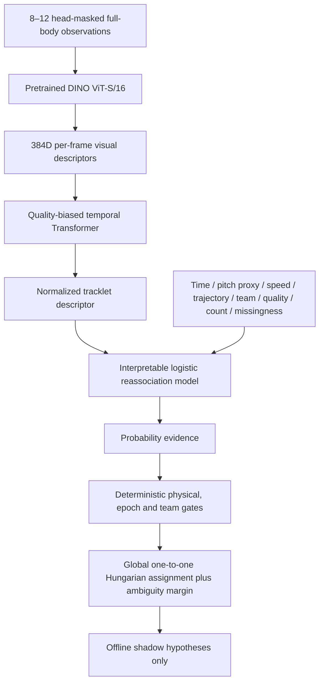

# TactiqAI CV Milestone 11 — Temporal Multi-Cue Soccer ReID

Verified 2026-11-02. **IMPLEMENTED / LOCALLY VERIFIED / EXPERIMENTAL.**

**M11 DOES NOT BEAT M10.** The bounded experiment is complete. A pretrained ViT, soccer tracklet fine-tuning, quality-aware temporal Transformer and learned multi-cue reassociation scorer were implemented and evaluated. Fine-tuning improves the new ViT baseline, but neither temporal aggregation nor the scorer beats the frozen M10 Soccer-OSNet. **M11 is not activated. M9 remains the serving player authority; M8 remains the camera authority.** No further training or threshold selection was performed after TEST.

## Verified held-out result and ablation

The primary comparison below uses **identical 8–12-frame tracklets for every model**, from two unseen matches. There are 43 eligible query/gallery identity pairs (87 total constructed test windows; one identity lacks both windows). These are organizer-annotation-defined sequences, not independently recovered physical player identities. Match galleries and the critical same-team restriction are fixed.

|Model|Same-team Rank-1|Rank-5|mAP|ROC-AUC|
|---|---|---|---|---|
|M9 generic OSNet|58.14%|86.05%|70.14%|0.7929|
|M10 Soccer-OSNet|86.05%|95.35%|91.03%|0.8978|
|M11 pretrained DINO ViT|58.14%|86.05%|69.41%|0.8437|
|M11 soccer-fine-tuned ViT|60.47%|100.00%|74.50%|0.8610|
|M11 ViT + temporal|58.14%|97.67%|73.26%|0.8559|
|M11 temporal + geometry proxy|58.14%|97.67%|73.26%|0.8571|
|M11 temporal + learned scorer|58.14%|100.00%|72.95%|0.8546|

The primary preregistered beat criterion required at least +3 percentage points in both same-team tracklet Rank-1 and mAP over M10. It fails decisively. ViT fine-tuning improves its own pretrained mAP (69.41%→74.50%); temporal attention reduces it to73.26%. The geometry proxy does not change ranking; learned scoring gives72.95%. The complete architecture cannot be claimed better because one component improves its own baseline.

For continuity with the original M10 evaluation, image models were additionally compared on the **unchanged 129 crop queries/43 identities and original 10–30-frame tracklets**:

|Image model|Same-team crop Rank-1|Rank-5|mAP|Original 10–30-frame weighted-tracklet mAP|
|---|---|---|---|---|
|M9 generic OSNet|28.68%|68.22%|33.71%|71.13%|
|M10 Soccer-OSNet|37.98%|79.84%|43.88%|93.69%|
|M11 pretrained DINO ViT|28.68%|69.77%|34.10%|70.24%|
|M11 soccer-fine-tuned ViT|32.56%|72.09%|37.77%|79.11%|

The new 12-frame M10 result (91.03%) differs from its original weighted 10–30-frame mAP (93.69%) because the sampled observations differ. They are different protocols, not a rewritten M10 result. Temporal models produce tracklet descriptors; no fictional single-crop temporal Rank-1 is reported.

|Model|Operating threshold|Same-team false-match rate|False-nonmatch rate|
|---|---|---|---|
|M9 generic OSNet|0.8200|87.38%|0.00%|
|M10 Soccer-OSNet|0.8200|46.19%|6.98%|
|M11 pretrained DINO ViT|0.8200|82.38%|0.00%|
|M11 soccer-fine-tuned ViT|0.8200|15.71%|34.88%|
|M11 ViT + temporal|0.8200|17.62%|32.56%|
|M11 temporal + geometry proxy|0.8200|22.86%|27.91%|
|M11 temporal + learned scorer|0.8993|1.43%|74.42%|

Cosine0.82 is retained as a descriptive operating point for visual descriptors; it is not a calibrated probability. The geometry mixture also uses0.82 for descriptive comparison. The learned probability threshold is **0.8992676100**, chosen only on same-team validation pairs to maximize recall subject to empirical FMR≤1%. These rates are annotation-defined pair rates, not actual application identity-switch rates. Pair dependence and two-match sample size prevent broad population guarantees.

## Baseline freeze and unchanged production

Before training, inspected current status/explorer, M9 report, M10 architecture/splits/datasets/checkpoints/history/retrieval/shadow/reference results and actual source structures. `frozen_m10.json` records SHA256s for the documents, M10 Python/config sources, all12 M10 checkpoints, manifests, selection, registry, held-out and shadow reports. Mandatory current-status documents are updated only at the end and excluded from the final immutability comparison.

`baseline_preservation.json` verifies M10 frozen inputs and the existing M8/M9 snapshots, deterministic team/reachability/global assignment code, analytics, serving registry and generic initializer. No production inference module or registry entry was changed for M11. No new M11 serving snapshot was created. The frontend still reads `test_match_m9_ready`, `team_goal_m9_ready`, `southampton_m9_ready`.

Independent identity/team/position confidence and uncertainty remain supported by the unchanged app: identity known/position unknown; team known/identity ambiguous; position known/identity unknown; competing reconnect hypotheses. The offline scorer never writes a canonical position, invents a player name or converts a probability into ground truth.

## Data audit and limits on expansion

Queried the official Hugging Face inventory at pinned revision `325bd4c57ee8e135ab652f3921d274526ada496b`. It contains **ten released MOT clips**. Longer panoramic half videos and GSR files exist, but a video inventory alone does not establish additional audited paired box identities. No new disjoint match/team identity source was verified. Inventory retained in `official_dataset_inventory.json`.

The66 eligible raw training sequence identities map to **51 unique registered players**. M10's train anchors already retain these51 without assuming cross-match positive identity labels or treating the same registered player as a negative under another sequence ID. Claiming66 new people or moving held-out teams into training would weaken the safeguards. **Substantial identity-count expansion was not achieved because legitimate additional disjoint supervision was not available under the frozen controls.** This part of the target remains unmet; no fabricated data or weak tracker pseudo-labels were substituted.

|Split|Matches|Crops|Annotated identities|Constructed tracklets|
|---|---|---|---|---|
|TRAIN|117093,118575,118576,118577|5361|51|294|
|VALIDATION|128058,132831|3612|32|64 retrieval windows|
|TEST|128057,132877|4867|44|87 retrieval windows|

Nominal train includes117092/118578, but their teams/players are excluded by held-out reservations. Match, registered player, team, annotation identity and source-video hashes remain disjoint across splits. No `test_match`, `team_goal` or `southampton` broadcast footage is supervised training data.

Identity target is the organizer MOT persistent ID **within its recording**; GSR `track_id`, registered `player_id`, annotation/image keys and generated M9 tracker IDs remain distinct. Existing inferred MOT→registered/team synchronization is preserved as metadata with limitations. No naive integer-ID joins, GSR alignment changes or cross-match biometric identity claims.

Reused all frozen head-masked M10 crop assets and source/crop/annotation hashes; every crop hash checked before training. M10 provenance already verifies paired official video byte hashes. No new videos were downloaded, uploaded or deleted for M11. The new dataset copies and clamps only its clipping display fraction; original M10 metadata, quality weights, crops and manifest remain unchanged. The historical rounding issue remains documented in M10.

## Tracklet construction and diversity

Training uses nonoverlapping40-second windows. Each needs at least8 distinct saved observations; select up to12, using temporal strata plus measured quality and scale/brightness/contrast/perceptual-hash diversity. During training select8 different observations from that tracklet. Source crops were sampled at least2seconds apart and near duplicates filtered in M10, so these are not16 adjacent nearly identical frames. Retrieval windows are10–70seconds and≥170seconds, with>90seconds separation.

Pose, true orientation, exact visibility and independent occlusion labels are unavailable. Scale, lighting, image quality and visual-change proxies encourage diversity; no quantitative front/back or pose coverage is claimed. Every tracklet preserves selected source sample/frame IDs, clocks, GT identity scope, quality and provenance.

Each training batch uses4 identities×2 tracklets:3 identities from one team,1 from another; positives within each identity. Same-team-preferred batch-hard triplet selects the nearest same-team negative when one exists. The visual stage actually sampled5,760 same-team and5,760 different-team negative sequence pairs; three of four identity anchors have same-team alternatives. No claim that75% of all M11 negative pairs were same-team. The scorer contains5,879 same-team training negatives.

## Architecture



Initializer: official [DINO ViT-S/16](https://github.com/facebookresearch/dino/blob/main/README.md), self-supervised ImageNet pretrained,approximately21million parameters/384D output. It is a stronger-capacity **candidate**, not an already soccer/person-ReID-pretrained model or an experimentally superior backbone. Weights: exact **86,710,517bytes**. Never trained from scratch. Model implementation from `timm==1.0.22`; no downloaded remote Python execution.

RGB full-body crops mask the top18% and retain aspect ratio in a neutral224×224 square; ImageNet normalization. This differs from OSNet's128×256 resize, so M10-versus-ViT comparisons evaluate complete preprocessing/representation pipelines, not a causal backbone-only experiment. No face model, face features, name recognition, jersey OCR or required jersey-number input. Visible kit texture may of course be present in ordinary body pixels.

**Visual adaptation:** freeze patch/position embeddings and first11 ViT blocks; cache their197×384 patch-token outputs in float16. Train the final transformer block, final norm and training-only51-class identity head. The loss is on quality-weighted **8-frame tracklet** descriptors, not just independent crop classification. Both identity CE and same-team-prioritized hard triplet margin0.3 apply.6epochs×80steps, AdamW lr0.00003, decay0.0005, gradient norm≤5. This is limited late-block adaptation, not full-backbone fine-tuning.

**Temporal aggregation:** staged training after the selected visual model is frozen. One Transformer encoder layer,4heads, feedforward width768, dropout0.1, relative-time linear encoding. Attention logit=`0.5*tanh(learned_logit)+log(max(quality,0.01))`; masked padding receives zero weight. This bounded correction gives poor frames a monotone quality prior; attention is not an independently calibrated visibility estimate. Pool visual plus0.1temporal residual, L2-normalize384D.12epochs×40steps, AdamW lr0.0001, same CE+triplet, embedding dropout0.05 and temporal subsampling. No pixel augmentation was possible after frozen-prefix caching; this is a limitation versus an end-to-end augmented regimen.

The actual TEST attention diagnostic has1044 selected frames, quality/attention correlation0.5941. This verifies a quality relationship, not that the learned attention improved identity accuracy. Unit tests cover deterministic inference, normalized vectors, padding invariance and low-quality downweighting.

## Learned multi-cue reassociation

L2-regularized logistic regression (`C=1`, max_iter2000) supplies an interpretable first small model rather than a more flexible tree/MLP. Median imputation with explicit missing indicators, standard scaling and coefficients are saved. It outputs a same-annotation-identity probability under its training pair distribution, **not a guaranteed calibrated broadcast identity probability**.

Inputs: visual cosine, team compatibility, elapsed seconds, pitch displacement metres, required speed m/s, camera uncertainty, trajectory residual metres, minimum quality, minimum observation count, visibility transition, geometry/uncertainty/visibility availability flags. No player ID, team ID, jersey, absolute pitch coordinate or match label is a model feature.

Pairs are chronological40-second GT windows in the same match, positive elapsed≤130seconds. Positives and negatives share window schedules; labels come from within-recording organizer identities. TRAIN **11,192 pairs/666 positives**; VALIDATION **8,126 pairs/443 positives**. Validation windows are reconstructed only to calibrate the scorer; no validation labels train visual/temporal/scorer weights.

Metric supervision uses **existing organizer image-to-pitch keypoints and the project's unchanged nonlinear interpolation**, with per-file hashes. These are pitch proxies, not independent GT localization or M8-camera training. No coordinate transform, supplied keypoints or GSR synchronization was altered.

**Important missing-cue limit:** camera uncertainty and actual visibility are entirely missing in training; geometry is missing outside supported calibration. Unknowns remain NaN with indicators, never fake zero error. The model therefore has no learned camera-uncertainty/visibility reliability evidence even though those input slots exist. Training uses fixed panoramic footage; real shadow footage has moving cameras, noisy boxes, fewer useful frames and often unknown geometry. The probability and count distributions shift.

At locked threshold, same-team VALIDATION FMR=0.98%, FNMR=84.65%. Held-out short-gap (≤8s) same-team pairs: **2,182 pairs/204 positives**, ROC-AUC0.9253, FMR0.56%, FNMR73.53%. Low false-match rate comes with a high missed-match rate. Saved calibration bins also show overconfidence; a low Brier score under many negatives is not proof of deployment calibration.

Geometry retrieval ablation is fixed `0.8*cosine+0.2*exp(-distance/(12*elapsed+3))`, applied only with available pitch proxy. Long retrieval gaps make that cue weak; identical ranking is expected to be possible. It does not certify a physical match and cannot be presented as learned geometry improvement.

## Real TactiqAI shadow results

Read original videos and **identical eligible M9 crop keys**, keeping raw boxes, frames, M8 camera epochs/coordinates, feature quality, kit histograms, segment construction and frozen team labels/strengths. Generic M9 graph replay exactly reproduces original accepted edges. Reused hash-validated M10 descriptors; no old cache overwritten.

|Source|M9 accepted / ambiguous|M10 accepted / ambiguous|Pretrained ViT|Fine-tuned ViT|Temporal|Temporal + scorer|
|---|---|---|---|---|---|---|
|test_match|1 / 1|1 / 3|2 / 0|0 / 1|1 / 1|0 / 2|
|team_goal|1 / 4|2 / 2|3 / 3|0 / 2|1 / 2|1 / 1|
|southampton|6 / 1|8 / 0|6 / 2|2 / 1|2 / 2|1 / 0|

All cells are **accepted / ambiguous target decisions**, not accuracy. Visual image-model ablations use M9 median segment aggregation. Temporal variants replace that with the learned descriptor from up to12 time-stratified quality-selected frames. Some real fragments have only3–7 eligible observations; they remain explicitly below the training support rather than inventing observations. Each frame/attention weight is retained.

The `temporal` graph still uses the frozen M9 evidence formula/appearance0.82/score0.78 and physical/global gates. The learned branch replaces appearance-only eligibility with learned probability evidence: original candidate geometry/image-continuity/team/epoch/time/quality checks run with the appearance floor0, then probability threshold0.8993 (also at least M9 score0.78), and original global alternative-assignment margin0.06. The existing weak-metric appearance≥0.90 prerequisite remains conservative. An additional physical veto checks known displacement/uncertainty; no score can override an impossible move. Unknown geometry still needs M9's short image-continuity support. This is an experimental evidence replacement, not a claim that the old uncalibrated appearance threshold can simultaneously remain the probability gate.

One-to-one Hungarian/dummy assignment, global alternative margin and acyclic nonoverlap checks remain deterministic. The offline assignment implementation is tested against original M9 evidence and the real replay. Strong team conflict, camera epoch discontinuity, stale gaps, simultaneous tracks, known impossible movement and insufficient position/image support cannot be rescued by high model probability. Current coordinates never come from the scorer.

Accepted totals: **M9 8; M10 11; pretrained ViT11; fine-tuned ViT2; temporal4; temporal+scorer2**. Fewer links alone is not improved accuracy. Duplicate violations and internally impossible accepted metric links are **zero for every variant**. Independent identity-switch/incorrect-reconnect accuracy remains **unavailable**. Existing qualitative references contain zero linked `APPEARS_DIFFERENT` examples in these variants, but do not cover all accepted edges or establish safety.

Reviewed all26 existing M9 cases, applying the explicit M10 reference amendment without rewriting old evidence. Temporal retains the plausible test_match437→521 link; the scorer makes it ambiguous. Temporal links team_goal0→92 but scorer instead retains the distinct orange-keeper426→489 path. Southampton temporal retains two linked fragments around332→417→572, while the scorer retains371→471. Full candidate/event/reference JSON records competing hypotheses and rejected links. Existing references include pans, disappearance/reappearance, tiny crops, teammates and longer gaps, but are not a balanced independently annotated crossing/reappearance benchmark.

## Failure analysis and measured scope

M11 temporal has **18 wrong same-team Rank-1 queries out of43**; **14 queries where M10 succeeds and M11 fails**. `failure_examples_0.jpg` and `_1.jpg` were inspected: wrong neighbours share kits; body detail is small/blurred; pose and lighting change. These are qualitative observations, not independently labelled cause categories. Scores alone do not prove a source annotation is wrong.

`training_curves.png` shows decreasing loss without corresponding temporal validation improvement. `heldout_ablation.png` shows M10 ahead. No post-TEST retraining, epoch search, threshold change, learned geometry redesign or favourable component cherry-picking was performed. This bounded run does not establish that ViTs or temporal models cannot work;51 identities, limited late-block adaptation, padding/preprocessing, no pixel augmentation, narrow panoramic data and weak broadcast cue supervision constrain the conclusion.

M10 TEST was already published in the previous milestone. M11 parameters/configuration/protocol were locked using TRAIN/VALIDATION before M11 TEST inference, but this is a **reused held-out comparison, not a fresh prospective test set**. Geometry/missingness errors and annotation/roster inference limitations remain. A future iteration needs more legitimate disjoint identities, new evaluation labels and validation-only calibration, not repeated tuning to these two test matches.

## Hashes, runtime and storage

|Artifact|SHA256|
|---|---|
|Pretrained DINO initializer|`1566d50496f27f52f07fea6094fa29b2fdd6fae89da65bdd3ebc3b24ef6b7eb7`|
|Selected visual epoch6 delta checkpoint|`283b48e5fba2ed101b6ee0de63905b4c7bd6ccf70da410cbe25b6f8006a404a2`|
|Selected temporal epoch10 checkpoint|`addcad75547c6363528f6251a7a14a624eb553060c57a6c0a08b70db2d0b5558`|
|Learned reassociation pipeline|`34a37cc59d749b7caa7027c080f94f4ff86216673b56c3f84b739a0730b80466`|
|M11 dataset manifest|`f7619453928470fadb7958d8376a3ebcec347c95fd09d639273b929a05e65df8`|
|Training configuration|`813879a428cb1d4a9cc35a382e78caadd6401bfff8a1421e5313b4100ae4d6da`|
|Evaluation protocol|`831a6a151f09cbdb411916eefae93b94aa06f70d91b46b67e97cca1653c8e3d3`|

Visual delta checkpoint needs the frozen initializer; it is not a standalone full-backbone file. All6visual/12temporal candidate checkpoints, histories, selected hashes, seeds, package versions, frozen inputs, caches and source snapshots are retained. `selection_lock.json` is immutable; final registry separately records evaluated/integration status. Optimizer state was not saved in these compact M11 delta checkpoints; exact interrupted-step resume is not supported. Retraining is seed-controlled but MPS is not claimed bitwise deterministic.

Apple M4/16GB unified-memory runtime, MPS, Python3.12.14, Torch2.14.1, torchvision0.29.1, timm1.0.22, scikit-learn1.9.1. Runtime environment JSON includes actual remaining package versions.

- Training epoch timers total **69.60s** (temporal timers include small validation overhead).
- Visual/temporal model-selection wall **86.14s**; excludes precomputed-prefix setup/scorer fit.
- All train/validation/TEST prefix inference **84.40s**.
- Final held-out evaluation **34.63s** including TEST-prefix computation, so do not add both totals as disjoint elapsed time.
- All three shadow sources **55.82s**.
- Research directory approximately2.2GiB at verification, dominated by float16 token caches. Peak training memory was **not measured**. No cloud GPU or storage write.

Research outputs and weights remain under ignored `outputs/ml/soccer_reid_m11`; no videos, large tensor caches or checkpoints added to Git. Optional isolated dependencies are in `requirements-reid-research.txt`, not production requirements. Versioned code:`ml/reid11/`;tests:`tests/test_cv_reid_m11.py`;configs:`configs/ml/temporal-soccer-reid-v1*.json`.

## Regression verification

- **666 backend tests run:665passed, one expected optional-media skip**, including24new M11 tests. Covers data temporal separation, minimum useful observations, head masking, normalized/deterministic attention, padded-frame invariance, quality prior, missing geometry, metric units, impossible/overlap/epoch/team/stale gates, validation FMR threshold, TEST seal, no identity-feature leakage, deterministic global replay and rejection of ineligible high-probability links. Existing M8/M9/Azure/Ask tests pass.
- **86frontend tests/15files passed; TypeScript/production build passed.** Initial sandbox attempts could not write Vite's existing external dependency cache; rerunning with appropriate filesystem access passed without source/config changes.
- **Nine CV Chrome suites passed**, including all three sources, smooth frame overlays, M8 geometry and M9 inspector/unknown current position/CV Ask503. The Azure suite initially timed out at first-video readyState0; an isolated unchanged retry passed **all10Azure clips,35.4s test/36.4s total**. This was not one clean all-suite browser run.
- Live `/health`, `/ready`, `/recordings` returned200; readiness13usable recordings. All three CV metadata responses remain camera`m8`/player`m9`. Azure118575 recording view200, video Range206/1,024bytes, grounded Local Ask200 with6evidence rows. No production model selection UI or setting change required.
- Python compilation, JSON parsing, `git diff --check` and frozen-baseline verification pass. Logs under `outputs/ml/soccer_reid_m11/verification` preserve actual outcomes, including the first browser timeout and retry.

## Reproduction and inspection commands

Current frontend remains http://127.0.0.1:5173. Backend command unchanged, from repository root:

```sh
AZURE_TOKEN_CREDENTIALS=AzureCliCredential MATCHMIND_PROVIDER=local \
 MATCHMIND_CACHE=/tmp/matchmind-azure-startup-cache \
 TACTIQAI_BACKEND_PYTHON=/tmp/tactiq-cv-m1/bin/python scripts/start_backend.sh
```

Offline new-run reproduction requires retained M10 audited crops/artifacts and authorized official dataset access. Use a **new root**; completed experiment selection/TEST files refuse overwrite. Do not run another experiment against this TEST to choose a better model.

```sh
uv pip install --python /tmp/tactiq-cv-m1/bin/python -r requirements-reid-research.txt
export TACTIQAI_REID11_RUN_ROOT=/tmp/tactiq-reid-m11-reproduction
/tmp/tactiq-cv-m1/bin/python -m ml.reid11.setup --download
/tmp/tactiq-cv-m1/bin/python -m ml.reid11.data
/tmp/tactiq-cv-m1/bin/python -m ml.reid11.features train validation
/tmp/tactiq-cv-m1/bin/python -m ml.reid11.train
/tmp/tactiq-cv-m1/bin/python -m ml.reid11.scorer
/tmp/tactiq-cv-m1/bin/python -m ml.reid11.evaluate
/tmp/tactiq-cv-m1/bin/python -m ml.reid11.shadow
/tmp/tactiq-cv-m1/bin/python -m ml.reid11.report
```

Exact completed experiment lives in the default repository output root. Code-source and training manifests/hashes are authoritative for this run; setup/reproduction packaging added afterward does not retroactively alter training. Existing `executed_source` records this run's implementation. Training uses no download at application startup.

Regression commands:

```sh
/tmp/tactiq-cv-m1/bin/python -m unittest discover -s tests
cd frontend
npm test -- --run
npm run build
TACTIQAI_AZURE_BROWSER=1 TACTIQAI_AZURE_REQUIRE_ANALYSIS=1 \
 ./node_modules/.bin/playwright test --config playwright.m9.config.ts
```

[Portable measured results](evidence/cv_m11_results.json) · [M10 retained baseline](cv_soccer_reid_m10.md) · [current pipeline status](current_pipeline_status.md).

**IMPLEMENTED:** pretrained ViT experiment, tracklet-supervised late adaptation, quality-aware temporal model, interpretable scorer/missingness, all requested representation/geometry/scorer ablations and real-video shadows. **UNMET:** substantial new disjoint identity supervision, learned uncertainty/visibility evidence, better-than-M10 held-out and application decisions. **NOT INTEGRATED:** M11 in serving. **FUTURE ONLY:** more legitimate labelled identities, fresh broadcast identity/cue labels and validation-only model/calibration research.

No ball perception, new analytics, commentary/provider changes, camera retraining, face recognition or jersey OCR work. Existing TactiqAI branding and MATCHMIND variables preserved. Stopped after M11.

**M11 DOES NOT BEAT M10**
