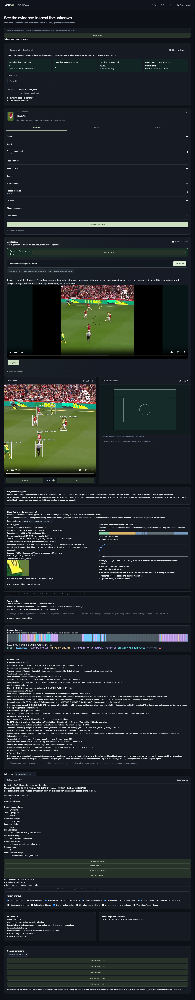
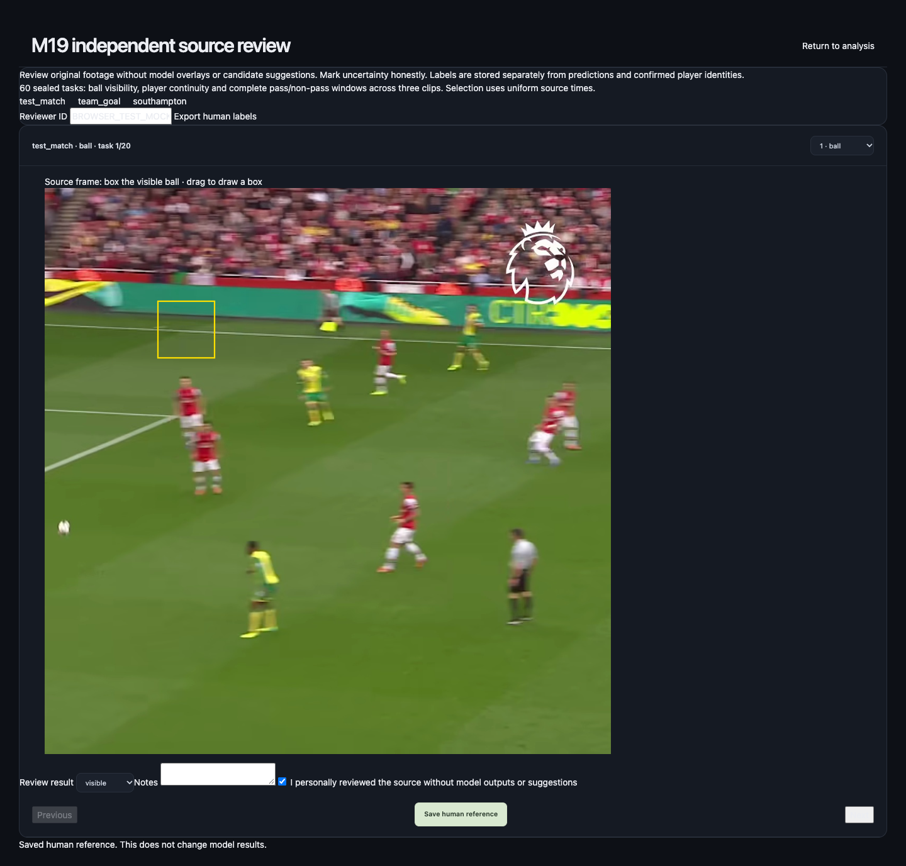

# TactiqAI M19 — Video-only tracking and pass evidence

Verified 2026-11-15. **Opt-in experiment and independent review workflow implemented. Independent accuracy acceptance remains pending human labels.** The user confirmed no labels exist. The three short clips processed successfully; the full Tottenham–Arsenal CV run remains deferred.

## Actual findings

| Clip | Frozen candidates | Direct observations before → M19 | Observed track changes before → M19 | Longest direct run before → M19 | Qualified estimates before → M19 | Candidates before → M19 |
|---|---|---:|---:|---:|---:|---:|
| test_match | M14 | 214/541 → 216/541 | 10 → 16 | 28 → 28 | 0 → 0 | 5 → 5 |
| test_match | M16 | 393/541 → 408/541 | 19 → 11 | 35 → 37 | 0 → 1 | 8 → 9 |
| team_goal | M14 | 39/500 → 40/500 | 10 → 12 | 6 → 6 | 0 → 0 | 1 → 1 |
| team_goal | M16 | 6/500 → 6/500 | 2 → 2 | 3 → 3 | 0 → 0 | 0 → 0 |
| southampton | M14 | 163/660 → 165/660 | 9 → 11 | 16 → 16 | 0 → 0 | 2 → 2 |
| southampton | M16 | 77/660 → 96/660 | 13 → 11 | 13 → 13 | 0 → 0 | 2 → 2 |

These are coverage and continuity diagnostics on all 1,701 source frames, not detection accuracy. “Observed track changes” compares successive direct observations, including across gaps; it is not a human-verified ID-switch count. The baseline eight M14 transfers still produce zero qualified estimates. M19 with frozen M16 candidates produces **one qualified estimate and 11 candidates** (9 test_match, 0 team_goal, 2 southampton). M14 remains the default. M19/M16 is explicitly selectable; it is not uniformly better: M14 has substantially better coverage in team_goal and southampton, and M19 worsens M14 track fragmentation.

## Baseline audit and root causes

Audited `cv_pass_detection_v1.md`, `player_focus_update.md`, canonical `unified_match_assistant_m18.md` (no `(2)` copy in this checkout), the M9 world model, M14/M16 trackers, pass gates, assistant and serving registries. Frozen input/source-code hashes and diagnostics are in [baseline evidence](evidence/cv_m19_baseline.json).

Overlapping rejection reasons for the eight M14 candidates:

- `INSUFFICIENT_OBSERVED_BALL_COVERAGE`: 7 of eight candidates.
- `BALL_OBSERVATION_GAP`: 6 of eight candidates.
- `BALL_TRACK_DISCONTINUITY`: 5 of eight candidates.
- `NO_OBSERVED_RELEASE_AND_FLIGHT`: 1 of eight candidates.
- `RECEIVER_NOT_VISIBLE_AT_RELEASE`: 2 of eight candidates.
- `INSUFFICIENT_SAME_FRAME_PLAYER_SEPARATION`: 1 of eight candidates.
- `OPPONENT_TRANSFER_NOT_PROVEN_PASS_ATTEMPT`: 2 of eight candidates.
- `TEAM_UNCERTAIN`: 2 of eight candidates.
- `CONTESTED_LOWER_BODY_CONTACT`: 1 of eight candidates.

Counts overlap; they do not sum to eight. Sparse direct ball observations and ball-track discontinuity dominate. The accepted-contact pipeline excludes ambiguous/unknown player identities. Unknown teams also prevent qualification. Existing appearance-segment provenance is retained. Ball gaps cannot be repaired by counting extrapolated coordinates as observations.

## Changes and controlled comparisons

`src/vision/ball19/tracker.py` implements one-to-one Hungarian association, avoiding one current candidate updating several branches, with one repeated-visual birth gate instead of stacked temporal gates. It uses actual elapsed time, accepted M8 camera transforms, epoch/cut resets, multiple competing hypotheses, explicit ambiguity and bounded occlusion prediction. Direct coordinates are exact current detector candidates at the **unchanged** source operating threshold (M14 0.5; M16 0.35). Predictions remain prediction-only, never current image boxes, observed pass-flight samples or metric ball positions. M19 has no verified ball ground height; metric ball coordinates stay unavailable. This experiment uses frozen detections, not newly trained weights.

`configs/vision/cv_m19.json` freezes the settings. M19 allows 0.35 seconds of hypothesis survival, matching the existing M14 upper bound; frozen M16 used 0.12 seconds. An explicit **0.12-second M19 ablation** on the identical inputs gives M16-source observed frames **391/6/89**, track changes **23/2/19**, and **zero qualified passes**. At 0.35 seconds those are **408/6/96**, **11/2/11**, and **one**. Thus the gain cannot be attributed solely to one-to-one matching. Retained hypotheses can match later real detections; gap coordinates still do not count as observations. Numeric pass gates never changed.

A fresh inference benchmark separately ran both existing checkpoints on the same 36 uniformly selected source frames: M14 generic tiled Faster R-CNN took **28.392 seconds on CPU**, M16 YOLO took **4.206 seconds on MPS**, excluding **0.170/0.261 seconds** loading. This measures the configured paths on different devices, not a fair architecture speed ranking or detection accuracy. No checkpoint was trained or modified. Full-clip neural inference was reused; per-clip association timings and model SHA-256 values are in [portable results](evidence/cv_m19_results.json). Raw benchmark predictions remain local in `outputs/m19/detector_benchmark.json`.

`src/vision/events/m19_players.py` checks short occlusion links using learned M9 appearance embeddings, histogram, shape, endpoint geometry, epoch, team compatibility and unique assignments. Cross-entity proposals require review and never merge identities or inherit manual confirmations. Actual supported links and cross-entity proposals were **0/0 in every clip**. No improvement in player identity accuracy or team accuracy has been demonstrated. This conservative layer does not rewrite M9 snapshots. Next justified work is independently reviewed continuation labels, camera-compensated player-link motion and stronger ball detection for team_goal; reducing gates to manufacture counts is unjustified.

`src/vision/events/passes_m19.py` reuses v1 pass gates. Receiver-at-release fallback can use a different source segment only when it already has the same unique M9 entity. Source segment/entity references stay explicit; uncertain identities are never merged. The one estimate also qualifies without that fallback, so it is not evidence of improved identity association. The 4-second config default is normalized to `4.0` so serialization preserves config/event hashes; the numeric threshold is unchanged. Existing stored v1 artifacts remain untouched.

## Precisely supported example

`test_match`, M19 on M16 detections: release **frame 66 / 2.752750 seconds**, receipt **frame 83 / 3.461792 seconds**. Sender `segment:0:TRACK_00018:32` / existing M9 `PLAYER_016`; receiver `segment:0:TRACK_00017:31` / `PLAYER_015`. The shared team is an estimate. Direct supporting ball frames: **66–75, 79, 83**, 12 of 18 (**66.7%**), one track ID, maximum missing gap 0.125 seconds. Every original contact, separation, observed-flight, gap, continuity and team-support gate passes. The source evidence, contacts, endpoints and rejection reasons are exported to JSON/CSV. **This is not a human-confirmed pass.** Attempts, completion accuracy, goals, shots, tackles and verified possession stay unavailable/null.

M19 serving verifies manifest hashes, schema, source clocks and all upstream sources, replays event gates, then recomputes each evidence frame from the validated world and ball source. Corrupt or forged evidence is rejected. Missing optional M19 outputs return 503 for explicit M19 queries; the baseline stays usable. No unrelated local artifact fallback is added.

## Human reference workflow — ready, no labels yet

Open [test_match review](http://127.0.0.1:5173/?recording=test_match&review=m19), [team_goal review](http://127.0.0.1:5173/?recording=team_goal&review=m19), or [southampton review](http://127.0.0.1:5173/?recording=southampton&review=m19). The CV page also links to **Independent source review**.

The sealed task file contains **60 uniformly timed tasks**, selected without consulting model candidates: 36 ball frames, 12 three-second pass/non-pass windows and 12 continuity pairs. It is a small development sample, not an untouched generalization test. Review original imagery without model overlays, enter a reviewer ID, draw source-coordinate boxes or mark uncertain, and explicitly attest to source review. For pass windows, mark release/receipt frames for every completed pass, or save an exhaustive reviewed window with no passes as a negative. Do not mark an uncertain window as a negative. Identity tasks compare two boxed players without assigning names. The image clock, bounds, task fingerprint and video hash are checked.

Human labels live separately in ignored `outputs/m19/human_review/labels.json` (override with `MATCHMIND_CV_REVIEW_ROOT`). Saving labels never changes detections, snapshots or player confirmations. Export using **Export human labels**. Browser tests mock saves and wrote **zero** real human labels.

```sh
# Existing verified backend runtime, or an equivalent environment with the project dependencies.
PYTHON=/Users/greatabhieyighan/Library/Caches/TactiqAI/backend-m17/bin/python
"$PYTHON" -X pycache_prefix=/tmp/tactiq-m19-pycache -m scripts.prepare_cv_m19_review
"$PYTHON" -X pycache_prefix=/tmp/tactiq-m19-pycache -m scripts.run_cv_m19 --output outputs/m19/new_run
"$PYTHON" -X pycache_prefix=/tmp/tactiq-m19-pycache -m scripts.install_cv_m19 --root outputs/m19/new_run
"$PYTHON" -X pycache_prefix=/tmp/tactiq-m19-pycache -m scripts.evaluate_cv_m19 --root outputs/m19/new_run --labels outputs/m19/human_review/labels.json --reviewer YOUR_ID
```

Use a fresh experiment directory; never overwrite earlier experiments. Task preparation verifies the sealed dataset instead of silently replacing it. Actual verified run is `outputs/m19/run_v3`; the ablation is `run_ttl012`; a second run `run_reproduce` matches all 30 checked ball/canonical/event/evidence/player-link byte hashes. Eighteen original video/world/ball/checkpoint/upstream-code hashes were independently rechecked unchanged.

Evaluation reports selected directly observed ball-output box precision/recall (IoU ≥0.25), one-to-one pass endpoint matching (≤0.25 seconds), false positives per exhaustively reviewed minute, and identity-pair agreement after unique visible-player box matches. Unknown visibility, uncertain pass windows and unmatched identity boxes are excluded and counted. Candidate transfers never become positive pass predictions. Duplicate reviewers require an explicit reviewer selection or adjudication. Zero denominators stay null, with sample counts and Wilson intervals where defined. It evaluates frozen M14, frozen M16 and both M19 association variants on the same references. Model candidates, synthetic tests and automated visual review are prohibited as ground truth. **Actual independently reviewed labels: zero; actual precision/recall/F1 and identity accuracy: undefined.** Independent-reference acceptance remains outstanding.

## Frontend, assistant and Azure

Select a CV recording at localhost:5173, then **Ball review → M19 association · opt-in**. The pass panel, player profile and unified assistant share the selected event version. Changing versions clears the previous answer/video/context and uses separate event indexes while retaining the same source-scoped player catalog and manual identities. Qualified estimates remain separate from candidates; source seeking, player focus and visibly labelled candidate-review videos remain available. Baseline selection restores existing M14 behavior.

No Azure environment variable rename, upload, deployment, media deletion, canonical analytics, possession, GSR alignment or grounding change was made for M19. Raw short-clip originals remain local because these CV reviews need them. Azure SoccerTrack playback still streams from Azure. Do not delete local CV originals. Readiness counts usable recordings, not the existence of optional M19 sidecars. Original football Ask for CV stays 503; the unified assistant exposes only validated experimental pass evidence. Canonical Ask on 118575_clip returned supported facts with the established pass-total question.

```sh
AZURE_TOKEN_CREDENTIALS=AzureCliCredential MATCHMIND_ARTIFACT_STORE=azure \
MATCHMIND_PROVIDER=local MATCHMIND_CACHE=outputs/cache/azure_m17 \
MATCHMIND_HIGHLIGHT_CACHE=outputs/highlights_m18 \
TACTIQAI_BACKEND_PYTHON=/Users/greatabhieyighan/Library/Caches/TactiqAI/backend-m17/bin/python \
scripts/start_backend.sh
# In a second terminal:
npm --prefix frontend run dev
```

## Validation and changed files

Backend: **989 run, 988 passed, one expected skip**. Frontend: **125 passed**, TypeScript and production build passed. Focused tests cover one-to-one association, birth support, prediction exclusion, cuts, ambiguity, confidence, clock, camera warp, link/team collisions, unchanged pass gates, same-entity source provenance, forged gate evidence, source-checked human labels, unknown/exhaustive-window semantics and metric arithmetic. Synthetic regressions are not accuracy evaluation. Six Chrome integration cases passed: all three baseline CV clips; Azure full halves; M19 player-specific pass video, seeking and model-blind review; score/heatmap/pass-map/goal compilation; player focus/marked videos; team_goal timeline. Live health and readiness are 200 (15 usable recordings); all three clip ranges return 206; canonical SoccerTrack view and grounded Ask are 200; explicitly unavailable M19 returns 503. Canonical CV Ask remains 503. Human labels written by browser tests: zero.





Core new files are `src/vision/ball19/`, `src/vision/events/{m19_players,passes_m19}.py`, `src/evaluation/cv_m19.py`, `src/serving/cv_review_labels.py`, `frontend/src/CVHumanReview.tsx`, the M19 configs and preparation/benchmark/replay/install/evaluation scripts. Integration updates `passes.py`, `cv_events.py`, ball schema, serving app, assistant request/service/profile paths, CV/player/assistant frontend components and recording routing. Tests, evidence, this report, pipeline status/explorer and Azure/frontend documentation accompany them. The GitHub push also needs the previously uncommitted M16/M17/M18 and pass-v1 dependencies; no videos, weights, outputs, credentials or human-label stores belong in Git.


## Review control visibility correction — 2026-11-17

Native buttons inherited the page's pale text but retained browser-default light backgrounds; unstyled fields and inline labels also crowded together. Scoped `.human-review` styles now define button/field surfaces, text, disabled states and focus treatment. Action groups, checkbox labels, reviewer setup, notes and navigation have explicit spacing and mobile wrapping. Review behavior and annotation data are unchanged.

The existing two review form tests and typed production build passed. Live Chrome checks at 1440×1100 and 390×844 verified all ten pass-review controls, minimum text contrast **7.83:1**, readable disabled controls, receipt-button enabling and no horizontal control overflow or page errors. Desktop/mobile screenshots were inspected locally. No annotation-save endpoint was called. [Measured visibility results](evidence/review_control_visibility_2026_11_17.json).


## Review save validation fixed (2026-11-18)

The review form now blocks incomplete submissions and shows **To save this task** guidance before any request. Both player boxes are required for same/different continuity labels; visible balls require valid boxes; pending releases, same-frame/reversed/out-of-window pass marks and invalid reviewer fields cannot be submitted. A browser timestamp precision bug that could turn pass-window start frame 31 into frame 30 is corrected. The exact field behind the user's original 422 is not available from the console trace alone; these client-side failures were independently reproduced.

Specific backend validation errors now appear beside Save; failed requests keep edits, duplicate in-flight saves are blocked, and success clears when fields are edited again. Save requires the server's positive acknowledgement. There is no automatic save or retry while editing. Server validation and human-reference semantics remain unchanged. **All 17 existing saved annotations are byte-for-byte unchanged.** Verification: **155 frontend tests, eight existing backend annotation-validation tests, typed build and three Chrome cases passed**. Browser writes were mocked; two captured valid payloads passed the real validator without saving. [Results](evidence/review_save_validation_2026_11_18.json).
