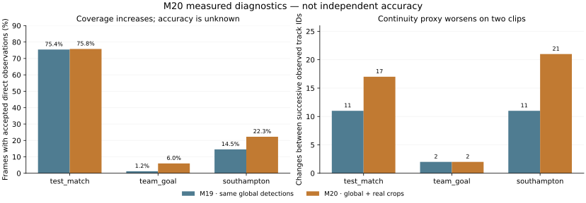
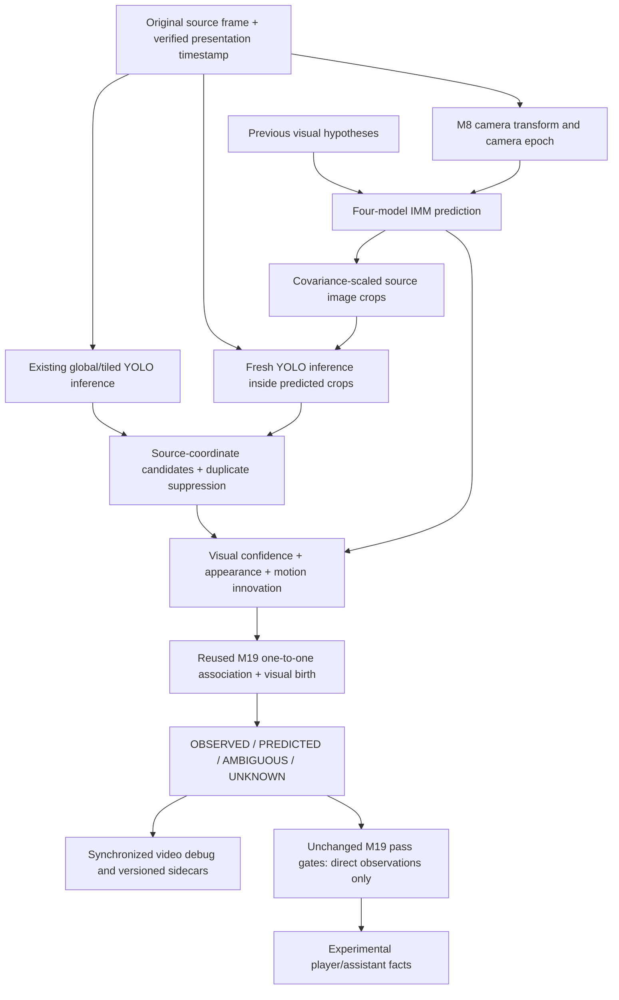
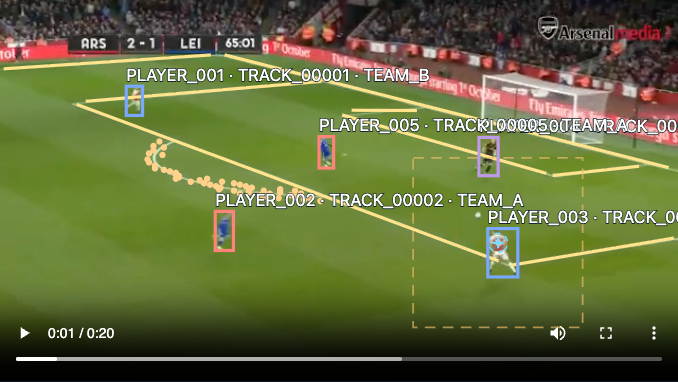
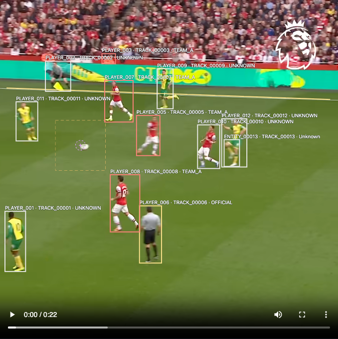

# TactiqAI M20 — Trajectory-guided ball detection and tracking

Verified **2026-11-18**. **Engineering complete as an opt-in experiment; completed human-sample evaluation does not establish accuracy acceptance.** All 60 source reviews are now saved and evaluated: M20 ball precision/recall **71.4%/32.3%** versus M19 **81.8%/29.0%** on 34 known frames (31 visible). M20 gains one correct detection and two false detections; both versions match **one of seven** reference passes. M20 misses all 11 reviewed visible balls on team_goal. M14 remains default. [Completed human evaluation, counts and limits](cv_human_evaluation_2026_11_18.md) · [Aggregate evidence](evidence/cv_human_evaluation_2026_11_18.json).

The engineering measurements below retain their original snapshot: only four reviews had been saved at implementation verification. Those four were preserved then; the user subsequently completed the remaining reviews. No expensive training, checkpoint download, paid model call, Azure upload or long-match CV run was performed.

## Demonstrated result

Real visual inference ran on **all 1,701 source frames** of test_match, team_goal and southampton, using the existing soccer YOLO11s checkpoint. M20 additionally executed **1,199 trajectory-guided crop views** on current source pixels. It is not merely a spatial filter over cached full-frame detections. Crops are planned before current detections are available.

| Clip | M14 frozen | M16 frozen | M19 same globals | M20 + guided crops | M19 → M20 track changes | M19 → M20 longest observed run | Qualified estimates / candidates, M20 |
|---|---:|---:|---:|---:|---:|---:|---:|
| test_match (541 frames) | 214 | 393 | 408 | 410 | 11 → 17 | 37 → 36 | 1 / 9 |
| team_goal (500 frames) | 39 | 6 | 6 | 30 | 2 → 2 | 3 → 7 | 0 / 0 |
| southampton (660 frames) | 163 | 77 | 96 | 147 | 11 → 21 | 13 → 19 | 0 / 2 |

Numbers in the four middle coverage columns are accepted directly observed frames, not independently verified ball detections. M19 and M20 use identical fresh global/tiled detections; M20 adds actual crop inference. Frozen M14/M16 are historical model baselines with their original operating points, not calibrated cross-model accuracy comparisons. Baseline pass estimates/candidates independently reproduce as M14 **0/5, 0/1, 0/2**, M16 **0/8, 0/0, 0/2**, and M19 **1/9, 0/0, 0/2** for the three clips.

**The result is mixed.** Coverage increases against M19, but observed track changes increase on test_match and southampton; the longest test_match observed run falls from 37 to 36. M14 still has greater coverage than M20 on team_goal and southampton. More accepted detections or more reacquisitions do not establish greater accuracy. No additional qualified pass is found. **M14 remains the default; M14/M16/M19 remain selectable.**



## Architecture and reused components

The audit covered `cv_tracking_passes_m19.md`, `cv_pass_detection_v1.md`, M14/M16/M19 tracker code, M8 camera transforms, detector checkpoints/thresholds/caches, event validation, serving and the player/assistant UI. M14 supplies existing camera utilities and the global detector infrastructure; M16 supplies the fine-tuned YOLO11s checkpoint and full-image/tiled inference; M19 supplies Hungarian one-to-one assignment, repeated visual birth, bounded track hypotheses, epoch resets and unchanged pass gates. M19's default path is retained; two optional hooks accept M20 motion priors and association costs.



The motion bank implements standard interacting-model mean/covariance mixing and likelihood-based mode updates, following the [FilterPy IMM reference implementation](https://filterpy.readthedocs.io/en/latest/_modules/filterpy/kalman/IMM.html). This project uses its own small NumPy/SciPy implementation and existing dependencies; it does not install a new filtering package.

The state is `[x, y, vx, vy, ax, ay]` in image pixels, pixels/second and pixels/second². All four modes share this state so they can interact:

- **constant_velocity**: compatible with short rolling or smooth image motion; acceleration decays.
- **curved_acceleration**: acceleration persists, supporting curved image motion compatible with projected flight or camera effects.
- **maneuver**: greater process noise supports abrupt turns, touches, bounce-like direction changes and deflections.
- **occlusion_diffuse**: greater uncertainty supports uncertain motion through short losses.

A continuous-time transition matrix uses actual elapsed timestamps, not a hard-coded frame step. Each mode predicts covariance and updates from visual measurement residuals; Gaussian likelihoods update normalized mode probabilities. A Joseph covariance update preserves numerical stability. The mixture tracks its mean, velocity, acceleration, covariance, model probabilities and visual-measurement age for each retained hypothesis. The frontend also shows elapsed time since the last **accepted** observation, separately from a competing hypothesis's measurement age.

**Gravity is not hard-coded as pixels/second².** The camera projection, depth and height needed to convert metric gravity are unknown. Curved acceleration is an image-space hypothesis compatible with projected gravitational motion, not a ballistic-height estimate. Upward image motion never establishes that the ball is airborne. No authoritative ball pitch coordinates, 3D position or height are exported.

## Camera and recovery behavior

M20 reuses accepted M8 adjacent field motion or camera-plane transforms. A local homography Jacobian transports state and covariance into the next image before motion prediction. Extreme/degenerate Jacobians are rejected; unsupported camera motion is explicitly recorded and inflates uncertainty. Camera-plane warps remain approximations for unknown-height objects. All image detections remain exact source-coordinate visual evidence.

Epoch changes and broadcast cuts clear motion/appearance hypotheses. No interpolation crosses a cut. Prediction age, covariance growth and a 0.35-second hypothesis TTL limit useful predictions. New global detections can seed unexpected trajectories, but require repeated current visual support before confirmation. Multiple plausible tracks remain explicit; none is forced into an observation when selection is ambiguous. Tests cover variable timestamps, pans, zooms, invalid transforms, occlusion, direction changes, reacquisition, ambiguity and cuts. Synthetic motion checks are engineering regressions, not match accuracy.

The engine consumes timestamps. For these three fixed-rate sources, ffprobe presentation timestamps were verified against every immutable world-frame clock (within microsecond precision), then passed to the tracker. Generic VFR ingestion/world-clock migration is not implemented; an incompatible source/world clock is rejected rather than silently resampled.

## Real guided visual inference

`configs/vision/cv_m20.json` freezes the experiment. The existing fine-tuned **YOLO11s** checkpoint is `outputs/ml/ball_m16/training/soccer11s/weights/best.pt`, SHA-256 `638dc0baeed14f0cb4cb50f55454840a7614928405f5886381f70793439db4df`. Runtime: Ultralytics **8.4.208**, Torch **2.15.0**, OpenCV **5.0.0**, local **MPS**, four CPU threads. Model loading took **2.607 seconds**, outside frame-inference timings. No weights changed.

The crop adapter supports 320–1280 inputs aligned to 32 pixels; this experiment uses **640** for global and crop inference. Crop images are taken from the current decoded source frame and passed to the detector. Ultralytics returns boxes mapped back to each input crop; the adapter adds the crop offset and validates source bounds. See the [official prediction interface](https://docs.ultralytics.com/modes/predict/). Non-square and resized-crop coordinate behavior is regression-tested.

Covariance determines search centers and crop sizes, bounded at **160–512 source pixels**, with at most **three regions**. Competing supported hypotheses can produce separate regions. Regions expand with uncertainty. The M19 operating threshold remains **0.35**, visual birth requires **two frames**, the existing association ambiguity margin is **0.12**, and the TTL remains **0.35 seconds**. Raw low-score candidates may be retained for diagnostics, but cannot become observed below the visual threshold.

Association uses detector confidence, covariance-normalized innovation, camera-compensated prediction and a lightweight source-patch HSV appearance comparison. An innovation gate (squared Mahalanobis distance ≤16) and appearance support act on associations. The rank blends 0.65 visual confidence, 0.20 temporal support and 0.15 appearance; it is not a calibrated probability. Trajectory proximity alone never creates a detection or raises its neural confidence. Duplicate suppression does not count two overlapping crops as two birth observations.

For a fair first control, **global/tiled detection runs on every frame** and is shared by M19/M20. This is a conservative period-one global-reacquisition schedule; adaptive local regions add compute. The runner intentionally fixes this matched control and does not claim a lower-cost production schedule or real-time inference. Reduced global frequency remains a separately justified future experiment.

## Computational cost and proxy measurements

| Clip | Global detector seconds, shared with M19 | Additional crop seconds | M20 inference median / p95 | Crop views | Mean summed crop area / source frame | Full paired processing seconds / FPS |
|---|---:|---:|---:|---:|---:|---:|
| test_match | 51.268 | 13.529 | 112.7 / 136.7 ms | 686 | 3.81% | 67.365 / 8.03 |
| team_goal | 8.108 | 1.591 | 16.7 / 44.8 ms | 71 | 1.58% | 10.153 / 49.24 |
| southampton | 84.780 | 8.960 | 131.9 / 181.4 ms | 442 | 2.34% | 96.411 / 6.85 |

Crop area is the sum of crop pixels divided by total source-frame pixels, averaged over all frames; overlaps are not a union. Inference medians/p95 include global plus crop detector calls, not just the filter. Paired processing includes decoding, both trackers and record preparation. Playback uses precomputed outputs and is distinct from live inference throughput.

The same 17 uniformly timed review frames that had planned regions supplied **23 identical crop views** to both 640 and 960. The measured single-pass totals were **1.281 seconds / six above-threshold candidates** at 640 and **0.930 seconds / one above-threshold candidate** at 960. This small ordered benchmark includes warm-up/shape effects; it is not a hardware-neutral speed ranking. No human truth establishes whether the additional or missing candidates are correct, so **false-positive rate and independent precision/recall remain unavailable**. There is no basis to promote higher resolution or download a larger checkpoint from this result; 640 remains configured.

A motion-only ablation reuses the exact verified global detections while removing all local crop candidates. It accepts **402/7/90** frames, versus **410/30/147** with real crops and **408/6/96** for M19. Thus motion changes alone are not uniformly beneficial; local visual re-detection contributes most of the coverage gain. Its candidates are still not verified true balls.

The following is a **search-position proxy**, using frozen M19 selected observations as held-out current-frame locations. Search regions were planned before current detections. These model-derived locations are not human ground truth and share detector biases:

| Clip | Frozen M19 observed frames | Frames with a search region | Prior-region hits | Hits / all reference frames | Hits / reference frames with regions |
|---|---:|---:|---:|---:|---:|
| test_match | 408 | 405 | 398 | 97.55% | 98.27% |
| team_goal | 6 | 4 | 4 | 66.67% | 100.00% |
| southampton | 96 | 93 | 82 | 85.42% | 88.17% |

The team_goal denominator is only six model observations. These percentages must not be presented as independent ball detection recall. Candidate rejections, ambiguity frames, covariance radii, recovery events and timings are recorded per clip in [portable measured results](evidence/cv_m20_results.json). Recovery-event counts are not verified recovery success rates.

## Pass integrity and examples

M20 uses the existing `detect_m19` and original `PassConfig` without changing numeric gates, player references, team uncertainty, observed release/flight, coverage, gap or epoch requirements. Serving replays those gates and recomputes every evidence frame from validated ball/world sources. Prediction-only and ambiguous positions cannot satisfy ball coverage. Attempts, accuracy, shots, goals, tackles and verified possession remain unavailable/null.

The sole qualified estimate is **the existing M19 event** in test_match, unreviewed at implementation time and now endpoint-matched in the completed human sample: release frame **66**, receipt frame **83**, direct ball frames **66–75,79,83**, **12/18** observed coverage. Sender `segment:0:TRACK_00018:32`; receiver `segment:0:TRACK_00017:31`. It is not an additional M20 discovery; the later human sample verifies a temporal endpoint match without independently checking participant attribution. All rejected transfers retain their reasons and source frames.

Actual frontend source examples, not generated illustrations or evaluation labels:

- **team_goal frame 32, OBSERVED**: a current visual candidate passed the tracker. The accepted region near a player's upper body is a useful **possible confusion to review**, not proof of a true ball or an independently labelled false positive. Coverage can increase through mistakes.
- **team_goal frame 28, PREDICTED**: dashed cyan uncertainty and a search crop, with no current accepted ball. This frame does not count as observed flight.
- **test_match frame 9, AMBIGUOUS**: competing support remains unresolved; no observation is forced.






These source illustrations were not written into the human-reference dataset. Failure modes remain small/blurred detections, bright player/background confusions, camera uncertainty, appearance changes, competing trajectories and sparse team_goal evidence. Fragmentation worsens on two clips despite coverage gains. Increasing thresholds or declaring torso-adjacent balls impossible after seeing these examples would not establish a validated improvement.

## Frontend, assistant and Azure

Open **http://127.0.0.1:5173**, select a CV clip, and choose **Ball review → M20 Trajectory Tracking · opt-in**. Mode selection is above the pass panel. The source overlay and trajectory inspector are frame-synchronized and distinguish observed/predicted/ambiguous/unknown states, covariance regions, crops, selected/rejected candidates, motion probabilities and loss/reacquisition events. Rejected candidates and detailed model checks are optional. Frame stepping, source seeking, player focus and profiles remain available.

The M19/M20 table shows matched coverage, fragmentation, longest observed runs and pass/candidate counts. Switching versions clears the previous assistant answer/video/context while retaining the same source-scoped M9 player identities and manual-confirmation rules. The assistant only reads validated events for the selected version; no prediction becomes a football fact. Ordinary canonical CV `/ask` stays 503; experimental facts use the unified `/assistant`. Existing Azure SoccerTrack statistics, grounded Ask and highlights remain separate.

M20 UI code loads on demand (6.70 kB), keeping the default production entry at 497.43 kB. Existing MATCHMIND_* variables keep their meanings. No Azure artifacts, media mappings or authentication settings were changed, and no cloud model was called. Keep the three local CV source videos. The full Tottenham–Arsenal video remains outside this short-clip run.

## Independent evaluation preparation and completed follow-up

**Follow-up:** all 60 tasks are saved; the unchanged metric rules have now measured the frozen versions against a private snapshot. See the [2026-11-18 human evaluation](cv_human_evaluation_2026_11_18.md). The descriptions of four annotations and pending measurements below refer to the earlier engineering verification. Sparse/uncertain references still limit what can be measured; completed reviews do not imply accuracy acceptance.

The existing M19 model-blind workflow and sealed 60-task protocol are reused. **Four saved human annotations remain byte-for-byte unchanged**; they were not used as a complete independent test set or as tuning targets. The default M20 evaluation requires no annotations and leaves precision/recall/F1/localization/association accuracy unavailable. Engineering completion is independent of annotation completion.

When source-reviewed labels are supplied explicitly, `scripts.evaluate_cv_m20` verifies task/source fingerprints and label rules, then evaluates M19 and M20 against the same references using the shared evaluator: selected-ball box IoU ≥0.25; source-pixel center error for matched direct observations; one-to-one pass endpoint matching within 0.25 seconds; exhaustive-window false positives; existing player-continuity pairs; sample sizes and Wilson intervals. Unknown visibility and incomplete windows are excluded and counted. Duplicate reviewers require selection/adjudication; zero denominators remain null.

Sparse ball boxes do not provide exhaustive temporal ball identity/reacquisition truth. Independent reacquisition success and incorrect-ball-association metrics stay null with that explicit reason until suitable temporal references exist. Regression sequences and cached detections never become human truth.

## Reproduce and start

All original clips, M9 world snapshots, frozen M14/M16/M19 artifacts, original pass gates, checkpoints, sealed tasks and saved annotation files in the **33-file frozen audit** matched their original hashes. Nothing was overwritten. Fresh inference artifacts are in `outputs/m20/run_v1`; motion-only ablation in `outputs/m20/global_only_ablation`; recorded-input replay in `outputs/m20/reproduce_v1`.

The replay independently reproduced **15 exact ball/canonical/event/evidence/control byte hashes**. All trajectory semantic fields also match when measured timing fields are excluded. This proves reproducibility from the verified recorded visual inputs on this runtime; it is not a claim that GPU inference is bit-identical on every platform.

```sh
m20_python=/Users/greatabhieyighan/Library/Caches/TactiqAI/backend-m17/bin/python
# Choose fresh output paths; preserve prior runs.
"$m20_python" -X pycache_prefix=/tmp/tactiq-m20-pycache -m scripts.run_cv_m20 --output outputs/m20/new_run
"$m20_python" -X pycache_prefix=/tmp/tactiq-m20-pycache -m scripts.install_cv_m20 --root outputs/m20/new_run
"$m20_python" -X pycache_prefix=/tmp/tactiq-m20-pycache -m scripts.run_cv_m20 --output outputs/m20/new_replay --replay-inference outputs/m20/new_run
"$m20_python" -X pycache_prefix=/tmp/tactiq-m20-pycache -m scripts.ablate_cv_m20 --source outputs/m20/new_run --output outputs/m20/new_motion_only
"$m20_python" -X pycache_prefix=/tmp/tactiq-m20-pycache -m scripts.benchmark_cv_m20_crops --root outputs/m20/new_run
# No labels required; actual independent accuracy remains pending.
"$m20_python" -X pycache_prefix=/tmp/tactiq-m20-pycache -m scripts.evaluate_cv_m20 --root outputs/m20/new_run
# With actual source-reviewed labels, preserve previous evaluation reports:
"$m20_python" -X pycache_prefix=/tmp/tactiq-m20-pycache -m scripts.evaluate_cv_m20 --root outputs/m20/new_run --labels outputs/m19/human_review/labels.json --reviewer YOUR_ID --output outputs/m20/new_evaluation/results.json
```

Exact verified backend command (no Azure configuration change):

```sh
AZURE_TOKEN_CREDENTIALS=AzureCliCredential MATCHMIND_ARTIFACT_STORE=azure \
MATCHMIND_PROVIDER=local MATCHMIND_CACHE=outputs/cache/azure_m17 \
MATCHMIND_HIGHLIGHT_CACHE=outputs/highlights_m18 \
TACTIQAI_BACKEND_PYTHON=/Users/greatabhieyighan/Library/Caches/TactiqAI/backend-m17/bin/python \
scripts/start_backend.sh
# Separate terminal:
npm --prefix frontend run dev
```

The environment needs the existing vision dependencies and ffprobe for source presentation timestamps. No new model download or paid service is required.

## Validation and changed files

**1,028 backend tests run: 1,027 passed, one expected skip. 130 frontend tests passed. TypeScript/production build passed. Seven Chrome integration cases passed**, including all three M20 clips, observation/prediction separation, frame stepping, source playback, player focus, version-isolated local assistant facts, M19 independent review, full Azure halves, score/heatmaps/pass maps/goal compilation and marked player videos. The final lazy-loaded M20 UI was rechecked in Chrome. Tests and screenshots wrote **zero** human labels; the existing four annotations are preserved.

Final real service verification: **health 200**, **ready 200 / 15 usable recordings** (12 canonical analytics recordings plus three local CV recordings); all three M20 metadata/event/trajectory endpoints 200; all three source video ranges 206; player-focused M20 assistant requests 200 with unsupported metrics null; existing 118575_clip view and grounded pass-total Ask 200 with supporting facts; unavailable M20 request 503 with no fallback. Invalid optional M20 sidecars do not remove a valid baseline or readiness. No independent accuracy is claimed from these regressions.

New core files: `src/vision/ball20/{motion,tracker,detector,schema}.py`, `src/serving/ball20.py`; M20 run/install/ablation/benchmark/evaluation scripts and configs; frontend trajectory contracts/overlay/inspector and tests; portable evidence and this report. Integration changes the optional hooks in `ball19/tracker.py`, version literals, strict ball serving, optional app routes, assistant/profile version selection and CV UI. The M19 browser test now checks that existing annotations are preserved instead of assuming there are none. No source video, weight, raw output cache or private annotation file belongs in Git.

The completed source review now identifies stronger small-ball visual verification, targeted bright-object/player/background negatives and improved player-box coverage as research priorities. New held-out references will be needed to assess changes tuned using these development findings. A reduced-frequency global schedule should be assessed separately after association errors can be measured. This report does not start another milestone.


## CV workspace startup routing (2026-11-18)

The backend was healthy (health/ready 200, 15 usable recordings), but a direct `?recording=test_match` link briefly mounted the analytics dashboard before recording capabilities arrived. That sent unsupported `/score` (404) and `/view` (503) requests for a CV-only recording. The frontend now waits for discovery before mounting a workspace and offers retry for unresolved nondefault links. Eight recording-router tests and the typed production build passed. A live Chrome check delayed discovery deliberately, loaded M20 and observed zero unsupported test_match score/view requests or page errors. No backend analytics availability or score semantics were changed.
