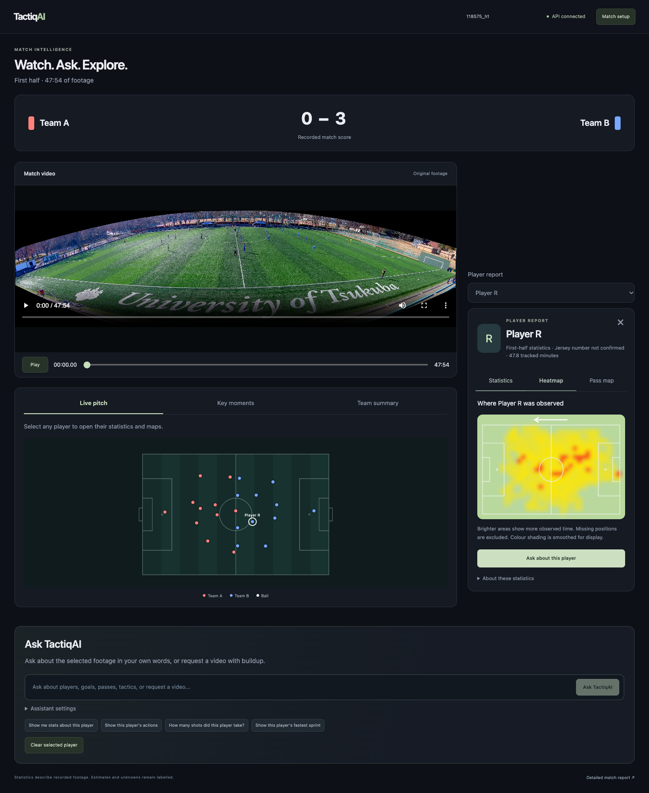
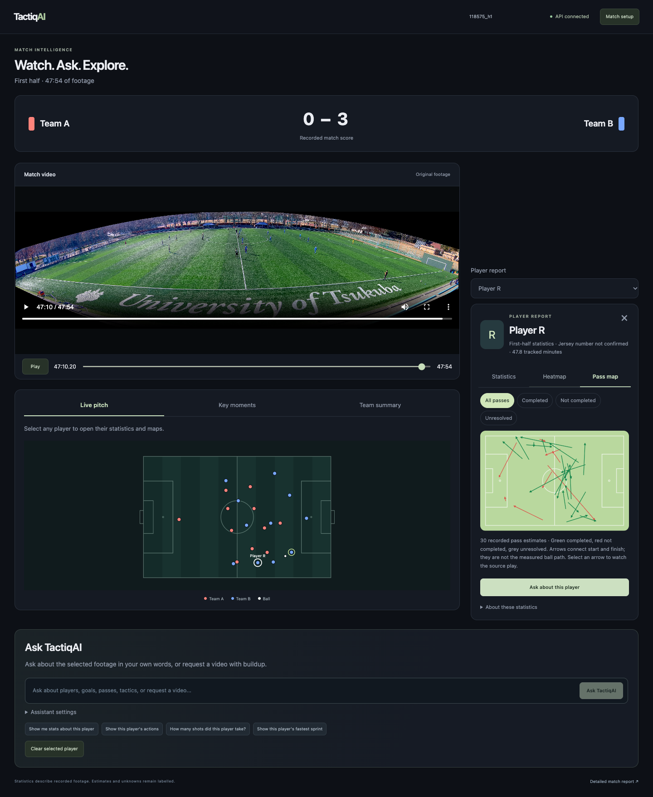

# TactiqAI — score, goal videos and player reports

**Superseded interface defaults:** [the current player-focus update](player_focus_update.md) adds automatic pre-event player markers, one visible answer/video, an explicit Developer mode and shorter 15/20-second goal lead-ins. The 120-second example and screenshots below describe the earlier verified version.

Verified locally against the live Azure recordings on 2026-11-11. This update addresses the match score, full-half highlight creation, natural-language requests, complete player statistics and a simpler match screen. Existing analytics, possession rules, source alignment and CV observations remain unchanged.

## What to use

Open http://127.0.0.1:5173 and refresh. The main screen now has a recorded score, the original video, a pitch and a player report. Team details are behind a tab; raw evidence remains in the optional inspector and detailed report.

- Select a player on the pitch or in **Player report**. The card opens with shots, goals, completed passes, pass attempts, pass accuracy, tackles, interceptions, receptions, crosses, distance and peak speed.
- Choose **Heatmap** to see observed position occupancy. Choose **Pass map** for completed/not-completed/unresolved endpoint arrows. Select an arrow to open the lead-in in the original footage.
- Ask **“Show me stats about Player R”**, **“Show me all the goals with buildup”**, or use a manually confirmed name/jersey. Unknown jersey numbers still require Match setup; tracker IDs never become jersey numbers.
- **Key moments → Goals** opens 30 seconds before a goal when that much source footage exists. It does not seek only to the ball crossing the line.

The current match displays **Team A 0–3 Team B**, derived from three distinct goal annotations. Full halves take priority over overlapping clips so a clip does not count a goal twice. Both halves are loaded, so the score is labelled **Recorded match score**. A clip-only recording is instead labelled as goals in the available footage; this is not an invented official final score. Team names/colours can be supplied in Match setup.

The goal query also works while viewing the second half: all recorded goals for this match are in the first half, and the returned video/source buttons retain that actual first-half source. Conversation ownership remains scoped to the requesting recording/session. Selecting the original-footage button switches to the correct available recording and seeks to its lead-in.

## Actual full-match video result

The verified compilation contains all three 118575 goal annotations in chronological order. The final manifest has **33.96 seconds before each goal** and **6.04 seconds afterward**. Output is **120.021333 seconds**, including AAC packet granularity, encoded H.264/AAC at 1280×720 / 30 FPS. Browser playback and seeking passed.

The old renderer explicitly rejected full halves. It now opens an ephemeral, random-token localhost range gateway to one registered Azure blob. Every Azure range is conditioned on the same ETag. FFprobe verifies frame count/rate/duration against the validated event clock before rendering. FFmpeg seeks the requested intervals; it does not cache the entire half. Reading is capped at 512 MiB per job, final video at 250 MB, and existing cancellation/duration limits remain enforced. The gateway closes after the job.

Measured source reads for the final render: **196,608,887 bytes** from a **3,550,087,937-byte** first-half video. The multi-gigabyte original was not downloaded as a local file. Output bytes are SHA-256 checked as before. A streamed source records its ETag-conditioned identity fingerprint in `source_identity_sha256`, with `source_sha256=null`: it does **not** pretend to have hashed the complete source video. A cross-field manifest validator requires this explicit registered-stream integrity evidence when a whole-source hash is absent. Existing cached/local clip sources still require their original source SHA-256. Canonical Azure artifact manifests/hash/schema validation were not loosened.

The previous duration allocator also centered shortened clips around the event, losing requested buildup. Allocation now preserves the requested lead-in/aftermath balance. Default goal windows request 30 seconds before / eight after; longer-buildup requests increase the lead-in and share the bounded compilation budget proportionally. Source boundaries and requested duration can reduce available context. This is **lead-in footage**, not a claim that a complete attacking possession has been reconstructed.

## LLM interpretation and grounded results

The unified assistant now uses the configured LLM as the primary interpreter. It is not restricted to accepting the built-in pattern parser's operation, time-window interpretation or vocabulary. The LLM receives the question, supported operations, anonymous/confirmed roster labels, selected-player context and previous plan. It produces a closed plan; deterministic services then resolve identities, retrieve records, calculate statistics and select video times. The LLM cannot supply arbitrary event IDs, measurements, source URLs or executable tool names.

Allowed-player references, explicit identity/team/time filters, recording bounds and source provenance remain validated. Unknown or unsupported requests ask for clarification. Local interpretation remains available as an explicit mode and as a **visible fallback**, not an undisclosed replacement for a working model. No system can honestly guarantee correct interpretation of every possible natural-language request.

Two live Gemini requests returned `provider=gemini` with no fallback:

1. “Could you splice the scoring moments into one reel and keep the attacking move before each one?” → goal actions, video enabled, longer buildup.
2. “Walk me through Player R’s numbers: distribution accuracy, shots, goals, tackles and interceptions.” → complete player profile.

One additional user-approved live check asked for all goals after a Player R stats turn. That request used `local_fallback`; the specific underlying failure category was not retained. It still returned all three goals and a completed video, with the fallback visible. Thus this is **two hosted interpretations plus one successful fallback**, not three claimed LLM successes or a general language-accuracy benchmark. Microsoft compatibility remains contract-tested; no new live Microsoft request is claimed.

The cloud planning payload can include roster labels/confirmed names and prior plan context, but not raw footage, images or measured statistics. The context-bearing follow-up check was initially blocked by automatic approval review and was run only after explicit user approval.

## Player measurements and maps

The new score/profile endpoints are read-only and use the existing validated actor/event/transfer data. Broad profile requests return the same card data as selecting the player, rather than a generic count of mixed actions. Existing recorded shots and goals remain separate annotation categories, explained in the card. No invented player rating, face, assist total or dribble count is shown.

Pass attempts/completion use the existing coverage-qualified transfer definition (at least 90% observed steps). Interceptions and receptions retain their inferred status. A zero means no eligible recorded entries, not independently proven absence of an action. Existing measured distance and peak speed retain their estimate/coverage limitations.

Heatmaps use hash-matching original GSR metric positions, joined by explicit actor ID and recording clock. Nonfinite/out-of-pitch positions are excluded. A 32×21 grid accumulates observed seconds; colour shading is smoothed only for visual display. No missing track is filled in. **Tracked minutes** describe source-position coverage, not independently verified playing time. CV-only sources without reliable metric/evidence coverage remain unavailable for the corresponding maps/statistics.

Pass arrows connect measured start/end points, not a fabricated ball trajectory. Green is completed; red is an explicitly not-completed outcome; unresolved is grey. The original footage remains one click away. Player identity edits refresh the card; manual annotations stay separate from immutable tracking.

Actual first-half Player R example:

|Measurement|Value|
|---|---:|
|Recorded shots / goals|1 / 0|
|Completed passes / qualified attempts|22 / 31|
|Estimated pass accuracy|70.9677%|
|Recorded tackles / inferred interceptions|1 / 5|
|Reception estimates / recorded crosses|24 / 1|
|Tracked distance / peak estimated speed|7,523.19 m / 9.0966 m/s|
|Heatmap observed time|2,869.32 s|
|Eligible pass-map arrows|30|

The pass map excludes attempts without valid in-pitch endpoints, so its arrow count need not equal the attempts denominator. Heatmap grid time sums to the observed time; no independent position, identity or event-accuracy re-evaluation is claimed.





## Workspace size and verification

The simple workspace opts into `X-TactiqAI-View: workspace`. Its response preserves the same replay samples, events, summary, pass-share facts, formations and media URL. It omits unshown dense tactical/pressure histories and samples ownership on the existing pitch-sample clock. Full `/view` responses and detailed reports retain the complete original evidence. This changes presentation payloads, not analytical possession results or geometry.

Actual first-half payload: **62,731,201 → 12,263,480 bytes** (about **80.45% smaller**). The paired localhost HTTP measurements were 0.259 / 0.122 seconds; these are individual warm requests, not a throughput/SLA claim. This also avoids validating/rendering large unused histories in the browser.

Verified:

- **905 backend tests run: 904 passed, one expected skip.** New coverage includes score deduplication, goal-window allocation, bounded ETag-pinned ranges, changed-source rejection, complete profile counts, heatmap time conservation, LLM-first plans and compact-workspace equivalence. The initial three loopback-test sandbox bind errors passed when run with localhost permission.
- **116 frontend tests** and TypeScript/Vite production build passed.
- **Three Chrome cases passed** in 23.7 seconds: the new experience, both full-half playback/grounded-Ask flows, and the existing team_goal CV viewer. They cover score, player reports, heatmap, pass filters/source navigation, real goal compilation playback/seek, second-half goal requests and mobile overflow. A final focused click check covers selecting the player directly on the pitch and opening goal lead-in footage.
- Final main API remains ready with **15 usable recordings**, with the existing ten clips and three CV sources retained alongside both full halves. No Azure source/bundle upload or model retraining occurred during this interface update.

The new UI retains TactiqAI branding. SofaScore-style layout inspiration did not introduce third-party player portraits, ratings or unsupported statistics. Source identity confirmations and analytics limitations remain explicit.

## Run and reproduce

The updated main services are http://127.0.0.1:8000 and http://127.0.0.1:5173. Temporary preview services were stopped. Reuse the existing Azure `.env`, CLI login and environment-variable names:

```sh
AZURE_TOKEN_CREDENTIALS=AzureCliCredential MATCHMIND_ARTIFACT_STORE=azure \
MATCHMIND_PROVIDER=local MATCHMIND_CACHE=outputs/cache/azure_m17 \
MATCHMIND_HIGHLIGHT_CACHE=outputs/highlights_m18 \
TACTIQAI_BACKEND_PYTHON=/Users/greatabhieyighan/Library/Caches/TactiqAI/backend-m17/bin/python \
scripts/start_backend.sh
# Separate terminal:
npm --prefix frontend run dev
```

`MATCHMIND_PROVIDER=local` retains the legacy Ask default; the unified assistant's **Automatic** selection uses configured Gemini when available. Choose **Local evidence** explicitly to exercise only local tools. Provider keys remain server-side.

```sh
PYTHON=/Users/greatabhieyighan/Library/Caches/TactiqAI/backend-m17/bin/python
"$PYTHON" -m unittest discover -s tests
npm --prefix frontend test
npm --prefix frontend run build
cd frontend
./node_modules/.bin/playwright test --config=playwright.experience.config.ts
```

The range-gateway tests need localhost socket permission. Private jobs/session URLs and full evaluation JSON stay in ignored `outputs/dashboard_evaluation/`. [Portable verified results](evidence/match_experience_results.json) omit session URLs. Existing screenshots in this report show real source footage and source-derived maps.
