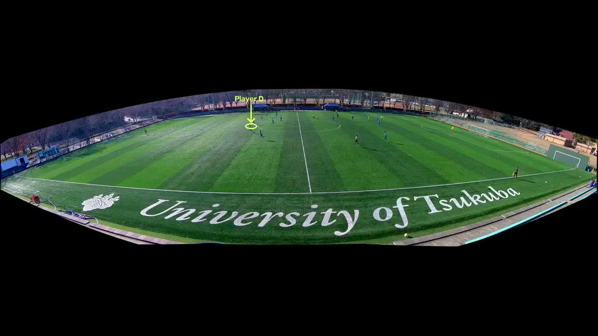

# Player focus, simpler answers and marked videos

Updated 2026-11-11. This follows the [score/player-report update](match_experience_update.md); earlier buildup durations and stacked conversation screenshots describe the previous interface.

Click a player on the pitch or select one in Player report. The page heading and assistant banner identify the focused player. Every subsequent player question/video stays scoped to that selection. **Back to match** clears the focus. Asking for another named player while focused prompts the user to choose that player rather than silently switching identities.

The focused player is shared by the report and assistant. Selecting another player clears previous event references, answers, input and pending video work. Late responses from the old player cannot replace the new result. New questions replace the previous answer/video, while same-player follow-up context remains available to the server. An unfinished replaced video is cancelled. Completed cached videos are not deleted or overwritten.

Normal video answers show the readable answer and video controls. **Developer mode**, off by default, reveals per-event seek/source links, detailed metrics, illustrations and the raw evidence inspector. The regular interface no longer prints a long list of pass timestamps under every video. Statistics answers still show their useful player report. Player action summaries describe shots, goals, pass completion, tackles and interceptions instead of a combined “supported actions” count. Counts, coverage and estimate qualifications remain grounded in the existing records.

Goal windows now request **15 seconds before / five seconds after** by default. Explicit buildup requests use **20 seconds before / five seconds after**. Source boundaries and the compilation budget can shorten a window. Key-moment navigation starts 15 seconds before a goal. This supersedes the previous 30/45-second lead-in settings; it does not claim to reconstruct a complete attacking possession.

## Player markers

Player-specific videos request a marker automatically. Existing clips/CV use checked frame-specific boxes. Full-half SoccerTrack videos use the original image foot coordinates in the compact GSR file, checked against the hash recorded in the validated bundle. Actor IDs and recording offsets select the exact source point. These are not reprojected pitch coordinates, guessed body boxes, jersey identities or a nearest-player assignment.

The video draws a labelled pointer and foot ring from source image points. The marker is present during the lead-in when the player has valid visible samples, so the viewer can identify them before the action. Missing, off-screen, duplicated or overlapping points suppress the marker; cuts reset trails. A renderer that cannot mark any frame fails explicitly rather than calling an unmarked result a successful highlight. Output hashes are updated after annotation, and the overlay version/source identity participates in the cache key.

Manifest diagnostics include drawn/hidden frames, pre-event marked frames and source-frame samples. Full-half portrait crops still require actual checked body boxes; a foot coordinate does not grant a player portrait. No canonical bundle/hash/schema validation, possession rules, GSR alignment or existing event attribution was changed.

## Fastest sprint requests

The existing sustained sprint definition remains unchanged. When the focused player has no qualifying sprint, the assistant can show their **fastest measured continuous run**, explicitly labelled as a run rather than a sprint. This uses the highest one-second average over observed valid in-pitch motion, excludes rejected derivatives and requires net displacement/path consistency of at least 0.8. It does not bridge missing frames or use a single-frame speed spike. Stationary/insufficient/unreliable tracking stays unavailable.

This addresses the previous all-or-nothing sprint response without inventing sprint events or weakening the scientific sprint threshold. Speed remains a tracking estimate, not independently verified ground truth.

## Verification

**Real Azure checks passed on 118575_h1:**

|Check|Verified result|
|---|---|
|Player D first-pass video|Completed; 241 marked frames, including 90 before the pass|
|Player D fastest measured run|Completed; 7.50 m/s one-second mean; explicitly not claimed as a qualifying sprint|
|Run marker|213 marked frames, including 120 before the run|
|Three-goal video with requested buildup|Completed; 75.021333 seconds, 20 seconds before/five after each goal|
|Service readiness|200, 15 usable recordings|
|Backend suite|920 run: 919 passed, one expected skip|
|Frontend suite / typed build|119 passed / build passed|
|Chrome regression|Four cases passed: new player-focus flow, workspace/maps/goals, both full halves, existing team_goal CV viewer|

Chrome verified changing Player R→Player D on the pitch, Ask-about-this-player synchronization, persistent scope for a bare question, one answer/video at a time, hidden/default versus enabled developer lists, real pass-video playback with a pre-event marker, a playable fastest-run video, shorter goal compilation and mobile overflow. The first browser attempt ran before the API finished startup; a subsequent check found the NumPy run-index serialization bug and an outdated test assumption that another player could override active focus. The final four-case run passed after the serialization fix and explicit player selection in the test.

The real pass and run outputs were decoded for visual inspection at one second into the lead-in. These images show the actual labelled source-foot marker:

[Portable verified results](evidence/player_focus_results.json). Detailed session/job URLs remain in ignored local evaluation files. No hosted model request, Azure upload, source-video deletion or model training is needed for these changes. Existing Azure environment settings and [startup commands](match_experience_update.md#run-and-reproduce) remain applicable.
