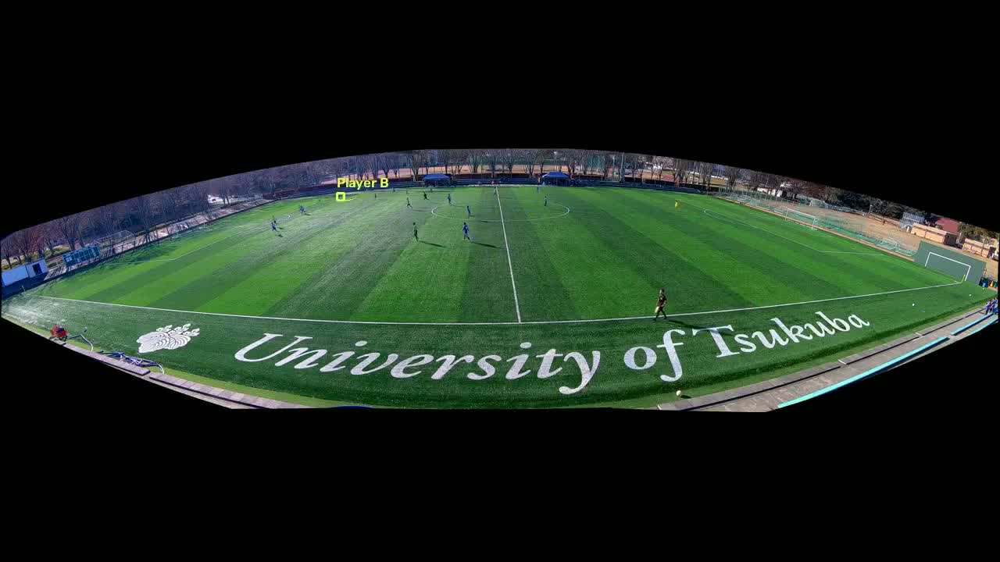

# TactiqAI M18 — Unified match assistant

**Current follow-up (2026-11-11):** the simplified workspace, recorded score, complete player profiles/maps and bounded full-half goal rendering are verified. Hosted planning now interprets requests first within validated capability/identity/time boundaries; it is no longer required to mirror the local parser's operation or wording. Two live Gemini requests passed; one approved follow-up used visible fallback and produced the correct video. [Current implementation, actual results and limitations](match_experience_update.md). The original M18 measurements and parser constraints below are historical.


Implemented locally, source-checked and experimental where noted. Date: 2026-11-11. This milestone adds no ball/event detector, model training, Azure upload, possession-rule change or camera/player-world recomputation. M8 geometry, M9 authority and M10–M17 research remain the existing sources.

## Experience and architecture

There is one **Ask TactiqAI** input in both analytics and CV review. It accepts questions, statistics, recorded actions, combined explanations/video, player selection and follow-ups. The separate highlight chatbot is removed from production; its M17 renderer and public API remain reusable. Older component fixtures without assistant capability retain their legacy client path.

`UnifiedMatchAssistant` coordinates `IntentAndQueryPlanner`, `AssistantEventIndex`, `PlayerIntelligenceService`, `SprintService`, `TacticalExplanationService`, the existing `HighlightService`, confirmed identity storage and `ResponseComposer`. Ordinary factual questions still use the existing closed Ask tools. Deterministic services select events, rank measurements and supply timestamps. Closed Pydantic plans reject arbitrary fields; hosted plans cannot change resolved players, explicit actions, rank type, team, time filters or requested outputs. API clients cannot supply the internal render selection override.

The built-in interpreter is available offline. Gemini uses a closed JSON plan through the existing provider adapter; Microsoft uses the existing closed tool-call abstraction. Invalid/unavailable plans fall back to the built-in interpreter, with diagnostics in the inspector. Hosted provider verification is reported separately from mocked contracts. Provider choice is under **Assistant settings**. The [official Gemini structured-output contract](https://ai.google.dev/gemini-api/docs/structured-output) is used; application validation remains mandatory after model output. Existing credentials and `MATCHMIND_*` names are unchanged.

Normal responses use temporary labels or manually confirmed names/numbers, plain English, timestamps, readable metrics and original-footage links. Raw event IDs, source codes, tracking references and JSON remain in the collapsed **Developer / detailed evidence** inspector. Detailed existing tactical evidence still has Beginner/Fan/Analyst presentations under **Evidence display**.

## Supported evidence and actions

|Capability|Support and boundary|
|---|---|
|Goals, shots, crosses, successful tackles|Existing synchronized source annotations; explicit source actor attribution, not new visual detection|
|Headers and carries|Existing validated annotation labels where present; a carry does not establish a successful dribble|
|Completed passes|Existing coverage-qualified tracking-derived transfers; supported estimates, not exhaustive independently verified pass totals|
|Receptions|Derived from the existing completed pass's explicit receiver; no nearest-player assignment|
|Interceptions|Qualified existing intercepted transfers with an explicit receiver; inferred, with the receiver's team|
|Player action compilation|Chronological recorded/supported entries; not every movement or guaranteed full-match coverage|
|Sprint|New summary of existing metric trajectories; experimental sustained-speed estimate, not independently validated physical speed|
|Pass difficulty|Existing retrospective geometry score; estimate, never a completion probability|
|Player distance, peak speed, direct control|Existing player summary values; missing values stay unavailable; peak speed is distinct from a sustained sprint|
|Dribbles, recoveries, fastest shot/pass, chance quality|Unsupported rather than invented|
|CV-only football actions|No verified actions in test_match, team_goal or southampton; explain this limitation|

Pass attempts and completion rates use transfer rows with at least 90% observed steps. Attempts include unresolved/intercepted/out-of-play outcomes; “completed pass estimates” counts completed qualifying rows. Recorded shots and goals are separate annotation categories. A count of zero means no eligible recorded entries, not proof of no real action. Per-number queries require a unique manual confirmation; numeric tracker IDs never become jersey numbers.

Metrics include definition, source, eligible window, support state, sample count, player reference and limitations. Supported count requests respect time filters. Comparisons and rankings use source measurements; distance ranking requires at least 90% valid motion. “Most possession” is explicitly estimated direct ball-control time, not a reconstructed possession sequence. The existing headline team possession proxy is unchanged.

## Identity and visual setup

The roster uses **Player A**, **Player B**, etc. Structured actors come from the validated analytics bundle. Optional local sync/MOT files enable an explicitly checked actor-to-video-track mapping; unavailable mapping disables pictures/markers without guessing an identity or invalidating the canonical actor roster.

For CV sources, cards are scoped to one visible, non-ambiguous M9 identity segment. A confirmation never silently propagates through uncertain re-identification or merges. The roster reads only needed fields from the source already fully validated by CVReview, with immutable-file stamp checks, rather than revalidating/serializing every historical field. Catalog construction uses recording-specific locks so optional CV setup does not block unrelated matches. Both source-video labels and mini-pitch labels require the exact current segment and confirmation time window; M9 observations remain immutable.

Cards provide a source crop, alternative views, enlargement, actual picture colour swatch, team, jersey, optional name and role (player/goalkeeper/official). Explicit confirmation stores `USER_CONFIRMED` provenance, image association, source signature and time window. The server rejects a photo associated with another player and duplicate numbers on the same team during overlapping time. Corrections and undo are supported. Unqualified numbers shared by two teams require selecting the correct card. Old browser labels are drafts until confirmed; displayed identities refresh from the server mapping.

Identity annotations live separately under `MATCHMIND_ASSISTANT_CACHE` (default `outputs/assistant_m18`), scoped to recording and browser session UUID. This UUID is an unguessable capability, not a new authentication system. Source-signature changes invalidate prior player confirmations. Existing API-token authorization applies to assistant routes. Photos contain no server credentials.

### Frame selection

The image job samples ten time bins per player, initially choosing a large source box in each bin. It decodes frames sequentially, avoiding repeated long seeks. Invalid, truncated, very small and strongly overlapping boxes are rejected. An interpretable ranking combines resolution (30%), torso sharpness (30%), number-region edge/contrast proxy (25%) and lack of overlap (15%). It retains three views from different moments.

An already installed Tesseract executable was evaluated as a small ranking aid, not a jersey model. A detected digit string can add 0.08 only when the crop is sufficiently sharp and at least 80 pixels high. OCR never fills or confirms a jersey. Body orientation is **UNKNOWN** and human readability **UNVERIFIED**; the proxy is not a trained back-facing/readability model. No model was downloaded or trained for M18. Candidate frame/time, score factors, hashes and unverified OCR hints stay inspectable.

Actual 118575_clip job: 22 players, 66 selected images, 25.28 seconds in the first measured run. Median crop height 58.5 pixels (range 36–150); 12/22 top-ranked crops are under 70 pixels high. This explains why larger alternatives and manual confirmation are necessary. No independently human-reviewed top-1/top-3 readability, identification completion rate or human identification time has been measured. **The suggested 80% readability target is not established.**

## Sustained sprints and moving overlays

`configs/assistant/m18.json` fixes the default threshold at 7 m/s, minimum duration at one second and ranking window at one second. Only hash-matching original metric pitch trajectories with synchronized source frames qualify. Existing median/Savitzky–Golay motion calculations are reused unchanged. Missing/invalid or speed-limit-rejected derivatives break a run. Net displacement must be at least 80% of its path length. A one-frame spike cannot qualify.

The source annotations contain sample-and-hold positions: raw jumps interspersed with zeros. Treating every raw jump flag as invalid eliminated all qualifying runs in the initial strict audit. M18 therefore rejects invalid smoothed derivatives, audits raw flags separately, and calls the result an **estimate**. This is not independent speed validation. The initial audit is retained locally, not hidden. Its strict raw-flag exclusion found no qualifying runs on the five clips checked before this correction.

For 118575_clip, default settings find one qualifying run: Player B, 171.00–172.36 seconds, 34 samples, highest one-second mean **9.00099 m/s** over 171.24–172.24 seconds. Raw speed flags occur in 38.24% of its samples; net/path ratio is 0.9445. Changing smoothing from 15 to 25 to 35 frames yields 1/2/6 qualifying runs and fastest estimates 9.001/8.812/8.770 m/s; the same source player ranks first. Run count is smoothing-sensitive. No independent sprint boundaries, surveyed coordinates or speed measurements exist here, so interval error and speed error remain unknown. CV image-space motion is never reported as m/s.

M17 first renders the source intervals. M18 then maps each output frame back to the exact source frame and selected player's source box, respecting source scaling/padding. The marker moves with that player and can show their confirmed label and short trail. Missing, truncated or more than 35% overlapping boxes suppress the marker and clear the trail; no off-camera ghost is drawn. The measured sprint video has 250 frames: 169 marked and 81 suppressed. All 169 recorded marker boxes match source-coordinate scaling. This validates box/time consistency, not independently adjudicated identity switches or physical localization accuracy.



Source: registered Azure footage for 118575_clip, 171.5 seconds, rendered with the temporary Player B label. The small panoramic player is not assigned an unverified jersey.

## Difficult passes and conversation

The inherited difficulty score combines up to 35 points for distance, 10 for forward progression, 25 for defenders near the straight origin/destination line, 20 for destination pressure at launch and 10 for nearby defenders around the sender. Existing configured radii and measurements are unchanged. No inverse score is presented as a validated completion probability. Explanations mention only available factors and distinguish destination pressure at launch from pressure when receiving.

On 118575_clip the longest completed-pass estimate is **43.95061 m** (Player J); the highest difficulty estimate is a different pass, by Player R, **34.1 m** when rounded. Its stored factors include one opponent near the origin/destination line, two near the sender and a nearest destination defender 17.3 m away at launch. That is not described as “tight receiving pressure.” The optional pitch diagram says **Start-to-finish illustration, not the actual ball path**.

Server turns retain recording, session, selected player/event, prior result IDs, highlight and filters. Wrong-session or wrong-recording turn IDs return 404. At most 100 recent turns per recording/session and 2,000 overall are retained, with 24-hour expiry. Turns/jobs do not survive backend restart; identity annotations do. Frontend recording changes clear prior answers and pending results. Follow-ups select the actual previous event/result instead of reranking it. Original-footage links open context before the event; generated moments seek within their compilation. Videos remain cancellable, bounded and rights-gated for download.

## Actual demonstrations

All requests below were exercised against the local API using the real validated Azure bundle/media. Unconfirmed jerseys were deliberately not invented.

|Request|Observed result|
|---|---|
|Show me all the goals.|One source-annotated goal; real playable MP4|
|Show me the fastest sprint and highlight the player.|Player B sustained-speed estimate; real moving-box MP4|
|Show me all the actions of player 7.|Asks for confirmation in Match setup; no fabricated player compilation|
|How many shots did player 7 take?|Asks for confirmation; no invented zero/count|
|Show me the most difficult pass and explain why.|Player R; grounded geometric factors and playable MP4|
|Show me that pass again.|Same event, new session-linked video response|
|Who was the player in that clip?|Player R; explicitly says jersey has not been confirmed|
|Show me his other actions.|Nine other supported entries for that player; chronological compilation|
|Compare the two teams’ shots.|Zero shot-category entries on each side for this clip; goals separate|
|Match setup using image cards|Chrome verified 22 cards, alternative image, zoom, explicit test-only number/name confirmation and undo|

The setup demonstration uses a clearly labelled **test annotation**, not a claim that a human verified that player's real jersey number. Backend fixtures additionally verify confirmed-number shot/goal counts, names, ambiguous duplicate resolution and reversibility. No real jersey-7 identity is asserted.

Additional actual requests: farthest tracked distance about 729.8 m (Player T), most estimated direct control 9.88 s (Player M), longest recorded completed pass about 44.0 m, a bounded 60-second recap, unsupported fastest-shot rejection and honest CV-only goal rejection.

## Numerical evaluation and limits

|Check|Measured result|Interpretation|
|---|---|---|
|Structured local interpretation|50/50 labelled development requests|Hand-authored and iterated during development; not independently labelled or held-out 95% generalization accuracy|
|Source event retrieval|50 TP / 0 FP / 0 FN across ten clips|Against raw source goal/shot/cross/tackle annotations|
|Player-reference resolution|25/25 labelled development fixtures|Simulated manual identities; not independent real-jersey accuracy|
|Source actor attribution|50/50 entries|Matches explicit raw source player IDs; not independent jersey identity truth|
|Pass attempts/completions|220/220 player attempt counts and 220/220 completed counts|Against coverage-qualified exported transfer rows, not manually annotated complete matches|
|Distance/difficulty ranking|20/20 clip/metric checks|Against existing exported measurements; six-decimal CSV rounding tolerance only|
|Photo/frame/track consistency|66/66 JPEG crops|Decoded source pixels and independently re-read raw MOT boxes/sync mapping; not human jersey readability|
|Moving marker consistency|169/169 drawn boxes|Exact source-frame scaling check; 81/250 frames intentionally unmarked|
|Plain chat source-code leakage|0/16 audited local responses|No raw event ID, BAS/MOT/GSR or actor/track code in answer text|
|Context isolation|Wrong-match and wrong-session references both 404|No accepted cross-recording/session turn|
|Independent physical sprint accuracy|Not measured|No ground truth supplied; synthetic constant-speed/gap/spike checks are not physical field validation|
|Independent player-number resolution/readability|Not measured|Fixture/user-annotation tests do not establish the requested independent 95%/80% targets|

Eight explicit count/distance/speed/pass-factor consistency checks passed against returned evidence and source summaries; the remaining responses were inspected for unsupported claims. No unsupported numerical claim was found in the 16-response audit. This is a small development audit, not a population guarantee. The user-approved live Gemini structured-plan request returned the Gemini provider with no fallback diagnostic. Microsoft structured planning passed a mocked tool contract; a live Microsoft call is not claimed. Research model improvements and unsupported actions remain outside this milestone.

Reproduction and final verification results are recorded below and in [the portable evidence file](evidence/unified_match_assistant_m18_results.json).

## Run and reproduce

From the repository root, with the existing Azure `.env` configuration and Azure CLI login:

```sh
AZURE_TOKEN_CREDENTIALS=AzureCliCredential MATCHMIND_ARTIFACT_STORE=azure \
MATCHMIND_PROVIDER=local MATCHMIND_CACHE=outputs/cache/azure_m17 \
MATCHMIND_HIGHLIGHT_CACHE=outputs/highlights_m18 \
TACTIQAI_BACKEND_PYTHON=/Users/greatabhieyighan/Library/Caches/TactiqAI/backend-m17/bin/python \
scripts/start_backend.sh
```

```sh
npm --prefix frontend run dev
```

Open http://127.0.0.1:5173. One API process should own port 8000. Existing account/container/recordings/media variables are reused. No Azure configuration change or artifact upload is required. **Known source limit:** 132877_clip plays from Azure but its MP4 has 5,958 decoded frames while the analytics expects 6,000. M17’s unchanged frame/rate guard rejects generated clips from that source; M18 explains the timing issue. Its original footage and existing analytics remain inspectable. No video was retimed, replaced or uploaded to hide this mismatch. Local CV videos must remain available. Azure source videos need not be downloaded manually; M17 rendering/photos make an explicit bounded local source cache from registered Azure media.

The current persistent Python environment already contains the optional dependencies. New environments need the existing service/Azure requirements, `requirements-assistant.txt`, FFmpeg/ffprobe; Tesseract is optional. Optional photo/overlay failures do not invent positions. Raw local SoccerTrack sync/MOT files are needed for source boxes; hash-matching compact GSR data is needed for new sprint computation. Canonical bundle analytics remain the authority; there is no fallback to unrelated local artifacts.

```sh
PYTHON=/Users/greatabhieyighan/Library/Caches/TactiqAI/backend-m17/bin/python
"$PYTHON" -m unittest discover -s tests
npm --prefix frontend test
npm --prefix frontend run build
"$PYTHON" -m scripts.evaluate_assistant_m18 language
"$PYTHON" -m scripts.evaluate_assistant_m18 sources
"$PYTHON" -m scripts.evaluate_assistant_m18 live
"$PYTHON" -m scripts.evaluate_assistant_identity_m18
"$PYTHON" -m scripts.evaluate_assistant_images_m18
cd frontend
TACTIQAI_AZURE_BROWSER=1 TACTIQAI_BROWSER_REGISTRY=configs/serving/local.json \
./node_modules/.bin/playwright test --config=playwright.m18.config.ts
```

Evaluation JSON and private source caches stay in ignored `outputs/m18_evaluation/`, `outputs/highlights_m18/` and `outputs/assistant_m18/`. Portable results omit private session URLs. Existing M17 example caches are preserved separately. Broader language coverage, independent identity/readability review, physically validated speeds and verified CV football events remain future work. Stop at M18; no next training milestone is started.

## Verification record and changed files

The full backend suite passed **887 tests run / 886 passed / one expected skip**. Assistant/M17 focused checks, closed provider contracts, interval/gap/spike handling, count/time filters, reversible identities, route ordering, immutable CV segment extraction and existing analytics regressions passed. **113 frontend tests across 20 files** and the production TypeScript/Vite build passed.

Chrome coverage: the 24 current application cases are verified across the full run and focused rechecks. The first full run was **21 passed / three failed**: an optional M16 layer had not loaded during that startup, one media metadata wait exceeded five seconds, and the extended playback test expected a generated video from the clock-mismatched 132877 source. Direct unchanged M16 sidecar validation passed; final restart reloaded it. The media readiness assertion now allows 30 seconds. The source-clock test now explicitly checks the safe refusal and original-footage navigation. All three cases and the full unified assistant demonstration passed the four-case recheck (44.6 seconds). This is not described as an initially failure-free run. All ten Azure clips passed source playback, seeking, byte ranges, tactical rendering and existing grounded Ask checks.

Final verified endpoint contracts: `/health`, `/ready`, `/recordings`, 118575 view and ordinary Local Ask all return 200; readiness has 13 usable recordings; ordinary pass-count Ask is grounded with 14 evidence rows. The 10 structured clips are Azure-validated, and no 118575_h1 entry is present in this current 13-entry catalogue; no Azure availability is claimed for it. M14 remains the default and the M16 test_match API returns 200 after validation. Cached test_match visual roster returned 81 conservative appearance-segment cards in about 0.008 seconds; this is a warm-cache result, not cold-start processing throughput.

The user-approved single live Gemini structured-planning check returned `provider=gemini`, with no fallback diagnostic, and selected the source goal. Microsoft was contract-tested only. The final local demonstration suite contains 16 requests, seven video-bearing responses, zero audited internal-code leaks, and wrong-match/session context rejection. Private job/session links remain local and expire; portable evidence includes the measured checks and limitations.

A preserved-input audit compared **199/199** prior source/research-manifest hashes with the pre-M18 snapshot: zero changes. No video, CV checkpoint or annotation source was overwritten. Earlier uncommitted M16/M17 work was retained. No Git push, Azure upload or training occurred during M18.

M18 implementation files:

- `src/assistant/`: schemas, catalogue, identity annotations, image selection, evidence/statistics, sprint summaries, moving overlay, planner, composer and orchestration/routes.
- `configs/assistant/m18.json`, `requirements-assistant.txt`.
- `src/highlights/{schema,render,service}.py`: additive action metadata, serialized source-cache resolution and internal deterministic selection/overlay integration; public M17 requests stay closed.
- `src/intelligence/commentary/gemini_provider.py`: additive closed-plan JSON method; existing sentence selection unchanged.
- `src/serving/app.py`: assistant mounting and static-roster route precedence over the old numeric player route.
- `frontend/src/{UnifiedAssistant,VisualPlayerSetup}.tsx`, `App.tsx`, `CVReview.tsx`, `identity.tsx`, `api.ts`, `styles.css`.
- `tests/test_assistant_m18.py`, `frontend/src/UnifiedAssistant.test.tsx`, current browser regression adaptations, `frontend/tests/unified-assistant.spec.ts`, `frontend/tests/helpers/ready-m18.ts`, `frontend/playwright.m18.config.ts`.
- `scripts/evaluate_assistant*_m18.py`, this report, portable evidence, actual sprint screenshot, frontend/Azure notes and the mandatory current status/explorer updates.

Remaining acceptance limits are independent player-number/readability review, independently labelled general language/reference resolution and physical sprint accuracy. Those targets are **not claimed achieved**. The local product flows are implemented and exercised; new event detection, source retiming and further training are outside M18.
